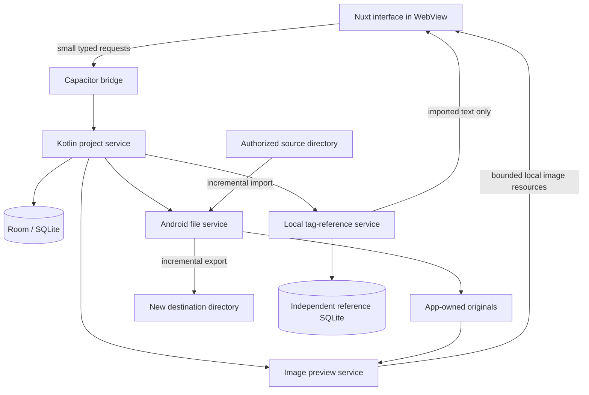

# Android Dataset Caption Editor

* **Author:** cpuopt
* **Status:** Draft — Overview, Technical Plan and Alternatives approved; Detailed Implementation in progress
* **Date:** 2026-11-11
* **Predecessor:** [Reviewed concepts brief](concepts_brief.md)
* **Supporting review:** [Seven-lens findings](docs/reviews/dataset-mobile/goldfish_review_report.md)

## Overview

Build an Android app for preparing image training datasets on a phone. Users import an existing local folder, inspect images and captions, correct tags and natural-language descriptions, organize training subsets, and export the resulting dataset into a new directory.

The working dataset is independent of its source after successful import. Edits are saved inside the app, so ordinary editing does not require continued access to the source folder. The initial release targets datasets of 100–1,000 images averaging about 5 MB per image, approximately 0.5–5 GB of image data. These figures describe the intended workload; they do not establish tested capacity or an agreed rejection limit.

The author requested refinement of the proposed Nuxt + Capacitor + Kotlin + Room/SQLite stack. This establishes the drafting direction: a WebView interface with Android-native file and persistence operations. Exact component responsibilities, database schema, library versions, device requirements and recovery mechanisms belong to the Technical Plan and are not settled by this section.

## The Problem

An automatically captioned training dataset still needs human inspection. Users must see each image while correcting its tags and prose. Editing raw TXT files alone makes it difficult to check the image, understand unfamiliar tags, preserve the tag/prose boundary, and track progress across hundreds of images.

Dataset organization is also part of training preparation. Images from different periods of an artist's work may need separate training subsets, to which the trainer can assign different repeat values. Users need to build folders manually and move matching image/caption pairs through rules without losing their individual edits.

A phone adds constraints: limited working memory, a small screen and keyboard, directory access granted through Android, and operations that can be interrupted. A dataset can be several gigabytes even though its caption text is small. The app must not equate a selected folder with a verified independent import, or a changed text field with a successfully saved edit.

The design must address two implementation-readiness blockers identified during concept review: a verifiable import-completion promise and an honest saved-state acknowledgement. It must also keep uncertain parsing from causing incorrect no-prose classification and keep partial exports from appearing complete.

## Goals

1. **Import nested local datasets into independent projects.** Use a user-authorized local directory as input and preserve the initial folder hierarchy. A successfully imported project remains usable after the source directory is removed or its access grant revoked. Define verification and treatment of failed or excluded files in the Technical Plan before claiming completion.

2. **Support overview navigation and per-image editing.** Show images with their corresponding captions. Expose individual tags for manual viewing, addition, removal and correction, with natural language edited separately. Retain image context and understandable navigation while the phone keyboard is open. Exact layout and progress-state controls remain design choices.

3. **Show imported Chinese tag references.** Tags and VLM descriptions retain English source text. Show Chinese tag translations and introductions only where the imported reference provides them. Uncovered tags and VLM prose remain English. The author explicitly deferred machine translation and model downloads for the first release. Reference display must not change source text, rule results or exported TXT.

4. **Format captions without silently changing their meaning.** Support one combined line, separate tag/prose lines, and natural language with one sentence per line. Preserve user corrections to the tag/prose boundary. Do not infer that a caption lacks prose merely because parsing is uncertain.

5. **Persist edits within the app.** Save caption and logical-folder changes in the internal project database. Distinguish unsaved work, acknowledged saves and failures. Define acknowledgement, interruption recovery and navigation behavior in the Technical Plan; the design must not promise that every keystroke survives sudden power loss without a defined commit point.

6. **Organize training subsets manually.** Allow creation of subdirectories and movement of images into and out of them. A corresponding image and TXT move as one logical item. Export uses the edited hierarchy; repeat values remain the trainer's responsibility.

7. **Run combined-condition classification only on explicit request.** Support tag-based and caption-content conditions. Required examples are `newest` tag membership leading to `newest/`, and confirmed absent natural-language description leading to `no-vlm/`. Editing tags must not start classification automatically.

8. **Preview and manually resolve classification conflicts.** Before a run commits moves, expose conflicting rule destinations and allow the user to handle them on the preview page. No implicit rule priority or last-match destination is permitted. Group resolution, skip behavior and unresolved-item policy require a later decision.

9. **Export a new dataset directory.** Write image/TXT pairs using the project's current logical folder structure. Exported captions use the selected format and contain no preview translations. The design must define collisions, consistent export content and failure/cancellation outcomes before treating an export as complete.

10. **Keep dataset processing local at the intended scale.** The design must account for native file access, private storage, decoded-image memory and destination space. Later validation must exercise representative datasets up to the expected 1,000-image/5-GB workload on explicitly chosen Android devices. No performance, format or device guarantees are implied before those tests.

## Non-Goals

* Supporting iOS in the first release.
* Requiring source access for ordinary editing after verified import.
* Updating the original source directory as the save mechanism.
* Uploading dataset content for processing, or silently falling back to an online service.
* Exporting translation previews as training-caption content.
* Continuously enforcing classification rules while captions are edited.
* Resolving conflicting rule destinations silently through priority or execution order.
* Configuring training repeat values or executing model training inside the app.
* Machine translation and translation-model downloads in the first release. Imported Chinese tag text remains in scope; VLM machine translation is deferred.

Video editing, automatic image tagging/caption generation, image retouching, cloud synchronization, ZIP output, restorable project backups, broad batch caption tools and global tag analytics are not included in this draft's baseline. They are deferred scope questions rather than permanently rejected features. Undo remains an open scope decision. Conflict multi-selection was subsequently approved in D7. The author subsequently added Danbooru tag-reference import to baseline scope, primarily for Chinese translations and tag introductions; this supersedes the earlier deferral of vocabulary imports only to that extent, not as approval of autocomplete or all vocabulary features.

## Open Questions

These questions are retained for the relevant drafting stages; they are not a request for the author to answer all of them at once.

* What constitutes verified complete import, and what happens to unreadable files, changed inputs and interrupted copies?
* Which edit revision may display saved, and what are the interruption, retry and undo guarantees?
* How should unknown or manually corrected tag/prose boundaries participate in rule evaluation and export?
* What are the condition-builder semantics, manual conflict controls and preview invalidation behavior?
* What source/format supplies imported tag translations and introductions? Machine translation is deferred, not a pending first-release dependency.
* What file formats, pairing rules, case comparisons and destination collision policies are supported?
* How are cancelled/failed exports identified and retried without mixing project revisions?
* What minimum Android/device envelope, project lifecycle and schema-upgrade policies will be supported?

## Critical User Journeys

These journeys translate the approved goals into proposed acceptance behavior. They belong to the Technical Plan review and have not yet been separately approved.

### CUJ 1: Import and continue without the source

* **Given:** A local folder contains nested image/TXT pairs and the user grants read access.
* **When:** The user imports it, waits for verified completion, and later removes the source.
* **Then:** The app can reopen the project, display its original images, edit captions and export. Any unreadable or incomplete input was disclosed before completion; an interrupted job was never presented as complete.

### CUJ 2: Edit an image and reopen the project

* **Given:** An imported project has a selected image with tags and prose.
* **When:** The user changes the caption, receives a saved acknowledgement and reopens the app.
* **Then:** The acknowledged caption and logical location are present. A translation preview has not changed them. A save failure remains distinguishable from success; the unacknowledged input recovery policy depends on decision D1 below.

### CUJ 3: Review overlapping classification rules

* **Given:** An image contains `newest` and has confirmed absent prose, matching rules for different folders.
* **When:** The user explicitly prepares a classification run.
* **Then:** Preview shows both reasons and targets. The run does not silently choose one. A manually resolved move executes only against the reviewed project state; relevant intervening changes require renewed validation.

### CUJ 4: Export the edited subsets

* **Given:** The project has edited captions and logical subset folders.
* **When:** The user selects a new destination and starts export.
* **Then:** A successful export contains the expected image/TXT pairs at the selected layout and paths. Failure or cancellation leaves the internal project intact and is not reported as complete delivery.

## Technical Plan (Architecture)

### 1. Drafting authority and current scope

The user approved Overview and Goals and requested the proposed technology stack: Nuxt, Capacitor, Kotlin and Room/SQLite. The boundaries and operation contracts below are design proposals for this section. They are not validated production behavior. No application implementation or Android build is authorized by this draft.

Open decisions are deliberately not replaced with assistant-selected defaults. D1–D8 are selected below. The author explicitly confirmed a subsequent scope change: first-release Chinese viewing uses imported tag references only; machine translation and model downloads are deferred, superseding D9/D10. Upstream reference format and remaining operation contracts are still open. Exact dependency versions and minimum Android version will be resolved before the per-file implementation plan.

### 2. Components and ownership

| Component | Proposed responsibility | Boundary |
| --- | --- | --- |
| Nuxt/Vue interface | Overview, active-image editing, tags/prose fields, rule construction, conflict preview, user-visible operation states | Holds visible-page data and transient edits; does not own the only saved project copy |
| Capacitor bridge | Typed requests, responses and progress between the WebView and Kotlin | Carries identifiers, bounded metadata and caption text; does not shuttle the dataset as Base64 or giant byte arrays |
| Kotlin project service | Coordinates imports, caption updates, logical folder operations, classification and exports | Validates project identity/revisions and separates authoritative writes from derived previews |
| Room/SQLite persistence | Project records, caption content, logical folder tree, rules and durable operation state | Owns the acknowledged structured state; database transaction success is required before a saved response |
| Android file service | Source/destination directory access, owned image storage, incremental copying and image resources | Owns streams and file permissions; source grants are needed during import, not for normal use afterward |
| Image preview service | Bounded thumbnails and active-image decoding | Returns constrained local resources; evicted thumbnails can be regenerated without losing originals |
| Tag-reference service | Lookup imported translations and introductions | Cannot mutate source captions; reference source/format remains unresolved; no machine-translation engine |

No Node/Express server is required on the phone. Nuxt supplies built UI assets; Kotlin accesses Android facilities. The trainer and its existing UI remain separate from this app. The existing `dataset-mobile` starter must be reconciled later; its current ZIP/buffer behavior is not the selected architecture.

### 3. Proposed project records

This is a conceptual model, not a final Room schema or table list.

| Record | Information and invariant |
| --- | --- |
| Project | Stable ID, lifecycle state, data-format version, content revision and timestamps |
| Asset | Stable ID, project ID, imported filename, owned-content locator, byte size and verification state; identity does not change when a logical folder changes |
| Caption | Asset ID, original text, ordered source tags, source prose, parse/review state and caption revision; manually corrected boundaries survive formatting changes |
| Logical folder | Stable ID, project ID, parent ID and name; moves cannot create a cycle |
| Placement | Asset ID, folder ID and output stem; one image/TXT pair has one current output placement |
| Rule | Rule ID, condition structure, target folder and revision; conditions do not execute themselves |
| Classification plan | Project/rule versions, evaluated scope, matched reasons, proposed moves, conflicts and manual decisions |
| Job and item progress | Operation ID, import/export state, item completion, errors and recovery references |

Missing TXT, empty TXT, uncertain parsing and confirmed empty prose must be distinguishable. Formatting is a projection of source tags/prose, not an instruction to repeatedly reparse stored text. Translation results are derived data associated with their source revision, never an alternative source caption.

Original image bytes are owned by the project after import. The author selected private image files referenced by database records. Original images are not stored as database BLOBs. Stable asset identity is independent of the source path, private filename and editable export placement.

#### D2: Original-image storage — Option A selected by author

Both options retain independent original bytes inside the app and store edits in Room/SQLite. Neither uses original source files as ongoing dependencies.

| Option | Mechanism | Trade-off | Failure boundary |
| --- | --- | --- | --- |
| A — Private image files plus database records | Native code stores original bytes in app-private files; database records reference them using stable asset IDs | Images can be streamed individually; file copies and database changes require coordinated recovery | A copy interrupted between file completion and record commit can leave orphaned or incomplete assets unless import reconciles them |
| B — Original-image BLOBs in SQLite | Store original bytes and structured project data in the database, with asset content separated from caption queries | Asset metadata/content can share database transactions; the database grows with gigabytes of images and needs careful read/write and maintenance behavior | Materializing BLOBs or using long transactions can raise memory/space pressure; corruption or recovery of the image-bearing database has a larger scope |

The author selected A. Native file operations store original bytes in app-private files; Room records hold stable asset references, caption content and logical folder placement. Creating or moving a logical folder does not recopy image bytes. Thumbnails are derived cache files and cannot substitute for owned originals.

File copies and database commits are not one atomic transaction. Import needs persistent per-item state and reconciliation so interruption cannot leave a completed record pointing to an incomplete file. Exact verification and recovery policies remain open. The physical directory layout and cache limits will be specified during implementation planning.

### 4. Import flow and completion boundary

Proposed flow: authorize directory → enumerate subtree incrementally → build input inventory → copy/verify items into owned storage → reconcile file/record completion → publish completed project. Persist job progress outside page state so leaving the page does not itself erase the operation.

Keep relative source paths for initial placement and pair captions within their parent directory. Flag ambiguous stems such as `001.jpg` and `001.png` sharing one `001.txt`. Do not invent image bytes, discard failed items silently or treat metadata enumeration as file verification.

Candidate lifecycle states are discovering, importing, needs-attention, complete and cancelled. A failed/paused job may be recoverable, but the exact resume and source-change policy is not selected. Import completion must account for every accepted item and cannot rely on a copied-file count alone. Verification strength and unsupported/orphan-file policy are later author decisions.

Space estimates distinguish the source, new owned copy, caches and eventual export. The app must not require source deletion to make an unverified import appear successful. Permission loss before completion is an import problem; after completion it must not prevent ordinary editing.

#### D3: Failed input items at import completion — Option B selected by author

These options apply to actual copy/read/verification failures. A missing TXT may instead be a valid image requiring new annotation; missing-caption, unsupported-file and ambiguous-pairing policies are separate decisions. Neither option authorizes silently losing files.

| Option | Mechanism | Trade-off | Failure boundary |
| --- | --- | --- | --- |
| A — Require all accepted items | Keep the project in needs-attention until every accepted item succeeds, or the import is cancelled | A completed project preserves the full accepted input set; one persistent bad file can prevent completion | Unreadable or changed source items must be repaired/retried before the project can be marked complete |
| B — Permit explicit exclusions | Present failed items and reasons; the user may retry or explicitly exclude selected failed items and complete the remaining verified dataset | Usable files can become an independent project without fixing every bad input; the project may contain fewer items than the original input | An excluded item is unavailable in the completed project and export; the exclusion list and final counts must stay visible and recorded |

Both options preserve completed copy progress and leave the source unchanged. Neither permits skipping an unreadable subtree whose unknown contents were never inventoried without separately disclosing that scope. Verification strength is still to be selected and is not weakened by excluding an item.

The author selected B. Present each failed item with its relative source path and failure reason, allowing retry or explicit exclusion. Record exclusions and final imported/excluded counts in the project. Mark the remaining dataset complete only after every retained accepted item passes verification; excluded originals are not available for editing or export. This choice does not authorize silently excluding unknown contents of an unreadable subtree or automatically treating missing TXT as a copy failure.

#### D4: Copy integrity verification — Option B selected by author

Verify in native code with bounded buffers, never by loading every image into the WebView. These choices concern copied-byte integrity, not caption interpretation or full image-decoding validation.

| Option | Mechanism | Trade-off | Failure boundary |
| --- | --- | --- | --- |
| A — Completion and byte-count checks | Check stream completion, copied-byte count, available source size metadata and final private-file size | Avoids an extra full read of each private image; performs less integrity checking | Cannot detect same-length corruption or replacement; missing or unreliable source metadata limits completeness evidence |
| B — Source-stream digest and destination read-back | Calculate a cryptographic digest while copying, reopen the private file, hash it and compare digest and byte count | Adds a full destination read and hashing work, increasing import time and energy use | Proves agreement with the source stream that was read, not that the source was healthy or unchanged before reading; does not guarantee future storage health |

Neither option permits an incomplete/unreadable destination to be published as verified. Interrupted verification leaves the item pending and subject to D3. Source mutation, unreliable enumeration and decode failures still need explicit treatment; a matching digest alone does not establish inventory completeness or a valid image.

The author selected B. Calculate the source-stream digest and byte count during native copying. Close and reopen the private destination, calculate its digest and byte count using bounded buffers, and compare both. Only a successful comparison permits the item to enter verified state. Persist that result with the asset record before counting it toward completed import. Digest mismatch or read-back failure is an item failure handled through D3, not an automatic exclusion. Persisted digests support recovery checks but do not imply continuous background verification. The exact digest algorithm and interrupted-item restart procedure will be specified in implementation planning.

### 5. Caption mutation and saved acknowledgement

Proposed request shape: project ID, asset ID, expected caption revision, client edit ID and source field changes. A response includes the committed caption revision and matching edit ID. This is an illustrative interface contract, not executable code or a final API.

The UI updates its visible draft immediately. Native persistence checks the expected revision and commits the change transactionally. The UI displays saved only when the acknowledgement covers its current draft; an older response cannot mark newer input saved. A failure leaves the draft visible with retry/recovery information. Export and classification must settle pending edits or explicitly stop; they cannot silently read older content.

Do not block the Android/UI thread waiting for database work. Serialize or otherwise order mutations affecting the same caption. Input-method composition is not a completed text edit until composition finishes; exact event handling belongs in the implementation plan.

#### D1: Save scheduling — Option B selected by author

Both options use the same revision-aware acknowledgements. Neither can claim that input not yet committed survives arbitrary process death or power loss.

| Option | Mechanism | Trade-off | Failure boundary |
| --- | --- | --- | --- |
| A — Submit each completed edit immediately | Send each tag action and completed text input change to the native write queue without an idle timer | More bridge/database traffic during continuous typing; smaller avoidable waiting period before a commit | A process ending before acknowledgement can still lose queued input; slow storage can accumulate pending work |
| B — Coalesce continuous text input | Save tag actions immediately; combine text changes after a short idle interval, and flush before navigation, classification or export | Fewer writes and bridge calls; recently typed text remains pending longer | Abrupt process termination may lose the idle window plus unfinished writes; lifecycle callbacks alone cannot guarantee a last flush |

The author selected B: coalesce continuous text input. Tag actions submit immediately; completed text edits become pending and are submitted after an idle interval. Navigation to another image, classification and export request a flush and wait for acknowledgement of the latest draft. A failed flush must retain the draft and prevent that action from silently proceeding against older data. Non-destructive inspection that does not leave the editor need not wait for persistence.

The exact idle interval and bounded queue/coalescing policy remain implementation-plan details to define and validate. The app cannot promise a final flush on abrupt process termination. An older acknowledgement must never mark newer text saved. A separate durable draft journal is not implicitly included. Undo/history scope is independent of this selected scheduling policy.

### 6. Manual moves and classification plans

Manual folder changes update logical placement and move the image/caption pair as one item. They must preserve asset identity and caption state. Reject invalid parent/child relationships and expose destination name collisions before committing.

A classification run evaluates a settled project version and a chosen rule scope, generating a stored or reconstructible plan for preview. Preview explains matches and conflicting targets. Tag edits do not run rules. A final apply request validates that the relevant state still matches the preview; it must not silently recompute a different image set and move that instead.

`newest` membership and absent-prose checks use source fields rather than translated text. Unknown parsing cannot become proven absent prose by default. D7 selects individual and multi-selection conflict handling; D11 selects nested conditions. Exact normalization, uncertain-value semantics, same-target overlaps and unresolved-item handling remain open decisions. No priority ordering or duplication policy is introduced here.

#### D7: Manual rule-conflict resolution — Option B selected by author

Both options show the image, current location, matched rules and competing destinations before any move. Each image has one final destination for this run; neither option introduces automatic priority, multiple subset membership or file duplication.

| Option | Mechanism | Trade-off | Failure boundary |
| --- | --- | --- | --- |
| A — Resolve each conflicting image individually | Open each conflict and explicitly select its destination | Every image receives an individual decision; large overlapping groups require repetitive phone interaction | A large unresolved set can make review slow; it must not be silently defaulted just to finish the run |
| B — Individual decisions plus explicit multi-selection | Retain individual handling, and let the user select several conflicts and assign one common destination to that selection | Reduces repetitive decisions; needs visible selected scope and affected-image counts | An overbroad selection can assign unintended images; group resolution must remain reviewable and must still validate destination collisions |

The author selected B. Preview retains per-image destination selection and additionally supports explicit selection of multiple conflicting images followed by one shared destination assignment. Display the selected images/count and destination before applying that resolution. Keep each affected image's resolution visible and individually changeable before the classification run commits moves. Multi-selection changes the move plan, not the saved rules or current folder placement.

Validate the chosen destination and resulting image/TXT names for every selected item. A bulk choice does not override filename collisions or make an invalid move executable. The project/rule version checks still apply after manual resolution. Grouping by matched rules may help navigation but does not itself select or resolve anything; exact controls remain UI design details. Skip behavior and whether unresolved items block the whole run are separate decisions. This approval applies to classification conflict resolution, not broad batch caption editing.

#### D11: Combined-condition structure — Option B selected by author

The author selected nested condition groups rather than a single flat all/any group. Represent a rule condition as a tree of all-match groups (AND), any-match groups (OR), and explicit exclusion/negation (NOT), with leaf predicates for tag membership and prose presence/absence. The exact UI representation of NOT and limits on depth/condition count remain implementation-plan details; arbitrary script execution or a textual programming language is not implied.

For example, `has tag newest AND (has tag solo OR confirmed no prose)` has one outer all-match group and a nested any-match group. Store the group structure explicitly rather than relying on ambiguous visual order or operator precedence. Each rule still names one target folder and runs only on explicit request. Several matching rules can still produce a conflict under D7.

The phone builder must show indentation/group labels and a readable expression before execution. Preview should expose matched conditions and rule targets for each image without flattening away group meaning. Invalid or empty groups cannot be silently treated as match-all. Resource limits must reject an overcomplex expression visibly, rather than truncating conditions. Unknown caption parsing cannot become confirmed absent prose through negation; detailed unknown/NOT semantics must be decided before finalizing the evaluator.

#### D12: Unresolved conflicts at execution — Option B selected by author

Neither option may move an image to an unresolved destination or silently exclude conflicting items.

| Option | Mechanism | Trade-off | Failure boundary |
| --- | --- | --- | --- |
| A — Resolve every conflict before executing | Block the run until all conflicts have valid reviewed destinations | The reviewed scope is handled as a whole; a few difficult images delay every planned move | Users may be unable to complete a large otherwise-valid plan without resolving all remaining items |
| B — Explicitly skip selected conflicts | Allow the user to mark unresolved images as skipped for this run and execute the valid remaining plan | Useful moves can proceed; the run has an explicit partial scope and skipped-item report | Skipped images remain in their original folders; the UI must not call them classified, and unmarked unresolved conflicts still block execution |

The author selected B. Users may explicitly mark conflicting images as skipped for this run, individually or through the approved multi-selection controls. The reviewed plan records those choices. An unresolved image without a valid destination or explicit skip still blocks execution; no automatic omission or target choice is allowed.

Before execution, distinguish planned moves, unchanged images, explicit skips and remaining blockers, with counts and inspectable image lists. Execute only the validated non-skipped moves, retaining skipped images at their existing placement. The result reports moved and skipped items separately; a skipped image must not be labeled classified. A relevant project/rule change still invalidates the plan as described above.

Skipping does not remove images from the project, exclude them from an ordinary dataset export or change saved rule definitions. Unlike D3 import exclusions, these assets remain available for editing and future classification runs. This choice does not waive filename-collision or invalid-path checks.

### 7. New-directory export

Proposed flow: settle pending edits → select a consistent project view → validate output names and pairing → authorize a new destination → stream originals and generated TXT files → verify the selected completion criteria → report delivery. The destination must not become the authority for subsequent editing.

Logical folders determine output paths. Formatting uses stored source tags/prose and selected layout; translations cannot enter TXT. No full-dataset ZIP intermediate or JavaScript-held export blob is required by this directory workflow.

Keep the internal project intact on failure. Track which output entries belong to this operation and avoid deleting unrelated destination files. Do not assume an Android document provider can atomically rename an entire directory. The author selected read-only export in D5 below; failure recovery is decision D6.

#### D5: Editing while exporting — Option A selected by author

Both options settle pending saves before starting and bind the operation to a known project revision. Neither permits different images' captions or paths to be read from arbitrary live revisions during a single export.

| Option | Mechanism | Trade-off | Failure boundary |
| --- | --- | --- | --- |
| A — Read-only project during export | After pending saves commit, block caption, asset and folder mutations for that project until the export completes, fails or is cancelled | A single project view is easier to preserve; the user cannot continue editing that project during a potentially long export | A stalled export blocks editing until cancelled or recovered; a process restart must reconcile the job rather than leave a permanent lock |
| B — Export a fixed snapshot and keep editing | Persist a short-transaction snapshot of captions, paths, formatting settings and asset references, then stream that frozen view while later edits proceed | Editing remains available; later changes are intentionally absent from this export and the UI must explain that boundary | Referenced originals must remain available until the job releases them; deletion/lifecycle handling and snapshot cleanup become more complex |

The author selected A. Settle and acknowledge pending saves before establishing a project-scoped read-only export session. While the job is actively exporting, native validation rejects caption edits, image additions/removals, folder changes, classification commits, project deletion and changes to active export settings. The UI explains the read-only state and allows inspection, progress viewing and cancellation. Enforce the restriction natively, not just by disabling controls.

Do not hold a database transaction open for the full multi-gigabyte copy. Associate the read-only session with its durable job and validated project revision. Restore edit access after confirmed success, failure or cancellation, once active writers for that job have stopped. On restart, reconcile interrupted jobs before permitting resume or releasing a stale session; never leave a permanent UI lock based only on a vanished page or process. This does not add an all-project global lock.

#### D6: Interrupted or failed directory export — Option B selected by author

Both options preserve the internal project, identify partial output as incomplete and never report success merely because some files exist. Once an interrupted job is stopped/reconciled, editing may resume under D5. Neither option may silently overwrite or remove unrelated destination files.

| Option | Mechanism | Trade-off | Failure boundary |
| --- | --- | --- | --- |
| A — Restart in a fresh output directory | Retain the failed-job report; a retry creates a clean new output directory and exports the current project from the beginning | Less resume-state logic, and no mixing of old/new revisions; completed large files are copied again | Retained partial output consumes space until deliberately cleaned; repeated interruptions waste time and I/O |
| B — Resume after validating the previous run | Persist per-item progress and expected output metadata; reauthorize/recheck the destination and continue only when project revision, settings and existing output still match | Can avoid recopying verified completed items; requires validation and recovery bookkeeping | If project content/settings changed, output was altered, or destination access cannot be restored, that run cannot resume and must restart separately |

The author selected B. Persist the job's project revision, export settings, destination references and per-item progress. Before resuming, restore access and compare the current project/settings with the recorded run, then validate the already-written output. Do not trust a completed-item flag or file existence without the corresponding validation. Revalidate or rewrite interrupted individual files.

A valid continuation reestablishes the project read-only session under D5. If the project/settings changed, output was altered or access cannot be restored, do not mix revisions or silently fall back to a fresh export: explain why continuation is unavailable and offer a separate restart in a new directory. Preserve the internal project and identify the previous partial result. No fixed-snapshot editing model is implied. Exact output-validation criteria, partial-output cleanup and naming collision handling remain later design details.

### 8. Imported Chinese tag reference display

Keep English source tags/prose visibly distinct from imported reference text. Lookup results identify the selected tag and reference version; late results cannot replace details for a different tag. Lookup failure does not clear source text, count as absent prose, block saving or enter export text. No machine-translation or online fallback is included.

The author confirmed the revised first-release scope: display dictionary-provided Chinese tag translations/introductions, keep uncovered tags in English, and defer VLM machine translation. If an introduction is available only in English, display its supplied language rather than generating Chinese. English VLM editing and formatting remain in scope. Prototype machine-translation dependencies do not authorize shipping those features.

#### Imported Danbooru tag references — confirmed scope addition

The app must accept an imported Danbooru-related tag database, primarily for tag translations and introductions. Treat the imported reference as viewing data distinct from project captions. Tag inspection should be able to show the English source tag, its available Chinese translation, and its available introduction. Missing dictionary entries or descriptions must be distinguishable from an empty source caption.

The author has not selected a source but confirmed SQLite as the representation after import. This does not require the upstream artifact itself to be SQLite, and does not authorize accepting arbitrary SQLite schemas unchanged. A future source adapter must map a documented input format into the app's supported reference schema. SQLite storage does not establish that Chinese descriptions or complete translations exist in the input.

The exact upstream source and file format are not yet supplied. Do not assume a tag autocomplete CSV contains wiki introductions, that every tag has Chinese text, or that a single upstream database supplies both. Danbooru documents tags and wiki pages as distinct API resources ([tags](https://safebooru.donmai.us/wiki_pages/api%3Atags), [wiki pages](https://safebooru.donmai.us/wiki_pages/api%3Awiki_pages)); this is source context, not authorization to fetch data or select a community translation dataset. Reference format/schema, availability of Chinese introductions, source/version metadata and update semantics must be inspected before an import contract is finalized.

Proposed service boundary: import/index reference records natively, and return only the requested tag details or bounded query results to the WebView. Keep reference-version identity separate from project revisions; loading a reference must not rewrite source tags, trigger subset moves or alter exported TXT. Lookup normalization, if later approved for `long hair` versus `long_hair`, applies to lookup keys rather than modifying stored caption text. Alias-driven tag rewriting is not approved.

Where the reference lacks Chinese text, retain the English tag and indicate missing reference content. Do not generate translations for tags, introductions or VLM prose. Reference import does not authorize image downloads, embedded external content, online translation fallback, autocomplete, or reference copies per project.

#### D8: SQLite reference placement — Option A selected by author

Both choices query imported reference data natively and return bounded results to the WebView. Both keep reference text out of exported training captions and retain provenance/version information separately from project edit revisions.

| Option | Mechanism | Trade-off | Failure boundary |
| --- | --- | --- | --- |
| A — Dedicated reference SQLite file | Keep the imported tag reference in a separate app-level SQLite database, independent of the project database | Reference maintenance is separate; requires coordinating availability/version changes across two database connections | Interrupted replacement can leave lookups unavailable without staging and safe activation |
| B — Reference tables in the app database | Import tag reference records into dedicated tables in the same Room/SQLite database that holds project metadata | Queries and transactions share a database; large reference updates share resources and migrations with projects | Long or failed imports can interfere with editing without bounded transactions and isolation |

The author selected A. Keep a dedicated app-level reference SQLite file independent of the Room/SQLite project database, shared by project lookups rather than copied into each dataset. Loading, replacing or removing reference data must not mutate source captions, project placement, review state or classification decisions.

A failed import/replacement must not expose a partially indexed reference as ready or replace a valid active database with an incomplete file. Existing valid reference data remains available on replacement failure; if no reference has ever been installed, show reference-unavailable explicitly while preserving ordinary editing. Invalidate reference-derived previews when the active reference version changes. Exact schema, replacement activation and native database access mechanism remain to be specified; do not assume atomic transactions across the independent databases.

#### D9: Translation model provisioning — superseded; first release deferred

**Historical decision only:** the author subsequently confirmed deferring machine translation, retaining imported Chinese tag references, and excluding translation engines/model downloads from the first release. The earlier permission below is not an active requirement or authorization to download anything.

The author accepts an initial network download of translation models, followed by on-device translation without uploading images or captions. Downloading a model is not permission to send dataset content to an online translator. Normal editing and imported-reference lookups remain available if model download fails; machine-translation preview must display its unavailable state rather than empty or fabricated output.

Expose model readiness and setup/download failure separately from translation failure. Offline inference requires that the needed model remains installed; deletion or app-data removal may require another setup download. Exact size, update policy and download network controls depend on the selected engine and are not specified by the user's acceptance.

#### D10: On-device translation engine — deferred, no active choice

The candidates below are retained as historical exploration only. No engine is selected or required in the first release. Reintroducing machine translation requires a later scope decision.

Both options operate locally after setup and provide previews only. No engine has been quality- or performance-tested against this app's tags and VLM prose. Imported reference text remains a separate source with its own provenance, not model-generated ground truth.

| Option | Mechanism | Trade-off | Failure boundary |
| --- | --- | --- | --- |
| A — Google ML Kit Translation | Kotlin uses its on-device translation API and managed language-model download facilities | Provides a defined translation interface and model management; model choice and terminology behavior are constrained by the SDK | Model download may be unavailable on the intended network/device; specialist tags and prose need quality checks and may be mistranslated |
| B — App-managed model through ONNX Runtime | Select a compatible English-to-Chinese model and tokenizer, manage their downloads and run native inference | Control over selected model/version and delivery; app owns tokenization, decoding, integrity, licensing and resource testing | No compatible model has been chosen; incompatible operators or model memory/latency can make it unusable on target phones |

Official evidence: [ML Kit Android translation](https://developers.google.com/ml-kit/language/translation/android) documents dynamic model downloads, readiness checks, explicit model management and resource release. [ML Kit translation overview](https://developers.google.com/ml-kit/language/translation) states inference runs on-device without sending user text to a remote server and calls for use-case-specific quality evaluation. [ONNX Runtime mobile guidance](https://onnxruntime.ai/docs/tutorials/mobile/) requires an appropriate compatible model that fits device storage/memory and recommends measuring latency and energy. These establish capabilities, not evidence that either candidate meets this app's quality or device targets. No option is selected.

### 9. Boundary changes and later implementation scope

The planned app adds a native project API for project discovery/opening, paged asset metadata, caption reads/mutations, folder changes, classification planning/apply and import/export jobs. Job responses should use bounded progress events and allow querying durable status after reopening the interface. Exact method signatures and event schemas will be finalized after the unresolved contracts are selected.

Later file-level planning will cover Nuxt views/state/API types, Kotlin bridge/project services, Room entities/queries/migrations, native file/image operations, lifecycle handling, build configuration, tests and documentation. This section does not yet authorize a file manifest or changes to the trainer. Selection of native background scheduling and supported device budgets requires Android-specific evidence before implementation claims.

### 10. Section review boundary and remaining decisions

The proposed architecture now reflects the author's decisions on save scheduling, private image files, explicit import exclusions, digest read-back verification, read-only export with validated continuation, individual/multi-selection conflict handling, independent reference SQLite, deferred machine translation, nested conditions and explicit per-run skips.

Section approval accepts these component boundaries and lifecycle direction, not a claim that the design is ready to implement without further decisions. Before the Detailed Implementation Plan can be approved, resolve the reference schema/input contract, caption dialect/parsing and unknown/NOT semantics, name/pairing/collision policies, import resume/source-change behavior, export validation, undo scope, database/version recovery, native job scheduling and supported Android/device envelope. These remain explicitly open; no default or silent scope addition is selected here.

The next drafting stage documents alternatives, separating alternatives superseded by the author from unresolved ones. The detailed implementation stage must turn remaining consequential choices into explicit decisions and specify every intended file and verification step. No production work is part of this approval.

## Alternatives Considered

### Decision provenance

The predecessor brief's Alternatives Weighed section was reread for this stage. It left storage, translation and several interaction decisions open. The author's later choices D1–D12 and subsequent explicit translation deferral resolve only the items identified below. An author selection is recorded as a selection, not as an invented quotation of the author's motivation. Technical advantages/disadvantages below explain the trade-offs presented during drafting. No rejection is attributed to an upstream maintainer.

### Ownership and large-file processing

#### Source-linked editing instead of independent import

* **Mechanism:** Keep source-directory file references as the working images and retain ongoing directory access.
* **Pros:** Avoids an additional full image copy and reduces initial storage use.
* **Cons:** Moving/deleting the source or losing access breaks the working dataset. Source changes can diverge from internal edits.
* **Reason for rejection:** Rejected by author: the user explicitly requires independence from original files after import. The selected private copy costs storage and import time; it must be verified before that independence is promised.

#### Original images as SQLite BLOBs instead of private files

* **Mechanism:** Store original image bytes inside the project database.
* **Pros:** Asset content and related metadata can use database transactions.
* **Cons:** Images grow the database into gigabytes; image reads, large writes and recovery need additional care. Database storage does not make the whole import atomic.
* **Reason for rejection:** Rejected by author through D2 Option A, which selects private image files and database references. The selected design must coordinate file completion and database records; it does not eliminate that recovery problem.

#### Whole-dataset WebView buffers instead of native incremental I/O

* **Mechanism:** Represent every input as JavaScript File/byte data and build complete archive buffers in a worker.
* **Pros:** Reuses web code and moves compression work off the UI thread.
* **Cons:** Worker execution does not bound the aggregate memory of originals, decoded images and output buffers. The inspected starter does not establish 5 GB workload support or native directory delivery.
* **Reason for non-selection:** Not adopted in the approved Technical Plan. This is an evidence gap for this workload, not a claim that all browser file APIs are inherently unusable. Native streaming and bounded previews still require device validation.

### Persistence and import completion

| Alternative | Mechanism and benefit | Cost or failure boundary | Recorded outcome |
| --- | --- | --- | --- |
| Submit every completed text change immediately | Queue each text event without an idle interval, reducing avoidable submission delay | More bridge/write traffic; unacknowledged work can still be lost | Rejected by author through D1 B: combine continuous text edits, save tag actions immediately, and await latest-save acknowledgement before dependent actions |
| Block import completion on every failed accepted item | Require repair/retry of all accepted failures before completion | A single persistently bad input can prevent use of the otherwise copied dataset | Rejected by author through D3 B: permit explicit recorded exclusions, then complete only the verified retained set |
| Copy-completion and byte-count checks alone | Check successful reads/writes and expected size without destination digest read-back | Cannot detect same-length content differences | Rejected by author through D4 B: hash source stream and destination read-back, accepting extra I/O and energy |

Coalesced saves do not imply a power-loss-proof draft journal. Explicit import exclusions do not imply silently skipping unknown subtrees. Matching hashes establish copied-byte agreement, not that a source image is valid or that the entire source inventory was stable.

### Classification behavior

| Alternative | Mechanism and benefit | Cost or failure boundary | Recorded outcome |
| --- | --- | --- | --- |
| Continuous rule enforcement | Reevaluate and relocate after caption changes | Images can move during manual editing, outside a reviewed operation | Rejected by author: classification is a separate manually started feature |
| Automatic precedence for competing destinations | Pick first/last/highest-priority matching rule | Removes manual work but silently chooses a subset when several rules match | Rejected by author: conflicts must be shown and manually handled in preview |
| Individual conflict decisions only | Each image gets its own destination decision | Hundreds of similar conflicts require repetitive phone actions | Rejected by author through D7 B: retain individual handling and add explicit multi-selection resolution |
| Flat all/any condition group only | Simple one-level builder with optional negated leaves | Cannot express nested combinations such as newest AND (solo OR no prose) | Rejected by author through D11 B: nested AND/OR/NOT groups, with additional builder and evaluator complexity |
| Require every conflict to be assigned a destination | Keeps all originally planned images in one completed classification run | A few difficult images delay all valid moves | Rejected by author through D12 B: allow explicit per-run skips, while unhandled conflicts still block execution |

These selections do not authorize implicit image duplication, multiple subset memberships, arbitrary scripts or automatic tag rewriting. A skip remains an in-project image at its old location, not an import exclusion. Same-destination overlaps and unknown/NOT behavior are still unresolved evaluator details.

### Export consistency and recovery

#### Editable project with fixed export snapshot

* **Mechanism:** Freeze caption/path/settings metadata for an export while allowing later project edits.
* **Pros:** Users can keep editing during a long copy.
* **Cons:** Requires clear snapshot-version presentation and preservation of referenced originals until delivery; later edits do not enter that export.
* **Reason for rejection:** Rejected by author through D5 A: the current project is read-only during active export. The selected design sacrifices editing availability and needs job recovery so a crashed export does not leave a permanent lock.

#### Always restart failed exports from the beginning

* **Mechanism:** Create a fresh output directory and copy the current project again.
* **Pros:** Less resume bookkeeping and no mixing with previous partial output.
* **Cons:** Repeats large completed copies, with time, space and energy cost.
* **Reason for rejection as the normal recovery route:** Rejected by author through D6 B: validate recorded progress, destination files and project/settings before continuing. A separate clean restart remains necessary when those conditions no longer match; resuming is not guaranteed after every interruption.

#### Archive-first delivery instead of directory export

* **Mechanism:** Build/share a full ZIP, optionally unpacked afterward.
* **Pros:** One transferable file can retain the hierarchy.
* **Cons:** Adds archive handling and potentially additional storage; ZIP sharing alone does not deliver the requested new directory.
* **Reason for non-selection:** Directory delivery is explicitly required and approved; archive output is deferred scope, not permanently rejected. Do not require a whole-dataset ZIP intermediate for the selected directory workflow.

### Reference data and translation scope

#### Reference tables in the project database

* **Mechanism:** Store imported tag-reference records in the same SQLite database as project metadata.
* **Pros:** One database lifecycle and access layer.
* **Cons:** Large imports/updates share resources and schema changes with user projects.
* **Reason for rejection:** Rejected by author through D8 A: a separate app-level reference SQLite is shared by projects. Its activation/replacement requires coordination and must not leave an incomplete database active.

#### Local machine translation using ML Kit or an app-managed model

* **Mechanism:** Download a model and generate Chinese previews for tags and VLM descriptions on-device.
* **Pros:** Can provide previews beyond imported dictionary coverage without sending captions to a translation server.
* **Cons:** Adds download/setup, inference and quality-validation work; neither candidate was validated for this app.
* **Reason for deferral:** Deferred by explicit author confirmation after D9 provisioning acceptance and before D10 engine selection. The first release shows imported Chinese tag text only. Uncovered tags and VLM prose remain English. Neither ML Kit nor ONNX Runtime is an active first-release dependency; they were not rejected on measured quality or performance grounds.

#### Online translation fallback

* **Mechanism:** Send caption text to an external translator when local/reference results are absent.
* **Pros:** Could offer additional coverage without an on-device model.
* **Cons:** Sends dataset text outside the device and requires networking/service setup.
* **Reason for non-selection:** Conflicts with approved local dataset processing and has not been authorized. No online fallback is implied by missing dictionary text or earlier acceptance of model download.

### Still open; no rejected alternative recorded

Phone editor layout, upstream tag-reference source/format, canonical reference schema, caption parsing and unknown/NOT semantics, pairing/name collisions, undo scope, import recovery details, export validation, schema/version recovery and native background execution still need detailed design. Do not turn an unresolved entry into a rejected alternative merely to fill this section.

The predecessor's desktop multi-panel versus linked phone views remains undecided. Autocomplete, broad batch caption tools, global tag analytics, video and project backup remain deferred scope questions. Different Android/device envelopes are not ranked here; neither compatibility nor performance has been measured.

## Detailed Implementation Plan

### Decision intake and implementation boundary

The author approved Alternatives Considered and authorized detailed implementation planning, not production implementation. This section is in progress. Its current inventory is evidence for planning; it is not yet the complete final file manifest or an implementation-ready plan. Resolve consequential choices before approving this section. No application files, dependencies or build outputs were changed in this stage.

### Existing source inventory

Read-only inventory on 2026-11-11 found exactly these ten files under `dataset-mobile`, including ignored files. A normal `rg --files` omitted `app/lib` because the repository `.gitignore` has an unanchored `lib/` pattern. Future implementation must ensure the intended source files are version-controlled without broadly removing the Python ignore rule.

| Existing path | Detailed-plan treatment and rationale |
| --- | --- |
| `dataset-mobile/.gitignore` | Review Android/build/cache exclusions once the native file manifest is fixed; retain source files in version control |
| `dataset-mobile/package.json` | Reconcile native integration and test scripts; remove deferred translation and archive-only dependencies if unused in final app; select compatible pinned versions later |
| `dataset-mobile/nuxt.config.ts` | Retain client-rendered bundled UI direction; reconcile actual page/style files and native release behavior |
| `dataset-mobile/capacitor.config.ts` | Retain packaged local assets; reconcile Android app identity and native plugin configuration during final planning |
| `dataset-mobile/tsconfig.json` | Reconcile generated Nuxt types and final project typechecking |
| `dataset-mobile/app/lib/captions.ts` | Replace heuristic parsing/formatting contracts after deciding supported dialects and unknown semantics; do not apply prototype cleanup rules as folder classification |
| `dataset-mobile/app/lib/dataset.ts` | Replace in-memory File/path identity and arbitrary prototype limits with native stable-ID metadata and agreed pairing/import policies |
| `dataset-mobile/app/lib/archive.ts` | Archive-first import/export is not the approved lifecycle; final manifest must remove this module or explicitly replace its callers with typed native jobs |
| `dataset-mobile/app/lib/device.ts` | Remove first-release machine-translation and Base64 ZIP sharing paths; replace native directory/project operations through the chosen bridge contracts |
| `dataset-mobile/app/workers/archive.ts` | Whole-archive ZIP buffering is outside the first-release directory workflow; final manifest must account for removal rather than leave an unused production path |

These treatments are future planned work only. No app entry page, styles, native Android project, Room schema, UI tests or native tests currently exist in this subtree. Existing trainer edits shown by Git are unrelated and outside this app's implementation scope.

The complete final manifest must also account for the repository `.gitignore`, all generated Android project/build/wrapper files to be committed, application/native sources, schema/migration artifacts, dependency lockfiles, tests and documentation. Do not use a vague directory placeholder as a substitute for the per-file list at section completion. Native generation/build dependencies have not been installed or run during this design workflow.

### D13: Phone per-image editor layout — Option A selected by author

Both options retain an image zoom action, individual tag editing/reference details, a separate English VLM editor, saved-state feedback and previous/next navigation. Neither introduces machine translation or desktop-sized simultaneous side panels.

| Option | Mechanism | Trade-off | Failure boundary |
| --- | --- | --- | --- |
| A — One vertically ordered editor | Show the image, tag chips and VLM editor in a single scrollable screen | Tags and prose remain directly discoverable; long captions need scrolling between image context and fields | A long tag list or open keyboard can push image context/navigation off screen unless layout and focus behavior are handled |
| B — Image with tag/prose tabs | Show the image area with separate Tags and VLM tabs for the editing area | Each editor has more focused space; switching fields needs a tab change and one field can hide issues in the other | Fixed image space can crowd the keyboard-open editor; tab changes must preserve drafts, selection and accurate saved state |

The author selected A. Use one vertically ordered editing page: image preview, individual tag chips/edit controls with imported reference details, then the English VLM field. Tags and prose are not placed in mutually exclusive tabs. Preserve the active asset's identity and draft while scrolling and opening image/reference details. Switching to a different asset still follows D1's save/acknowledgement contract.

The final UI plan must keep saved/pending/failed state and previous/next actions reachable with the keyboard open, without covering focused text. Image zoom is an explicit action rather than automatic swipe navigation while selecting text. Test long tag lists, multi-line prose, portrait/landscape image proportions and keyboard resize on representative phone viewports. Exact control placement is a UI implementation detail; the selected order must not become a fixed-height image that makes fields inaccessible.

### D14: Destination name collisions — Option A selected by author

Two different source folders can contain image/TXT pairs with the same stem. Moving them into one subset can cause a collision. The output namespace must also account for different image extensions sharing one caption name, such as `001.jpg` and `001.png` both requiring `001.txt`. Neither option silently overwrites existing content or changes private image bytes.

| Option | Mechanism | Trade-off | Failure boundary |
| --- | --- | --- | --- |
| A — Manual resolution before moving | Show the colliding pairs and require the user to rename a logical output stem or choose another folder | Retains explicit naming control; a bulk move can require many manual decisions | A colliding move cannot commit until names are valid, unless explicitly skipped under the applicable reviewed-plan policy |
| B — Automatic unique output names with preview | Allocate a unique suffix to the moving pair's logical stem and show both image/TXT output names before confirmation | Fewer manual naming steps; changes user-facing filenames and requires a stable allocation policy | A stale preview or incomplete namespace check can reintroduce collisions; final commit must validate names and invalidate/review changes rather than silently renaming again |

The author selected A. Show conflicting image/TXT pairs, current paths and intended destination names. Require an explicit logical stem change or another destination before committing a colliding move. Do not automatically append suffixes or overwrite content. A stem change updates the image and caption output names together and preserves asset identity, imported filename, source caption and private original bytes.

Check the complete destination namespace, including pairs within the same proposed batch, before committing. A stale reviewed plan cannot silently adopt new names. D12 still allows explicit skipping during classification; skipped colliding assets remain at their old placement. Manual moves outside classification must likewise expose the conflict rather than partially overwrite anything. Final export also validates names because external destination contents may differ from the internal tree.

This decision concerns collisions between already identified assets, not ambiguous source caption pairing during import.

### D15: Ambiguous source caption pairing — Option A selected by author

Example: one source folder contains `001.jpg`, `001.png` and `001.txt`. Different source folders with the same filenames are not ambiguous, because pairing is scoped to their parent directory. D14's output-name policy remains in force regardless of the caption decision.

| Option | Mechanism | Trade-off | Failure boundary |
| --- | --- | --- | --- |
| A — Require explicit pairing | Mark the group as needing attention and ask which image receives the TXT, or require explicit assignment of that TXT to each intended image | Avoids silently giving a caption to the wrong image; adds an import review step | The ambiguous group cannot be published as resolved until paired or explicitly excluded through the reviewed import flow |
| B — Initialize every same-stem image from the TXT | Use the shared TXT as the initial caption of each same-stem image; thereafter each caption is independent | Imports with fewer pairing actions; can duplicate an incorrect caption onto a different image | Content similarity is not established by matching stems; output naming still needs manual resolution under D14 |

The author selected A. List the ambiguous source group with image previews and the candidate TXT content. Require an explicit pairing decision before publishing that group as resolved. The user may assign the TXT to one image or explicitly to several; if several receive it, create independent caption records rather than shared mutable text. Record the assignment and source provenance.

Do not select an image by extension, enumeration order or apparent visual similarity. Images that receive no TXT follow the missing-caption policy rather than silently inheriting the text. Retained same-stem images still need valid logical output names under D14. Copy progress and unresolved pairing state must survive interruption; a completed project cannot retain source access as the only way to read an assigned caption. D3 explicit exclusions remain available for the applicable import items. No image is silently removed by this pairing choice.

### D16: Images with no corresponding TXT — Option A selected by author

This includes an ordinary unpaired image and an image intentionally left without TXT after D15 resolution. A readable image with no annotation is not the same as a failed image copy. Neither choice treats missing text as a confirmed tags-only caption for `no-vlm` rules.

| Option | Mechanism | Trade-off | Failure boundary |
| --- | --- | --- | --- |
| A — Import as unannotated | Retain the verified image and a distinct missing-caption state; allow the user to create tags/prose in the app | Supports completing annotations on the phone; requires visible incomplete-caption status and a later export policy | A blank field must not be mistaken for confirmed absence of prose |
| B — Require annotation or explicit exclusion before import completion | Keep the image in needs-attention until text is supplied/created or the user excludes it | Completed imports have no unresolved missing-caption items; delays opening otherwise usable images | Users must resolve each item rather than silently lose images through automatic exclusion |

The author selected A. Import the verified image as an asset with a distinct missing-caption state and empty editable fields. Absence of TXT alone does not block import completion or require exclusion. Overview and the editor identify it as unannotated, and users can create English tags/prose inside the app under D1's save contract. A newly created caption is database-backed and must not require writing a TXT into the original source directory.

Keep imported-empty-TXT provenance, missing-TXT provenance and user-confirmed caption interpretation distinct. Merely opening or saving blank fields must not silently turn missing text into a confirmed tags-only caption. Classification cannot infer confirmed absent prose solely from the missing-caption state; unknown-rule semantics remain to be finalized. The ordinary export treatment of still-empty captions is D17 below.

### D17: Still-empty captions during dataset export — Option B selected by author

Both options expose affected images in export preflight, keep internal assets intact, and never silently omit images or invent captions. An empty exported TXT does not establish a manually verified tags-only interpretation inside the project.

| Option | Mechanism | Trade-off | Failure boundary |
| --- | --- | --- | --- |
| A — Allow explicitly acknowledged empty captions | Show missing/empty captions and allow the user to confirm exporting those images with same-stem empty UTF-8 TXT files | Can deliver an incompletely annotated dataset intentionally; training behavior depends on the consumer's handling of empty captions | Empty captions can be exported unintentionally if preflight acknowledgement or affected-image counts are unclear |
| B — Require text or explicit per-export exclusion | Block unresolved empty items until the user supplies text or deliberately excludes them from this export | Ensures retained exported pairs contain text; can delay delivery or export fewer images | Exclusions must be shown and recorded as this export's scope, not deletions or permanent project exclusions |

The author selected B. Preflight lists retained images whose effective source caption has no non-whitespace text. Before an export begins, each must receive saved text or an explicit exclusion from this export's scope. Excluded assets remain in the internal project at their current placement and can be edited or included in later exports. Show excluded items/count and never silently create empty captions or omit images.

Persist the reviewed inclusion/exclusion set in the export job. Continuation under D6 uses that same set and project/settings version; it must not accidentally reintroduce excluded images. Caption updates before starting require the latest save acknowledgement and refreshed validation under D1/D5. This decision covers absent/empty source content, not uncertain interpretation of existing nonempty text.

### D18: Nonempty captions with uncertain tag/prose boundaries — Option B selected by author

An automatic parser can propose a boundary but cannot prove the interpretation of every caption. Preserve original text and manual corrections in either option. Neither may export a guessed split as though it were confirmed or treat uncertainty as no prose.

| Option | Mechanism | Trade-off | Failure boundary |
| --- | --- | --- | --- |
| A — Allow explicit unchanged-text export | Offer a reviewed per-item choice to retain nonempty original text without applying the selected layout to that unresolved caption | Avoids requiring manual boundary decisions for every ambiguous caption; some exported TXT files can retain a different layout | The UI must disclose that formatting is bypassed for those items; this cannot be used to discard or override an edited caption |
| B — Require a confirmed interpretation or explicit exclusion | Before exporting an uncertain caption, require the user to confirm/correct its tags/prose interpretation, or exclude the image from this export | Retained captions can all use the selected formatting contract; more manual review may be needed | A large ambiguous set can delay export; the app must provide a way to reach and resolve each item without silently guessing |

The author selected B. Export preflight lists nonempty captions whose tag/prose interpretation is uncertain. Retained images require a saved manual confirmation/correction; otherwise they need explicit exclusion from this export under the same reviewed scope used by D17. No per-item raw-text bypass of the selected output format is offered. Opening an item or acknowledging an export warning alone does not confirm its interpretation.

Link each preflight item to its image, retained original text and editable tags/prose. A confirmation is tied to the interpreted caption revision; later content changes invalidate stale preflight evidence. Preserve original text and manual boundaries rather than rerunning a heuristic over them when the output layout changes. The decision does not require manual approval of every confidently parsed caption or settle parser-confidence thresholds. D19 addresses classification independently of this export gate.

### D19: Uncertain fields during classification — author choice required

Both options preserve unknown as distinct from false or confirmed absence. Neither permits `NOT unknown` to prove a match or assigns `no-vlm` merely because TXT is missing. Needs-review items are shown explicitly and can be resolved or explicitly skipped under D12.

| Option | Mechanism | Trade-off | Failure boundary |
| --- | --- | --- | --- |
| A — Require complete interpretation before classifying the image | Any uncertain caption split makes the image needs-review for the run | Simpler conservative review policy; can block a tag-only move even when its needed information is already reliable | Large ambiguous datasets may require extensive manual review or explicit skips before useful classification |
| B — Use only independently reliable fields | Evaluate rules against known fields; require review when uncertain information can affect the final destination or conflict set | Can perform safe moves that do not depend on uncertain prose; requires explicit field certainty and unknown-aware evaluation | Treating a proposed tag split as known, or ignoring a rule whose uncertain result could add a competing destination, would cause incorrect moves |

For B, a known tag can support a tag-only rule when prose is unknown, but an enabled `no-vlm` rule may still leave the final target unresolved. A determinate boolean result may avoid unnecessary review only when unknown inputs cannot change the reviewed move/conflict outcome. Exact evaluator truth tables and fixtures must implement the selected policy before the detailed plan is approved. No option is selected yet.

### Remaining detailed-plan work

After D19 and remaining consequential behaviors listed in the approved Technical Plan, write one unified per-file implementation list covering native persistence/file jobs, reference import, UI and tests. Specify the authoritative caption/rule evaluation contract once, with shared fixtures across any language boundary; do not leave independent heuristics in the frontend and native evaluator. File-level rationale, interfaces, error/recovery behavior and verification belong in that final list. This stage has not reached its section approval gate yet.

## Drafting Progress

Overview and Goals, Technical Plan and Alternatives Considered are approved. D1 B, D2 A, D3 B, D4 B, D5 A, D6 B, D7 B, D8 A, D11 B, D12 B, D13 A, D14 A, D15 A, D16 A, D17 B and D18 B (confirm interpretation or exclude from export) are selected; D9/D10 machine translation remains deferred. Detailed Implementation is in progress with the ten-file starter inventory and source-ignore issue recorded. D19 classification uncertainty is pending, followed by remaining behavior decisions and the complete per-file plan/verification. Production implementation remains paused.

*Drafted with EGM*
