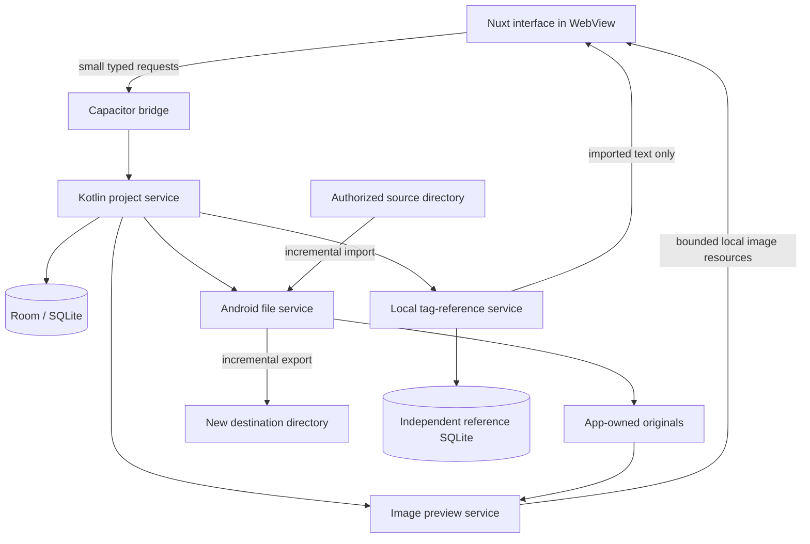

# Android Dataset Caption Editor

* **Author:** cpuopt
* **Status:** Design content approved; final save location pending; production implementation paused
* **Date:** 2026-11-12
* **Created:** 2026-11-11
* **Predecessor:** [Reviewed concepts brief](concepts_brief.md)
* **Supporting review:** [Seven-lens findings](docs/reviews/dataset-mobile/goldfish_review_report.md)
* **Predecessor reconciliation:** [Approved differences and remaining evidence](docs/reviews/dataset-mobile/draft-alignment.md)

## Overview

Build an Android app for preparing image training datasets on a phone. Users import an existing local folder, inspect images and captions, correct tags and natural-language descriptions, organize training subsets, and export the resulting dataset into a new directory.

The working dataset is independent of its source after successful import. Edits are saved inside the app, so ordinary editing does not require continued access to the source folder. The initial release targets datasets of 100–1,000 images averaging about 5 MB per image, approximately 0.5–5 GB of image data. These figures describe the intended workload; they do not establish tested capacity or an agreed rejection limit.

The author requested refinement of the proposed Nuxt + Capacitor + Kotlin + Room/SQLite stack. This establishes the drafting direction: a WebView interface with Android-native file and persistence operations. Exact component responsibilities, database schema, library versions, device requirements and recovery mechanisms belong to the Technical Plan and are not settled by this section.

## The Problem

An automatically captioned training dataset still needs human inspection. Users must see each image while correcting its tags and prose. Editing raw TXT files alone makes it difficult to check the image, understand unfamiliar tags, preserve the tag/prose boundary, and track progress across hundreds of images.

Dataset organization is also part of training preparation. Images from different periods of an artist's work may need separate training subsets, to which the trainer can assign different repeat values. Users need to build folders manually and move matching image/caption pairs through rules without losing their individual edits.

A phone adds constraints: limited working memory, a small screen and keyboard, directory access granted through Android, and operations that can be interrupted. A dataset can be several gigabytes even though its caption text is small. The app must not equate a selected folder with a verified independent import, or a changed text field with a successfully saved edit.

The design must address two implementation-readiness blockers identified during concept review: a verifiable import-completion promise and an honest saved-state acknowledgement. It must also keep uncertain parsing from causing incorrect no-prose classification and keep partial exports from appearing complete.

## Goals

1. **Import nested local datasets into independent projects.** Use a user-authorized local directory as input and preserve the initial folder hierarchy. A successfully imported project remains usable after the source directory is removed or its access grant revoked. Define verification and treatment of failed or excluded files in the Technical Plan before claiming completion.

2. **Support overview navigation and per-image editing.** Show images with their corresponding captions. Expose individual tags for manual viewing, addition, removal and correction, with natural language edited separately. Retain image context and understandable navigation while the phone keyboard is open. Exact layout and progress-state controls remain design choices.

3. **Show imported Chinese tag references.** Tags and VLM descriptions retain English source text. Show Chinese tag translations and introductions only where the imported reference provides them. Uncovered tags and VLM prose remain English. The author explicitly deferred machine translation and model downloads for the first release. Reference display must not change source text, rule results or exported TXT.

4. **Format captions without silently changing their meaning.** Support one combined line, separate tag/prose lines, and natural language with one sentence per line. Preserve user corrections to the tag/prose boundary. Do not infer that a caption lacks prose merely because parsing is uncertain.

5. **Persist edits within the app.** Save caption and logical-folder changes in the internal project database. Distinguish unsaved work, acknowledged saves and failures. Define acknowledgement, interruption recovery and navigation behavior in the Technical Plan; the design must not promise that every keystroke survives sudden power loss without a defined commit point.

6. **Organize training subsets manually.** Allow creation of subdirectories and movement of images into and out of them. A corresponding image and TXT move as one logical item. Export uses the edited hierarchy; repeat values remain the trainer's responsibility.

7. **Run combined-condition classification only on explicit request.** Support tag-based and caption-content conditions. Required examples are `newest` tag membership leading to `newest/`, and confirmed absent natural-language description leading to `no-vlm/`. Editing tags must not start classification automatically.

8. **Preview and manually resolve classification conflicts.** Before a run commits moves, expose conflicting rule destinations and allow the user to handle them on the preview page. No implicit rule priority or last-match destination is permitted. Group resolution, skip behavior and unresolved-item policy require a later decision.

9. **Export a new dataset directory.** Write image/TXT pairs using the project's current logical folder structure. Exported captions use the selected format and contain no preview translations. The design must define collisions, consistent export content and failure/cancellation outcomes before treating an export as complete.

10. **Keep dataset processing local at the intended scale.** The design must account for native file access, private storage, decoded-image memory and destination space. Later validation must exercise representative datasets up to the expected 1,000-image/5-GB workload on explicitly chosen Android devices. No performance, format or device guarantees are implied before those tests.

## Non-Goals

* Supporting iOS in the first release.
* Requiring source access for ordinary editing after verified import.
* Updating the original source directory as the save mechanism.
* Uploading dataset content for processing, or silently falling back to an online service.
* Exporting translation previews as training-caption content.
* Continuously enforcing classification rules while captions are edited.
* Resolving conflicting rule destinations silently through priority or execution order.
* Configuring training repeat values or executing model training inside the app.
* Machine translation and translation-model downloads in the first release. Imported Chinese tag text remains in scope; VLM machine translation is deferred.

Video editing, automatic image tagging/caption generation, image retouching, cloud synchronization, ZIP output, restorable project backups, broad batch caption tools and global tag analytics are not included in the first-release baseline. They are deferred rather than permanently rejected. Current-session undo is selected in D20. Conflict multi-selection is selected in D7. Imported Danbooru references are in scope for supplied Chinese tag translations/introductions, not as approval of autocomplete or machine translation.

## Remaining Verification and External Inputs

The author decisions and proposed implementation contracts below resolve the earlier design questions for this draft. Remaining evidence is not described as already obtained:

* Verify pinned dependency/toolchain interoperability and actual native generation paths during separately authorized implementation.
* Verify the reported OnePlus 13T / Android 17 configuration and run the physical-device matrix before claiming compatibility or scale performance.
* An upstream Danbooru source is not selected or bundled. The app-defined v1 CSV/JSON/SQLite input contract permits a later source to be converted without changing the app architecture; inspect the actual source before claiming coverage or data-use rights.
* Measure parser ambiguity and false-confidence behavior on representative real captions; manual correction/readiness/export safeguards remain required. Fixtures establish supported deterministic behavior, not universal semantic accuracy.
* Predecessor reconciliation is complete with no open contradiction: later explicit author choices account for the listed differences. Final save location remains the current EGM gate. Production implementation remains unauthorized.

## Critical User Journeys

These journeys translate the goals into acceptance behavior approved with the Technical Plan. Their implementation and device verification have not occurred.

### CUJ 1: Import and continue without the source

* **Given:** A local folder contains nested image/TXT pairs and the user grants read access.
* **When:** The user imports it, waits for verified completion, and later removes the source.
* **Then:** The app can reopen the project, display its original images, edit captions and export. Any unreadable or incomplete input was disclosed before completion; an interrupted job was never presented as complete.

### CUJ 2: Edit an image and reopen the project

* **Given:** An imported project has a selected image with tags and prose.
* **When:** The user changes the caption, receives a saved acknowledgement and reopens the app.
* **Then:** The acknowledged caption and logical location are present. A translation preview has not changed them. A save failure remains distinguishable from success; the unacknowledged input recovery policy depends on decision D1 below.

### CUJ 3: Review overlapping classification rules

* **Given:** An image contains `newest` and has confirmed absent prose, matching rules for different folders.
* **When:** The user explicitly prepares a classification run.
* **Then:** Preview shows both reasons and targets. The run does not silently choose one. A manually resolved move executes only against the reviewed project state; relevant intervening changes require renewed validation.

### CUJ 4: Export the edited subsets

* **Given:** The project has edited captions and logical subset folders.
* **When:** The user selects a new destination and starts export.
* **Then:** A successful export contains the expected image/TXT pairs at the selected layout and paths. Failure or cancellation leaves the internal project intact and is not reported as complete delivery.

## Technical Plan (Architecture)

### 1. Drafting authority and current scope

The user approved Overview and Goals and requested the proposed technology stack: Nuxt, Capacitor, Kotlin and Room/SQLite. The boundaries and operation contracts below are design proposals for this section. They are not validated production behavior. No application implementation or Android build is authorized by this draft.

Open decisions are deliberately not replaced with assistant-selected defaults. D1–D8 are selected below. The author explicitly confirmed a subsequent scope change: first-release Chinese viewing uses imported tag references only; machine translation and model downloads are deferred, superseding D9/D10. Upstream reference format and remaining operation contracts are still open. Exact dependency versions and minimum Android version will be resolved before the per-file implementation plan.

### 2. Components and ownership

| Component | Proposed responsibility | Boundary |
| --- | --- | --- |
| Nuxt/Vue interface | Overview, active-image editing, tags/prose fields, rule construction, conflict preview, user-visible operation states | Holds visible-page data and transient edits; does not own the only saved project copy |
| Capacitor bridge | Typed requests, responses and progress between the WebView and Kotlin | Carries identifiers, bounded metadata and caption text; does not shuttle the dataset as Base64 or giant byte arrays |
| Kotlin project service | Coordinates imports, caption updates, logical folder operations, classification and exports | Validates project identity/revisions and separates authoritative writes from derived previews |
| Room/SQLite persistence | Project records, caption content, logical folder tree, rules and durable operation state | Owns the acknowledged structured state; database transaction success is required before a saved response |
| Android file service | Source/destination directory access, owned image storage, incremental copying and image resources | Owns streams and file permissions; source grants are needed during import, not for normal use afterward |
| Image preview service | Bounded thumbnails and active-image decoding | Returns constrained local resources; evicted thumbnails can be regenerated without losing originals |
| Tag-reference service | Lookup imported translations and introductions | Cannot mutate source captions; reference source/format remains unresolved; no machine-translation engine |

No Node/Express server is required on the phone. Nuxt supplies built UI assets; Kotlin accesses Android facilities. The trainer and its existing UI remain separate from this app. The existing `dataset-mobile` starter must be reconciled later; its current ZIP/buffer behavior is not the selected architecture.

### 3. Proposed project records

This is a conceptual model, not a final Room schema or table list.

| Record | Information and invariant |
| --- | --- |
| Project | Stable ID, lifecycle state, data-format version, content revision and timestamps |
| Asset | Stable ID, project ID, imported filename, owned-content locator, byte size and verification state; identity does not change when a logical folder changes |
| Caption | Asset ID, original text, ordered source tags, source prose, parse/review state and caption revision; manually corrected boundaries survive formatting changes |
| Logical folder | Stable ID, project ID, parent ID and name; moves cannot create a cycle |
| Placement | Asset ID, folder ID and output stem; one image/TXT pair has one current output placement |
| Rule | Rule ID, condition structure, target folder and revision; conditions do not execute themselves |
| Classification plan | Project/rule versions, evaluated scope, matched reasons, proposed moves, conflicts and manual decisions |
| Job and item progress | Operation ID, import/export state, item completion, errors and recovery references |

Missing TXT, empty TXT, uncertain parsing and confirmed empty prose must be distinguishable. Formatting is a projection of source tags/prose, not an instruction to repeatedly reparse stored text. Translation results are derived data associated with their source revision, never an alternative source caption.

Original image bytes are owned by the project after import. The author selected private image files referenced by database records. Original images are not stored as database BLOBs. Stable asset identity is independent of the source path, private filename and editable export placement.

#### D2: Original-image storage — Option A selected by author

Both options retain independent original bytes inside the app and store edits in Room/SQLite. Neither uses original source files as ongoing dependencies.

| Option | Mechanism | Trade-off | Failure boundary |
| --- | --- | --- | --- |
| A — Private image files plus database records | Native code stores original bytes in app-private files; database records reference them using stable asset IDs | Images can be streamed individually; file copies and database changes require coordinated recovery | A copy interrupted between file completion and record commit can leave orphaned or incomplete assets unless import reconciles them |
| B — Original-image BLOBs in SQLite | Store original bytes and structured project data in the database, with asset content separated from caption queries | Asset metadata/content can share database transactions; the database grows with gigabytes of images and needs careful read/write and maintenance behavior | Materializing BLOBs or using long transactions can raise memory/space pressure; corruption or recovery of the image-bearing database has a larger scope |

The author selected A. Native file operations store original bytes in app-private files; Room records hold stable asset references, caption content and logical folder placement. Creating or moving a logical folder does not recopy image bytes. Thumbnails are derived cache files and cannot substitute for owned originals.

File copies and database commits are not one atomic transaction. Import needs persistent per-item state and reconciliation so interruption cannot leave a completed record pointing to an incomplete file. Exact verification and recovery policies remain open. The physical directory layout and cache limits will be specified during implementation planning.

### 4. Import flow and completion boundary

Proposed flow: authorize directory → enumerate subtree incrementally → build input inventory → copy/verify items into owned storage → reconcile file/record completion → publish completed project. Persist job progress outside page state so leaving the page does not itself erase the operation.

Keep relative source paths for initial placement and pair captions within their parent directory. Flag ambiguous stems such as `001.jpg` and `001.png` sharing one `001.txt`. Do not invent image bytes, discard failed items silently or treat metadata enumeration as file verification.

Candidate lifecycle states are discovering, importing, needs-attention, complete and cancelled. A failed/paused job may be recoverable, but the exact resume and source-change policy is not selected. Import completion must account for every accepted item and cannot rely on a copied-file count alone. Verification strength and unsupported/orphan-file policy are later author decisions.

Space estimates distinguish the source, new owned copy, caches and eventual export. The app must not require source deletion to make an unverified import appear successful. Permission loss before completion is an import problem; after completion it must not prevent ordinary editing.

#### D3: Failed input items at import completion — Option B selected by author

These options apply to actual copy/read/verification failures. A missing TXT may instead be a valid image requiring new annotation; missing-caption, unsupported-file and ambiguous-pairing policies are separate decisions. Neither option authorizes silently losing files.

| Option | Mechanism | Trade-off | Failure boundary |
| --- | --- | --- | --- |
| A — Require all accepted items | Keep the project in needs-attention until every accepted item succeeds, or the import is cancelled | A completed project preserves the full accepted input set; one persistent bad file can prevent completion | Unreadable or changed source items must be repaired/retried before the project can be marked complete |
| B — Permit explicit exclusions | Present failed items and reasons; the user may retry or explicitly exclude selected failed items and complete the remaining verified dataset | Usable files can become an independent project without fixing every bad input; the project may contain fewer items than the original input | An excluded item is unavailable in the completed project and export; the exclusion list and final counts must stay visible and recorded |

Both options preserve completed copy progress and leave the source unchanged. Neither permits skipping an unreadable subtree whose unknown contents were never inventoried without separately disclosing that scope. Verification strength is still to be selected and is not weakened by excluding an item.

The author selected B. Present each failed item with its relative source path and failure reason, allowing retry or explicit exclusion. Record exclusions and final imported/excluded counts in the project. Mark the remaining dataset complete only after every retained accepted item passes verification; excluded originals are not available for editing or export. This choice does not authorize silently excluding unknown contents of an unreadable subtree or automatically treating missing TXT as a copy failure.

#### D4: Copy integrity verification — Option B selected by author

Verify in native code with bounded buffers, never by loading every image into the WebView. These choices concern copied-byte integrity, not caption interpretation or full image-decoding validation.

| Option | Mechanism | Trade-off | Failure boundary |
| --- | --- | --- | --- |
| A — Completion and byte-count checks | Check stream completion, copied-byte count, available source size metadata and final private-file size | Avoids an extra full read of each private image; performs less integrity checking | Cannot detect same-length corruption or replacement; missing or unreliable source metadata limits completeness evidence |
| B — Source-stream digest and destination read-back | Calculate a cryptographic digest while copying, reopen the private file, hash it and compare digest and byte count | Adds a full destination read and hashing work, increasing import time and energy use | Proves agreement with the source stream that was read, not that the source was healthy or unchanged before reading; does not guarantee future storage health |

Neither option permits an incomplete/unreadable destination to be published as verified. Interrupted verification leaves the item pending and subject to D3. Source mutation, unreliable enumeration and decode failures still need explicit treatment; a matching digest alone does not establish inventory completeness or a valid image.

The author selected B. Calculate the source-stream digest and byte count during native copying. Close and reopen the private destination, calculate its digest and byte count using bounded buffers, and compare both. Only a successful comparison permits the item to enter verified state. Persist that result with the asset record before counting it toward completed import. Digest mismatch or read-back failure is an item failure handled through D3, not an automatic exclusion. Persisted digests support recovery checks but do not imply continuous background verification. The exact digest algorithm and interrupted-item restart procedure will be specified in implementation planning.

### 5. Caption mutation and saved acknowledgement

Proposed request shape: project ID, asset ID, expected caption revision, client edit ID and source field changes. A response includes the committed caption revision and matching edit ID. This is an illustrative interface contract, not executable code or a final API.

The UI updates its visible draft immediately. Native persistence checks the expected revision and commits the change transactionally. The UI displays saved only when the acknowledgement covers its current draft; an older response cannot mark newer input saved. A failure leaves the draft visible with retry/recovery information. Export and classification must settle pending edits or explicitly stop; they cannot silently read older content.

Do not block the Android/UI thread waiting for database work. Serialize or otherwise order mutations affecting the same caption. Input-method composition is not a completed text edit until composition finishes; exact event handling belongs in the implementation plan.

#### D1: Save scheduling — Option B selected by author

Both options use the same revision-aware acknowledgements. Neither can claim that input not yet committed survives arbitrary process death or power loss.

| Option | Mechanism | Trade-off | Failure boundary |
| --- | --- | --- | --- |
| A — Submit each completed edit immediately | Send each tag action and completed text input change to the native write queue without an idle timer | More bridge/database traffic during continuous typing; smaller avoidable waiting period before a commit | A process ending before acknowledgement can still lose queued input; slow storage can accumulate pending work |
| B — Coalesce continuous text input | Save tag actions immediately; combine text changes after a short idle interval, and flush before navigation, classification or export | Fewer writes and bridge calls; recently typed text remains pending longer | Abrupt process termination may lose the idle window plus unfinished writes; lifecycle callbacks alone cannot guarantee a last flush |

The author selected B: coalesce continuous text input. Tag actions submit immediately; completed text edits become pending and are submitted after an idle interval. Navigation to another image, classification and export request a flush and wait for acknowledgement of the latest draft. A failed flush must retain the draft and prevent that action from silently proceeding against older data. Non-destructive inspection that does not leave the editor need not wait for persistence.

The exact idle interval and bounded queue/coalescing policy remain implementation-plan details to define and validate. The app cannot promise a final flush on abrupt process termination. An older acknowledgement must never mark newer text saved. A separate durable draft journal is not implicitly included. Undo/history scope is independent of this selected scheduling policy.

### 6. Manual moves and classification plans

Manual folder changes update logical placement and move the image/caption pair as one item. They must preserve asset identity and caption state. Reject invalid parent/child relationships and expose destination name collisions before committing.

A classification run evaluates a settled project version and a chosen rule scope, generating a stored or reconstructible plan for preview. Preview explains matches and conflicting targets. Tag edits do not run rules. A final apply request validates that the relevant state still matches the preview; it must not silently recompute a different image set and move that instead.

`newest` membership and absent-prose checks use source fields rather than translated text. Unknown parsing cannot become proven absent prose by default. D7 selects individual and multi-selection conflict handling; D11 selects nested conditions. Exact normalization, uncertain-value semantics, same-target overlaps and unresolved-item handling remain open decisions. No priority ordering or duplication policy is introduced here.

#### D7: Manual rule-conflict resolution — Option B selected by author

Both options show the image, current location, matched rules and competing destinations before any move. Each image has one final destination for this run; neither option introduces automatic priority, multiple subset membership or file duplication.

| Option | Mechanism | Trade-off | Failure boundary |
| --- | --- | --- | --- |
| A — Resolve each conflicting image individually | Open each conflict and explicitly select its destination | Every image receives an individual decision; large overlapping groups require repetitive phone interaction | A large unresolved set can make review slow; it must not be silently defaulted just to finish the run |
| B — Individual decisions plus explicit multi-selection | Retain individual handling, and let the user select several conflicts and assign one common destination to that selection | Reduces repetitive decisions; needs visible selected scope and affected-image counts | An overbroad selection can assign unintended images; group resolution must remain reviewable and must still validate destination collisions |

The author selected B. Preview retains per-image destination selection and additionally supports explicit selection of multiple conflicting images followed by one shared destination assignment. Display the selected images/count and destination before applying that resolution. Keep each affected image's resolution visible and individually changeable before the classification run commits moves. Multi-selection changes the move plan, not the saved rules or current folder placement.

Validate the chosen destination and resulting image/TXT names for every selected item. A bulk choice does not override filename collisions or make an invalid move executable. The project/rule version checks still apply after manual resolution. Grouping by matched rules may help navigation but does not itself select or resolve anything; exact controls remain UI design details. Skip behavior and whether unresolved items block the whole run are separate decisions. This approval applies to classification conflict resolution, not broad batch caption editing.

#### D11: Combined-condition structure — Option B selected by author

The author selected nested condition groups rather than a single flat all/any group. Represent a rule condition as a tree of all-match groups (AND), any-match groups (OR), and explicit exclusion/negation (NOT), with leaf predicates for tag membership and prose presence/absence. The exact UI representation of NOT and limits on depth/condition count remain implementation-plan details; arbitrary script execution or a textual programming language is not implied.

For example, `has tag newest AND (has tag solo OR confirmed no prose)` has one outer all-match group and a nested any-match group. Store the group structure explicitly rather than relying on ambiguous visual order or operator precedence. Each rule still names one target folder and runs only on explicit request. Several matching rules can still produce a conflict under D7.

The phone builder must show indentation/group labels and a readable expression before execution. Preview should expose matched conditions and rule targets for each image without flattening away group meaning. Invalid or empty groups cannot be silently treated as match-all. Resource limits must reject an overcomplex expression visibly, rather than truncating conditions. Unknown caption parsing cannot become confirmed absent prose through negation; detailed unknown/NOT semantics must be decided before finalizing the evaluator.

#### D12: Unresolved conflicts at execution — Option B selected by author

Neither option may move an image to an unresolved destination or silently exclude conflicting items.

| Option | Mechanism | Trade-off | Failure boundary |
| --- | --- | --- | --- |
| A — Resolve every conflict before executing | Block the run until all conflicts have valid reviewed destinations | The reviewed scope is handled as a whole; a few difficult images delay every planned move | Users may be unable to complete a large otherwise-valid plan without resolving all remaining items |
| B — Explicitly skip selected conflicts | Allow the user to mark unresolved images as skipped for this run and execute the valid remaining plan | Useful moves can proceed; the run has an explicit partial scope and skipped-item report | Skipped images remain in their original folders; the UI must not call them classified, and unmarked unresolved conflicts still block execution |

The author selected B. Users may explicitly mark conflicting images as skipped for this run, individually or through the approved multi-selection controls. The reviewed plan records those choices. An unresolved image without a valid destination or explicit skip still blocks execution; no automatic omission or target choice is allowed.

Before execution, distinguish planned moves, unchanged images, explicit skips and remaining blockers, with counts and inspectable image lists. Execute only the validated non-skipped moves, retaining skipped images at their existing placement. The result reports moved and skipped items separately; a skipped image must not be labeled classified. A relevant project/rule change still invalidates the plan as described above.

Skipping does not remove images from the project, exclude them from an ordinary dataset export or change saved rule definitions. Unlike D3 import exclusions, these assets remain available for editing and future classification runs. This choice does not waive filename-collision or invalid-path checks.

### 7. New-directory export

Proposed flow: settle pending edits → select a consistent project view → validate output names and pairing → authorize a new destination → stream originals and generated TXT files → verify the selected completion criteria → report delivery. The destination must not become the authority for subsequent editing.

Logical folders determine output paths. Formatting uses stored source tags/prose and selected layout; translations cannot enter TXT. No full-dataset ZIP intermediate or JavaScript-held export blob is required by this directory workflow.

Keep the internal project intact on failure. Track which output entries belong to this operation and avoid deleting unrelated destination files. Do not assume an Android document provider can atomically rename an entire directory. The author selected read-only export in D5 below; failure recovery is decision D6.

#### D5: Editing while exporting — Option A selected by author

Both options settle pending saves before starting and bind the operation to a known project revision. Neither permits different images' captions or paths to be read from arbitrary live revisions during a single export.

| Option | Mechanism | Trade-off | Failure boundary |
| --- | --- | --- | --- |
| A — Read-only project during export | After pending saves commit, block caption, asset and folder mutations for that project until the export completes, fails or is cancelled | A single project view is easier to preserve; the user cannot continue editing that project during a potentially long export | A stalled export blocks editing until cancelled or recovered; a process restart must reconcile the job rather than leave a permanent lock |
| B — Export a fixed snapshot and keep editing | Persist a short-transaction snapshot of captions, paths, formatting settings and asset references, then stream that frozen view while later edits proceed | Editing remains available; later changes are intentionally absent from this export and the UI must explain that boundary | Referenced originals must remain available until the job releases them; deletion/lifecycle handling and snapshot cleanup become more complex |

The author selected A. Settle and acknowledge pending saves before establishing a project-scoped read-only export session. While the job is actively exporting, native validation rejects caption edits, image additions/removals, folder changes, classification commits, project deletion and changes to active export settings. The UI explains the read-only state and allows inspection, progress viewing and cancellation. Enforce the restriction natively, not just by disabling controls.

Do not hold a database transaction open for the full multi-gigabyte copy. Associate the read-only session with its durable job and validated project revision. Restore edit access after confirmed success, failure or cancellation, once active writers for that job have stopped. On restart, reconcile interrupted jobs before permitting resume or releasing a stale session; never leave a permanent UI lock based only on a vanished page or process. This does not add an all-project global lock.

#### D6: Interrupted or failed directory export — Option B selected by author

Both options preserve the internal project, identify partial output as incomplete and never report success merely because some files exist. Once an interrupted job is stopped/reconciled, editing may resume under D5. Neither option may silently overwrite or remove unrelated destination files.

| Option | Mechanism | Trade-off | Failure boundary |
| --- | --- | --- | --- |
| A — Restart in a fresh output directory | Retain the failed-job report; a retry creates a clean new output directory and exports the current project from the beginning | Less resume-state logic, and no mixing of old/new revisions; completed large files are copied again | Retained partial output consumes space until deliberately cleaned; repeated interruptions waste time and I/O |
| B — Resume after validating the previous run | Persist per-item progress and expected output metadata; reauthorize/recheck the destination and continue only when project revision, settings and existing output still match | Can avoid recopying verified completed items; requires validation and recovery bookkeeping | If project content/settings changed, output was altered, or destination access cannot be restored, that run cannot resume and must restart separately |

The author selected B. Persist the job's project revision, export settings, destination references and per-item progress. Before resuming, restore access and compare the current project/settings with the recorded run, then validate the already-written output. Do not trust a completed-item flag or file existence without the corresponding validation. Revalidate or rewrite interrupted individual files.

A valid continuation reestablishes the project read-only session under D5. If the project/settings changed, output was altered or access cannot be restored, do not mix revisions or silently fall back to a fresh export: explain why continuation is unavailable and offer a separate restart in a new directory. Preserve the internal project and identify the previous partial result. No fixed-snapshot editing model is implied. Exact output-validation criteria, partial-output cleanup and naming collision handling remain later design details.

### 8. Imported Chinese tag reference display

Keep English source tags/prose visibly distinct from imported reference text. Lookup results identify the selected tag and reference version; late results cannot replace details for a different tag. Lookup failure does not clear source text, count as absent prose, block saving or enter export text. No machine-translation or online fallback is included.

The author confirmed the revised first-release scope: display dictionary-provided Chinese tag translations/introductions, keep uncovered tags in English, and defer VLM machine translation. If an introduction is available only in English, display its supplied language rather than generating Chinese. English VLM editing and formatting remain in scope. Prototype machine-translation dependencies do not authorize shipping those features.

#### Imported Danbooru tag references — confirmed scope addition

The app must accept an imported Danbooru-related tag database, primarily for tag translations and introductions. Treat the imported reference as viewing data distinct from project captions. Tag inspection should be able to show the English source tag, its available Chinese translation, and its available introduction. Missing dictionary entries or descriptions must be distinguishable from an empty source caption.

The author has not selected a source but confirmed SQLite as the representation after import. This does not require the upstream artifact itself to be SQLite, and does not authorize accepting arbitrary SQLite schemas unchanged. A future source adapter must map a documented input format into the app's supported reference schema. SQLite storage does not establish that Chinese descriptions or complete translations exist in the input.

The exact upstream source and file format are not yet supplied. Do not assume a tag autocomplete CSV contains wiki introductions, that every tag has Chinese text, or that a single upstream database supplies both. Danbooru documents tags and wiki pages as distinct API resources ([tags](https://safebooru.donmai.us/wiki_pages/api%3Atags), [wiki pages](https://safebooru.donmai.us/wiki_pages/api%3Awiki_pages)); this is source context, not authorization to fetch data or select a community translation dataset. Reference format/schema, availability of Chinese introductions, source/version metadata and update semantics must be inspected before an import contract is finalized.

Proposed service boundary: import/index reference records natively, and return only the requested tag details or bounded query results to the WebView. Keep reference-version identity separate from project revisions; loading a reference must not rewrite source tags, trigger subset moves or alter exported TXT. D23 selects exact tag comparison, without case folding or space/underscore equivalence. Alias-driven tag rewriting is not approved.

Where the reference lacks Chinese text, retain the English tag and indicate missing reference content. Do not generate translations for tags, introductions or VLM prose. Reference import does not authorize image downloads, embedded external content, online translation fallback, autocomplete, or reference copies per project.

#### D8: SQLite reference placement — Option A selected by author

Both choices query imported reference data natively and return bounded results to the WebView. Both keep reference text out of exported training captions and retain provenance/version information separately from project edit revisions.

| Option | Mechanism | Trade-off | Failure boundary |
| --- | --- | --- | --- |
| A — Dedicated reference SQLite file | Keep the imported tag reference in a separate app-level SQLite database, independent of the project database | Reference maintenance is separate; requires coordinating availability/version changes across two database connections | Interrupted replacement can leave lookups unavailable without staging and safe activation |
| B — Reference tables in the app database | Import tag reference records into dedicated tables in the same Room/SQLite database that holds project metadata | Queries and transactions share a database; large reference updates share resources and migrations with projects | Long or failed imports can interfere with editing without bounded transactions and isolation |

The author selected A. Keep a dedicated app-level reference SQLite file independent of the Room/SQLite project database, shared by project lookups rather than copied into each dataset. Loading, replacing or removing reference data must not mutate source captions, project placement, review state or classification decisions.

A failed import/replacement must not expose a partially indexed reference as ready or replace a valid active database with an incomplete file. Existing valid reference data remains available on replacement failure; if no reference has ever been installed, show reference-unavailable explicitly while preserving ordinary editing. Invalidate reference-derived previews when the active reference version changes. Exact schema, replacement activation and native database access mechanism remain to be specified; do not assume atomic transactions across the independent databases.

#### D9: Translation model provisioning — superseded; first release deferred

**Historical decision only:** the author subsequently confirmed deferring machine translation, retaining imported Chinese tag references, and excluding translation engines/model downloads from the first release. The earlier permission below is not an active requirement or authorization to download anything.

The author accepts an initial network download of translation models, followed by on-device translation without uploading images or captions. Downloading a model is not permission to send dataset content to an online translator. Normal editing and imported-reference lookups remain available if model download fails; machine-translation preview must display its unavailable state rather than empty or fabricated output.

Expose model readiness and setup/download failure separately from translation failure. Offline inference requires that the needed model remains installed; deletion or app-data removal may require another setup download. Exact size, update policy and download network controls depend on the selected engine and are not specified by the user's acceptance.

#### D10: On-device translation engine — deferred, no active choice

The candidates below are retained as historical exploration only. No engine is selected or required in the first release. Reintroducing machine translation requires a later scope decision.

Both options operate locally after setup and provide previews only. No engine has been quality- or performance-tested against this app's tags and VLM prose. Imported reference text remains a separate source with its own provenance, not model-generated ground truth.

| Option | Mechanism | Trade-off | Failure boundary |
| --- | --- | --- | --- |
| A — Google ML Kit Translation | Kotlin uses its on-device translation API and managed language-model download facilities | Provides a defined translation interface and model management; model choice and terminology behavior are constrained by the SDK | Model download may be unavailable on the intended network/device; specialist tags and prose need quality checks and may be mistranslated |
| B — App-managed model through ONNX Runtime | Select a compatible English-to-Chinese model and tokenizer, manage their downloads and run native inference | Control over selected model/version and delivery; app owns tokenization, decoding, integrity, licensing and resource testing | No compatible model has been chosen; incompatible operators or model memory/latency can make it unusable on target phones |

Official evidence: [ML Kit Android translation](https://developers.google.com/ml-kit/language/translation/android) documents dynamic model downloads, readiness checks, explicit model management and resource release. [ML Kit translation overview](https://developers.google.com/ml-kit/language/translation) states inference runs on-device without sending user text to a remote server and calls for use-case-specific quality evaluation. [ONNX Runtime mobile guidance](https://onnxruntime.ai/docs/tutorials/mobile/) requires an appropriate compatible model that fits device storage/memory and recommends measuring latency and energy. These establish capabilities, not evidence that either candidate meets this app's quality or device targets. No option is selected.

### 9. Boundary changes and later implementation scope

The planned app adds a native project API for project discovery/opening, paged asset metadata, caption reads/mutations, folder changes, classification planning/apply and import/export jobs. Job responses should use bounded progress events and allow querying durable status after reopening the interface. Exact method signatures and event schemas will be finalized after the unresolved contracts are selected.

Later file-level planning will cover Nuxt views/state/API types, Kotlin bridge/project services, Room entities/queries/migrations, native file/image operations, lifecycle handling, build configuration, tests and documentation. This section does not yet authorize a file manifest or changes to the trainer. Selection of native background scheduling and supported device budgets requires Android-specific evidence before implementation claims.

### 10. Section review boundary and remaining decisions

The proposed architecture now reflects the author's decisions on save scheduling, private image files, explicit import exclusions, digest read-back verification, read-only export with validated continuation, individual/multi-selection conflict handling, independent reference SQLite, deferred machine translation, nested conditions and explicit per-run skips.

Section approval accepts these component boundaries and lifecycle direction, not a claim that the design is ready to implement without further decisions. Before the Detailed Implementation Plan can be approved, resolve the reference schema/input contract, caption dialect/parsing and unknown/NOT semantics, name/pairing/collision policies, import resume/source-change behavior, export validation, undo scope, database/version recovery, native job scheduling and supported Android/device envelope. These remain explicitly open; no default or silent scope addition is selected here.

The next drafting stage documents alternatives, separating alternatives superseded by the author from unresolved ones. The detailed implementation stage must turn remaining consequential choices into explicit decisions and specify every intended file and verification step. No production work is part of this approval.

## Alternatives Considered

### Decision provenance

The predecessor brief's Alternatives Weighed section was reread for this stage. It left storage, translation and several interaction decisions open. The author's later choices D1–D12 and subsequent explicit translation deferral resolve only the items identified below. An author selection is recorded as a selection, not as an invented quotation of the author's motivation. Technical advantages/disadvantages below explain the trade-offs presented during drafting. No rejection is attributed to an upstream maintainer.

### Ownership and large-file processing

#### Source-linked editing instead of independent import

* **Mechanism:** Keep source-directory file references as the working images and retain ongoing directory access.
* **Pros:** Avoids an additional full image copy and reduces initial storage use.
* **Cons:** Moving/deleting the source or losing access breaks the working dataset. Source changes can diverge from internal edits.
* **Reason for rejection:** Rejected by author: the user explicitly requires independence from original files after import. The selected private copy costs storage and import time; it must be verified before that independence is promised.

#### Original images as SQLite BLOBs instead of private files

* **Mechanism:** Store original image bytes inside the project database.
* **Pros:** Asset content and related metadata can use database transactions.
* **Cons:** Images grow the database into gigabytes; image reads, large writes and recovery need additional care. Database storage does not make the whole import atomic.
* **Reason for rejection:** Rejected by author through D2 Option A, which selects private image files and database references. The selected design must coordinate file completion and database records; it does not eliminate that recovery problem.

#### Whole-dataset WebView buffers instead of native incremental I/O

* **Mechanism:** Represent every input as JavaScript File/byte data and build complete archive buffers in a worker.
* **Pros:** Reuses web code and moves compression work off the UI thread.
* **Cons:** Worker execution does not bound the aggregate memory of originals, decoded images and output buffers. The inspected starter does not establish 5 GB workload support or native directory delivery.
* **Reason for non-selection:** Not adopted in the approved Technical Plan. This is an evidence gap for this workload, not a claim that all browser file APIs are inherently unusable. Native streaming and bounded previews still require device validation.

### Persistence and import completion

| Alternative | Mechanism and benefit | Cost or failure boundary | Recorded outcome |
| --- | --- | --- | --- |
| Submit every completed text change immediately | Queue each text event without an idle interval, reducing avoidable submission delay | More bridge/write traffic; unacknowledged work can still be lost | Rejected by author through D1 B: combine continuous text edits, save tag actions immediately, and await latest-save acknowledgement before dependent actions |
| Block import completion on every failed accepted item | Require repair/retry of all accepted failures before completion | A single persistently bad input can prevent use of the otherwise copied dataset | Rejected by author through D3 B: permit explicit recorded exclusions, then complete only the verified retained set |
| Copy-completion and byte-count checks alone | Check successful reads/writes and expected size without destination digest read-back | Cannot detect same-length content differences | Rejected by author through D4 B: hash source stream and destination read-back, accepting extra I/O and energy |

Coalesced saves do not imply a power-loss-proof draft journal. Explicit import exclusions do not imply silently skipping unknown subtrees. Matching hashes establish copied-byte agreement, not that a source image is valid or that the entire source inventory was stable.

### Classification behavior

| Alternative | Mechanism and benefit | Cost or failure boundary | Recorded outcome |
| --- | --- | --- | --- |
| Continuous rule enforcement | Reevaluate and relocate after caption changes | Images can move during manual editing, outside a reviewed operation | Rejected by author: classification is a separate manually started feature |
| Automatic precedence for competing destinations | Pick first/last/highest-priority matching rule | Removes manual work but silently chooses a subset when several rules match | Rejected by author: conflicts must be shown and manually handled in preview |
| Individual conflict decisions only | Each image gets its own destination decision | Hundreds of similar conflicts require repetitive phone actions | Rejected by author through D7 B: retain individual handling and add explicit multi-selection resolution |
| Flat all/any condition group only | Simple one-level builder with optional negated leaves | Cannot express nested combinations such as newest AND (solo OR no prose) | Rejected by author through D11 B: nested AND/OR/NOT groups, with additional builder and evaluator complexity |
| Require every conflict to be assigned a destination | Keeps all originally planned images in one completed classification run | A few difficult images delay all valid moves | Rejected by author through D12 B: allow explicit per-run skips, while unhandled conflicts still block execution |

These selections do not authorize implicit image duplication, multiple subset memberships, arbitrary scripts or automatic tag rewriting. A skip remains an in-project image at its old location, not an import exclusion. Same-destination overlaps and unknown/NOT behavior are still unresolved evaluator details.

### Export consistency and recovery

#### Editable project with fixed export snapshot

* **Mechanism:** Freeze caption/path/settings metadata for an export while allowing later project edits.
* **Pros:** Users can keep editing during a long copy.
* **Cons:** Requires clear snapshot-version presentation and preservation of referenced originals until delivery; later edits do not enter that export.
* **Reason for rejection:** Rejected by author through D5 A: the current project is read-only during active export. The selected design sacrifices editing availability and needs job recovery so a crashed export does not leave a permanent lock.

#### Always restart failed exports from the beginning

* **Mechanism:** Create a fresh output directory and copy the current project again.
* **Pros:** Less resume bookkeeping and no mixing with previous partial output.
* **Cons:** Repeats large completed copies, with time, space and energy cost.
* **Reason for rejection as the normal recovery route:** Rejected by author through D6 B: validate recorded progress, destination files and project/settings before continuing. A separate clean restart remains necessary when those conditions no longer match; resuming is not guaranteed after every interruption.

#### Archive-first delivery instead of directory export

* **Mechanism:** Build/share a full ZIP, optionally unpacked afterward.
* **Pros:** One transferable file can retain the hierarchy.
* **Cons:** Adds archive handling and potentially additional storage; ZIP sharing alone does not deliver the requested new directory.
* **Reason for non-selection:** Directory delivery is explicitly required and approved; archive output is deferred scope, not permanently rejected. Do not require a whole-dataset ZIP intermediate for the selected directory workflow.

### Reference data and translation scope

#### Reference tables in the project database

* **Mechanism:** Store imported tag-reference records in the same SQLite database as project metadata.
* **Pros:** One database lifecycle and access layer.
* **Cons:** Large imports/updates share resources and schema changes with user projects.
* **Reason for rejection:** Rejected by author through D8 A: a separate app-level reference SQLite is shared by projects. Its activation/replacement requires coordination and must not leave an incomplete database active.

#### Local machine translation using ML Kit or an app-managed model

* **Mechanism:** Download a model and generate Chinese previews for tags and VLM descriptions on-device.
* **Pros:** Can provide previews beyond imported dictionary coverage without sending captions to a translation server.
* **Cons:** Adds download/setup, inference and quality-validation work; neither candidate was validated for this app.
* **Reason for deferral:** Deferred by explicit author confirmation after D9 provisioning acceptance and before D10 engine selection. The first release shows imported Chinese tag text only. Uncovered tags and VLM prose remain English. Neither ML Kit nor ONNX Runtime is an active first-release dependency; they were not rejected on measured quality or performance grounds.

#### Online translation fallback

* **Mechanism:** Send caption text to an external translator when local/reference results are absent.
* **Pros:** Could offer additional coverage without an on-device model.
* **Cons:** Sends dataset text outside the device and requires networking/service setup.
* **Reason for non-selection:** Conflicts with approved local dataset processing and has not been authorized. No online fallback is implied by missing dictionary text or earlier acceptance of model download.

### Still open; no rejected alternative recorded

Phone editor layout, upstream tag-reference source/format, canonical reference schema, caption parsing and unknown/NOT semantics, pairing/name collisions, undo scope, import recovery details, export validation, schema/version recovery and native background execution still need detailed design. Do not turn an unresolved entry into a rejected alternative merely to fill this section.

The predecessor's desktop multi-panel versus linked phone views remains undecided. Autocomplete, broad batch caption tools, global tag analytics, video and project backup remain deferred scope questions. Different Android/device envelopes are not ranked here; neither compatibility nor performance has been measured.

## Non-Functional Requirements

* **Privacy and authority:** Dataset work stays local; no online translation, remote UI runtime or embedded reference media. Database acknowledgements and native mutation guards, not UI optimism, establish saved/read-only state.
* **Bounded resources:** Stream originals, page metadata, bound decoding/history/reference records and keep caches regenerable. The concrete limits and device measurements are specified in the implementation contracts and verification plan; they are not universal performance guarantees.
* **Recovery and compatibility:** Independent projects require verified owned content; import/export/reference jobs persist enough state to recover without publishing partial success. Schema incompatibility never triggers destructive reset. Source/output files not owned by a job are not cleaned up as temporary data.
* **Operational visibility:** Save/job states expose pending, failed, paused, excluded and complete outcomes distinctly, with affected item/counts and recovery actions. No silent priority, truncation, omission, renaming or fallback replaces the approved behavior.

These requirements restate the approved contracts below; they introduce no new feature, dependency or implementation authorization.

## Detailed Implementation Plan

### Decision intake and implementation boundary

The author approved Alternatives Considered and authorized detailed implementation planning, not production implementation. The section now includes selected decisions, concrete contracts, one unified file manifest and verification requirements for review. Initial inventory is evidence rather than existing implemented capability. No application files, dependencies or build outputs were changed in this stage.

### Existing source inventory

Read-only inventory on 2026-11-11 found exactly these ten files under `dataset-mobile`, including ignored files. A normal `rg --files` omitted `app/lib` because the repository `.gitignore` has an unanchored `lib/` pattern. Future implementation must ensure the intended source files are version-controlled without broadly removing the Python ignore rule.

| Existing path | Detailed-plan treatment and rationale |
| --- | --- |
| `dataset-mobile/.gitignore` | Review Android/build/cache exclusions once the native file manifest is fixed; retain source files in version control |
| `dataset-mobile/package.json` | Reconcile native integration and test scripts; remove deferred translation and archive-only dependencies if unused in final app; select compatible pinned versions later |
| `dataset-mobile/nuxt.config.ts` | Retain client-rendered bundled UI direction; reconcile actual page/style files and native release behavior |
| `dataset-mobile/capacitor.config.ts` | Retain packaged local assets; reconcile Android app identity and native plugin configuration during final planning |
| `dataset-mobile/tsconfig.json` | Reconcile generated Nuxt types and final project typechecking |
| `dataset-mobile/app/lib/captions.ts` | Replace heuristic parsing/formatting contracts after deciding supported dialects and unknown semantics; do not apply prototype cleanup rules as folder classification |
| `dataset-mobile/app/lib/dataset.ts` | Replace in-memory File/path identity and arbitrary prototype limits with native stable-ID metadata and agreed pairing/import policies |
| `dataset-mobile/app/lib/archive.ts` | Archive-first import/export is not the approved lifecycle; final manifest must remove this module or explicitly replace its callers with typed native jobs |
| `dataset-mobile/app/lib/device.ts` | Remove first-release machine-translation and Base64 ZIP sharing paths; replace native directory/project operations through the chosen bridge contracts |
| `dataset-mobile/app/workers/archive.ts` | Whole-archive ZIP buffering is outside the first-release directory workflow; final manifest must account for removal rather than leave an unused production path |

These treatments are future planned work only. No app entry page, styles, native Android project, Room schema, UI tests or native tests currently exist in this subtree. Existing trainer edits shown by Git are unrelated and outside this app's implementation scope.

The complete final manifest must also account for the repository `.gitignore`, all generated Android project/build/wrapper files to be committed, application/native sources, schema/migration artifacts, dependency lockfiles, tests and documentation. Do not use a vague directory placeholder as a substitute for the per-file list at section completion. Native generation/build dependencies have not been installed or run during this design workflow.

### D13: Phone per-image editor layout — Option A selected by author

Both options retain an image zoom action, individual tag editing/reference details, a separate English VLM editor, saved-state feedback and previous/next navigation. Neither introduces machine translation or desktop-sized simultaneous side panels.

| Option | Mechanism | Trade-off | Failure boundary |
| --- | --- | --- | --- |
| A — One vertically ordered editor | Show the image, tag chips and VLM editor in a single scrollable screen | Tags and prose remain directly discoverable; long captions need scrolling between image context and fields | A long tag list or open keyboard can push image context/navigation off screen unless layout and focus behavior are handled |
| B — Image with tag/prose tabs | Show the image area with separate Tags and VLM tabs for the editing area | Each editor has more focused space; switching fields needs a tab change and one field can hide issues in the other | Fixed image space can crowd the keyboard-open editor; tab changes must preserve drafts, selection and accurate saved state |

The author selected A. Use one vertically ordered editing page: image preview, individual tag chips/edit controls with imported reference details, then the English VLM field. Tags and prose are not placed in mutually exclusive tabs. Preserve the active asset's identity and draft while scrolling and opening image/reference details. Switching to a different asset still follows D1's save/acknowledgement contract.

The final UI plan must keep saved/pending/failed state and previous/next actions reachable with the keyboard open, without covering focused text. Image zoom is an explicit action rather than automatic swipe navigation while selecting text. Test long tag lists, multi-line prose, portrait/landscape image proportions and keyboard resize on representative phone viewports. Exact control placement is a UI implementation detail; the selected order must not become a fixed-height image that makes fields inaccessible.

### D14: Destination name collisions — Option A selected by author

Two different source folders can contain image/TXT pairs with the same stem. Moving them into one subset can cause a collision. The output namespace must also account for different image extensions sharing one caption name, such as `001.jpg` and `001.png` both requiring `001.txt`. Neither option silently overwrites existing content or changes private image bytes.

| Option | Mechanism | Trade-off | Failure boundary |
| --- | --- | --- | --- |
| A — Manual resolution before moving | Show the colliding pairs and require the user to rename a logical output stem or choose another folder | Retains explicit naming control; a bulk move can require many manual decisions | A colliding move cannot commit until names are valid, unless explicitly skipped under the applicable reviewed-plan policy |
| B — Automatic unique output names with preview | Allocate a unique suffix to the moving pair's logical stem and show both image/TXT output names before confirmation | Fewer manual naming steps; changes user-facing filenames and requires a stable allocation policy | A stale preview or incomplete namespace check can reintroduce collisions; final commit must validate names and invalidate/review changes rather than silently renaming again |

The author selected A. Show conflicting image/TXT pairs, current paths and intended destination names. Require an explicit logical stem change or another destination before committing a colliding move. Do not automatically append suffixes or overwrite content. A stem change updates the image and caption output names together and preserves asset identity, imported filename, source caption and private original bytes.

Check the complete destination namespace, including pairs within the same proposed batch, before committing. A stale reviewed plan cannot silently adopt new names. D12 still allows explicit skipping during classification; skipped colliding assets remain at their old placement. Manual moves outside classification must likewise expose the conflict rather than partially overwrite anything. Final export also validates names because external destination contents may differ from the internal tree.

This decision concerns collisions between already identified assets, not ambiguous source caption pairing during import.

### D15: Ambiguous source caption pairing — Option A selected by author

Example: one source folder contains `001.jpg`, `001.png` and `001.txt`. Different source folders with the same filenames are not ambiguous, because pairing is scoped to their parent directory. D14's output-name policy remains in force regardless of the caption decision.

| Option | Mechanism | Trade-off | Failure boundary |
| --- | --- | --- | --- |
| A — Require explicit pairing | Mark the group as needing attention and ask which image receives the TXT, or require explicit assignment of that TXT to each intended image | Avoids silently giving a caption to the wrong image; adds an import review step | The ambiguous group cannot be published as resolved until paired or explicitly excluded through the reviewed import flow |
| B — Initialize every same-stem image from the TXT | Use the shared TXT as the initial caption of each same-stem image; thereafter each caption is independent | Imports with fewer pairing actions; can duplicate an incorrect caption onto a different image | Content similarity is not established by matching stems; output naming still needs manual resolution under D14 |

The author selected A. List the ambiguous source group with image previews and the candidate TXT content. Require an explicit pairing decision before publishing that group as resolved. The user may assign the TXT to one image or explicitly to several; if several receive it, create independent caption records rather than shared mutable text. Record the assignment and source provenance.

Do not select an image by extension, enumeration order or apparent visual similarity. Images that receive no TXT follow the missing-caption policy rather than silently inheriting the text. Retained same-stem images still need valid logical output names under D14. Copy progress and unresolved pairing state must survive interruption; a completed project cannot retain source access as the only way to read an assigned caption. D3 explicit exclusions remain available for the applicable import items. No image is silently removed by this pairing choice.

### D16: Images with no corresponding TXT — Option A selected by author

This includes an ordinary unpaired image and an image intentionally left without TXT after D15 resolution. A readable image with no annotation is not the same as a failed image copy. Neither choice treats missing text as a confirmed tags-only caption for `no-vlm` rules.

| Option | Mechanism | Trade-off | Failure boundary |
| --- | --- | --- | --- |
| A — Import as unannotated | Retain the verified image and a distinct missing-caption state; allow the user to create tags/prose in the app | Supports completing annotations on the phone; requires visible incomplete-caption status and a later export policy | A blank field must not be mistaken for confirmed absence of prose |
| B — Require annotation or explicit exclusion before import completion | Keep the image in needs-attention until text is supplied/created or the user excludes it | Completed imports have no unresolved missing-caption items; delays opening otherwise usable images | Users must resolve each item rather than silently lose images through automatic exclusion |

The author selected A. Import the verified image as an asset with a distinct missing-caption state and empty editable fields. Absence of TXT alone does not block import completion or require exclusion. Overview and the editor identify it as unannotated, and users can create English tags/prose inside the app under D1's save contract. A newly created caption is database-backed and must not require writing a TXT into the original source directory.

Keep imported-empty-TXT provenance, missing-TXT provenance and user-confirmed caption interpretation distinct. Merely opening or saving blank fields must not silently turn missing text into a confirmed tags-only caption. Classification cannot infer confirmed absent prose solely from the missing-caption state; unknown-rule semantics remain to be finalized. The ordinary export treatment of still-empty captions is D17 below.

### D17: Still-empty captions during dataset export — Option B selected by author

Both options expose affected images in export preflight, keep internal assets intact, and never silently omit images or invent captions. An empty exported TXT does not establish a manually verified tags-only interpretation inside the project.

| Option | Mechanism | Trade-off | Failure boundary |
| --- | --- | --- | --- |
| A — Allow explicitly acknowledged empty captions | Show missing/empty captions and allow the user to confirm exporting those images with same-stem empty UTF-8 TXT files | Can deliver an incompletely annotated dataset intentionally; training behavior depends on the consumer's handling of empty captions | Empty captions can be exported unintentionally if preflight acknowledgement or affected-image counts are unclear |
| B — Require text or explicit per-export exclusion | Block unresolved empty items until the user supplies text or deliberately excludes them from this export | Ensures retained exported pairs contain text; can delay delivery or export fewer images | Exclusions must be shown and recorded as this export's scope, not deletions or permanent project exclusions |

The author selected B. Preflight lists retained images whose effective source caption has no non-whitespace text. Before an export begins, each must receive saved text or an explicit exclusion from this export's scope. Excluded assets remain in the internal project at their current placement and can be edited or included in later exports. Show excluded items/count and never silently create empty captions or omit images.

Persist the reviewed inclusion/exclusion set in the export job. Continuation under D6 uses that same set and project/settings version; it must not accidentally reintroduce excluded images. Caption updates before starting require the latest save acknowledgement and refreshed validation under D1/D5. This decision covers absent/empty source content, not uncertain interpretation of existing nonempty text.

### D18: Nonempty captions with uncertain tag/prose boundaries — Option B selected by author

An automatic parser can propose a boundary but cannot prove the interpretation of every caption. Preserve original text and manual corrections in either option. Neither may export a guessed split as though it were confirmed or treat uncertainty as no prose.

| Option | Mechanism | Trade-off | Failure boundary |
| --- | --- | --- | --- |
| A — Allow explicit unchanged-text export | Offer a reviewed per-item choice to retain nonempty original text without applying the selected layout to that unresolved caption | Avoids requiring manual boundary decisions for every ambiguous caption; some exported TXT files can retain a different layout | The UI must disclose that formatting is bypassed for those items; this cannot be used to discard or override an edited caption |
| B — Require a confirmed interpretation or explicit exclusion | Before exporting an uncertain caption, require the user to confirm/correct its tags/prose interpretation, or exclude the image from this export | Retained captions can all use the selected formatting contract; more manual review may be needed | A large ambiguous set can delay export; the app must provide a way to reach and resolve each item without silently guessing |

The author selected B. Export preflight lists nonempty captions whose tag/prose interpretation is uncertain. Retained images require a saved manual confirmation/correction; otherwise they need explicit exclusion from this export under the same reviewed scope used by D17. No per-item raw-text bypass of the selected output format is offered. Opening an item or acknowledging an export warning alone does not confirm its interpretation.

Link each preflight item to its image, retained original text and editable tags/prose. A confirmation is tied to the interpreted caption revision; later content changes invalidate stale preflight evidence. Preserve original text and manual boundaries rather than rerunning a heuristic over them when the output layout changes. The decision does not require manual approval of every confidently parsed caption or settle parser-confidence thresholds. D19 addresses classification independently of this export gate.

### D19: Uncertain fields during classification — Option A selected by author

Both options preserve unknown as distinct from false or confirmed absence. Neither permits `NOT unknown` to prove a match or assigns `no-vlm` merely because TXT is missing. Needs-review items are shown explicitly and can be resolved or explicitly skipped under D12.

| Option | Mechanism | Trade-off | Failure boundary |
| --- | --- | --- | --- |
| A — Require complete interpretation before classifying the image | Any uncertain caption split makes the image needs-review for the run | Simpler conservative review policy; can block a tag-only move even when its needed information is already reliable | Large ambiguous datasets may require extensive manual review or explicit skips before useful classification |
| B — Use only independently reliable fields | Evaluate rules against known fields; require review when uncertain information can affect the final destination or conflict set | Can perform safe moves that do not depend on uncertain prose; requires explicit field certainty and unknown-aware evaluation | Treating a proposed tag split as known, or ignoring a rule whose uncertain result could add a competing destination, would cause incorrect moves |

The author selected A. Apply an interpretation-readiness check to every image in the classification run's scope before evaluating its rule conditions. If the caption split is uncertain, place that image in needs-review rather than evaluating partial known fields or assigning any rule destination. The user must save a confirmed/corrected interpretation or explicitly skip the image under D12 before that run can execute. Do not reinterpret this decision as a requirement for manual review of every confidently parsed caption.

For ready captions, evaluate the selected nested condition tree with explicit boolean semantics: AND requires every child, OR requires at least one child, and NOT reverses a determinate child. Empty/invalid groups are validation errors. A missing/unresolved caption cannot enter ready state merely because its fields are empty; it cannot be made a `no-vlm` match through NOT. A caption-readiness or content change invalidates affected preview evidence. Fixtures must cover known tags with uncertain prose being held for review, including cases where one branch would otherwise suffice to prove a match. There is no field-level uncertainty optimization in this release.

### D20: Undo scope — Option A selected by author

Autosave does not itself provide undo. These choices concern caption edits and logical organization, including an applied classification batch; they do not promise recovery of deleted projects, original source files or already delivered external exports.

| Option | Mechanism | Trade-off | Failure boundary |
| --- | --- | --- | --- |
| A — Current-session undo | Keep a bounded inverse-operation history for the open project session | Lower persistent-history complexity; mistaken edits/moves can be reversed while the session remains open | Closing/restarting the project or app ends the available history; pending-save and batch-undo ordering still need definition |
| B — Persistent project undo | Store a bounded operation history with project mutations and restore it after reopening | Mistakes can be reversed across app restarts; adds storage, transaction, migration and retention requirements | Expired/pruned history or incompatible historical operations cannot be offered as reversible; undo cannot silently overwrite newer unrelated changes |
| C — No undo in the first release | Persist edits without a general undo history; retain explicit previews for classification/export | Smaller first-release scope; users must correct changes manually | An accidental saved caption edit or committed move has no general one-action recovery |

The author selected A. Provide bounded undo for the currently open project session, covering saved caption changes and logical folder/placement changes, including a committed classification batch. Ordinary navigation between images/pages does not close the project session. Closing/reopening the project or losing the app process ends that history; backgrounding alone is not a request to clear it while the process/session survives. No cross-restart undo log is promised.

Offer undo only for a successfully committed change. Pending text edits must be settled or explicitly cancelled without a late save reapplying text after an undo. An applied classification batch is one user-visible undo operation, restoring its actual previous placements while leaving explicitly skipped items untouched. Undo itself uses the mutation/save acknowledgement contract and native validation; it is unavailable during the read-only export session in D5.

Only update the history stack after the original operation/undo commits successfully. Surface invalid inverse operations, including newly conflicting folder/name state, rather than overwriting newer content. The bounded history capacity and grouping of continuous text edits will be specified in the final plan; do not imply an unlimited history or project-deletion recovery. Exact in-process ownership must survive ordinary UI navigation without making page-local state the sole owner of native operation identity.

### D21: Import/export when the app leaves the foreground — Option A selected by author

Both options persist job progress and preserve incomplete/complete distinctions. Neither guarantees continued execution after process termination, force stop, lost storage access or resource exhaustion. Android execution restrictions require interruption-safe jobs regardless of the chosen experience.

| Option | Mechanism | Trade-off | Failure boundary |
| --- | --- | --- | --- |
| A — Pause on leaving the foreground | Cooperatively stop at a safe checkpoint, record progress and allow continuation when the user returns | Less background-execution scope; large copies require keeping the app open to progress | Screen changes/backgrounding can delay completion; lifecycle delivery is not guaranteed, so interrupted items still need recovery |
| B — Continue through native background execution | Start a user-visible native job while the app is foregrounded, expose progress/cancellation and aim to continue during background use or screen lock | Users need not keep the editor visible; requires supported Android scheduling/service behavior and notification handling | The system can still stop/defer work; permissions, execution limits and device policies affect continuation |

The author selected A. Import/export advances while the app is foregrounded. On backgrounding or screen-lock transition, request a cooperative pause, stop at a safe stream/checkpoint boundary, close the affected resources and persist progress. Returning exposes the recorded progress and a continuation action. Pausing does not mean cancelling, completing, discarding copied data or clearing a surviving project session's undo history.

An incomplete file or uncommitted verification cannot count as a completed item. If interruption occurs before the cooperative checkpoint is acknowledged, recover from persisted item states and revalidate/restart that item; do not infer that Android delivered a final lifecycle callback. Import still requires source access for unfinished copies; export continuation still uses D6 project/settings/destination validation. The first release does not add a background-transfer service or claim continued copying while hidden.

Pending caption saves are governed by D1 rather than delayed until the next foreground session; backgrounding requests a best-effort flush, not a guarantee against process death. Export's D5 read-only session and job recovery remain authoritative: pausing alone does not silently release the mutation guard while a writer may still be active. Exiting/cancelling an export must wait for the writer to stop before allowing mutations. Exact native lifecycle bindings will be enumerated in the final file plan.

[Android background-work guidance](https://developer.android.com/develop/background-work/background-tasks/data-transfer-options) provides platform context for interruption-safe work, not a selected background-service implementation. Test app switching, screen lock and process death separately because their notification/checkpoint behavior differs.

### Primary target device — OnePlus 13T

The author identified OnePlus 13T as the primary first-release test phone and reported Android 17 as its current system version. Treat this as user-reported device configuration, not an independently verified SDK/API level or completed compatibility test. Actual RAM/storage configuration, free space and representative image dimensions have not been supplied or measured. The model name alone does not establish app heap availability or the minimum supported device envelope.

The [official OnePlus 13T specifications page](https://www.oneplus.com/cn/13t/specs) was located, but the fetched page did not expose detailed specification values. No hardware numbers or factory OS claims are adopted from that limited result. Record the full installed build, actual API level and WebView version during later real-device verification rather than substituting a factory release. Memory/cache limits must be bounded and measured rather than equating physical RAM with usable app memory. No device has been benchmarked and no SDK/build has been installed through this design workflow.

The eventual test plan should exercise the approved vertical editor with long tags/prose and keyboard open, large-image decode/zoom, nested-directory authorization, 100–1,000-image import with digest read-back, foreground/background pause and recovery, reviewed classification and read-only resumable directory export on this phone. These are planned checks, not performance guarantees. Additional OS/device compatibility requires separately stated targets and evidence.

### D22: External tag-reference import contract — Option B selected by author

SQLite is the confirmed internal representation; an upstream Danbooru translation/description source has not been selected. These options define what the first release can accept, not which community dataset is bundled. Neither promises automatic ingestion of an arbitrary vendor schema.

| Option | Mechanism | Trade-off | Failure boundary |
| --- | --- | --- | --- |
| A — Versioned reference SQLite only | Publish the app's reference schema and accept SQLite packages prepared to that contract | A narrow validated import path; upstream conversion must happen before importing on the phone | Existing community files with a different schema are rejected until converted; SQLite filename alone does not prove compatibility |
| B — Documented text inputs converted on-device | Accept app-defined CSV/JSON field layouts and compatible SQLite, converting text data into a staged reference SQLite | Users can prepare simpler tables; more parsers, mapping validation, indexing and interruption recovery are required | Arbitrary community CSV/JSON still needs field conversion; malformed/duplicate records need visible handling rather than being silently accepted |

The author selected B. Publish supported CSV/JSON field layouts and a versioned compatible SQLite schema. Native import validates and converts text records into a staged independent reference database, checks the result and activates it under D8 only after successful completion. The previous valid reference remains available on failure. Do not execute input SQL or treat an arbitrary SQLite file as a supported schema merely because it opens.

The final contract must identify an English tag key, available Chinese translation, supplied introduction text/language and source/version provenance, while allowing absent optional reference fields without inventing their contents. Include row/record error locations, duplicate/colliding-key detection, quoted CSV fields, embedded newlines in introductions and invalid encoding in format fixtures. JSON validation and indexing must be bounded; do not require the WebView to hold the entire imported reference.

Supporting defined formats does not authorize arbitrary community schemas, automatic field guessing, remote data collection, autocomplete or machine translation. Conversion documentation and sample reference files belong in the final per-file plan. The upstream source can be selected later as long as it is converted to this documented contract.

### D23: Tag comparison policy — Option A selected by author

These alternatives apply to whole-tag membership and reference lookup, not substring search or source-text rewriting. Preserve original English tag spelling/order in the caption and export under either option. Automatic alias substitution is not included.

| Option | Mechanism | Trade-off | Failure boundary |
| --- | --- | --- | --- |
| A — Exact tag text | After structural trimming of surrounding whitespace, compare tag text with case and space/underscore differences preserved | Fewer implicit equivalences; users must enter the same spelling as captions/reference records | `long hair` and `long_hair`, or `Newest` and `newest`, may fail to match even when the user intended the same concept |
| B — Normalized comparison keys | Compare through a separate key that ignores English letter case and treats spaces/underscores equivalently, while retaining source text | Better matches common spelling variations; requires explicit treatment of reference keys that normalize to the same value | Distinct source keys can collapse; do not silently overwrite reference records or conflate aliases beyond the stated normalization |

The author selected A. Remove structural surrounding whitespace when reading a tag token, then compare the complete remaining text exactly. Preserve letter case, internal whitespace, underscores and punctuation. `Newest` does not satisfy a `newest` membership condition; `long hair` does not look up `long_hair`. Do not add case-insensitive matching or spelling-equivalence fallback to rules or reference queries.

Neither rule matching nor reference lookup uses substring membership, translates source text, expands aliases or strips tag weights. A miss remains a visible miss. Exact duplicate reference keys must be reported by reference import rather than overwritten silently; distinct keys differing only in case or spaces/underscores remain distinct. The final fixtures must exercise those distinctions consistently across native evaluation and interface display. Source captions retain original tag order/spelling apart from explicit edits.

### D24: Other files in the selected dataset tree — Option B selected by author

The source may include orphan TXT files, JSON metadata, readme documents or unsupported file formats in addition to image/TXT pairs. Inventory their presence in either option rather than hiding skipped content. Neither option executes those files or treats a reference database found inside a dataset as automatically installed.

| Option | Mechanism | Trade-off | Failure boundary |
| --- | --- | --- | --- |
| A — Retain as project attachments | Copy non-pair files into owned storage and preserve their relative paths for ordinary export | Preserves more of the selected source tree; adds storage, attachment records and output-namespace handling | Attachments can collide with generated captions or reorganized paths; they require explicit conflict handling and are not editable image captions |
| B — Import only supported images and their captions | Report other files/paths and counts, then require acknowledgement that they are not imported | Keeps the project focused on training pairs with less storage and export complexity | Omitted originals are unavailable after source removal; the import must not claim complete preservation of every source file |

The author selected B. Inventory supported images, matched/ambiguous TXT candidates and all other discovered entries separately. Before import publication, show the other-file paths/counts and require acknowledgement that they are not copied into the project. Orphan TXT and unrelated metadata are omitted under that explicit policy, not silently treated as annotations or installed reference data.

After source removal, omitted files cannot be recovered from this project; completion must promise independence for the accepted training dataset, not a complete backup of the selected directory. An unreadable subtree with unknown inventory is still needs-attention, and failed supported image copies remain governed by D3. User-created captions under D16 are unaffected. Ordinary export includes the reviewed retained image/TXT pairs only; there is no attachment subsystem in the first-release file manifest.

### Toolchain evidence for file-level planning

Read-only checks located the pinned [Capacitor 8.6.0 Android template variables](https://raw.githubusercontent.com/ionic-team/capacitor/8.6.0/android-template/variables.gradle): minimum SDK 24, compile/target SDK 36. Its [root build template](https://raw.githubusercontent.com/ionic-team/capacitor/8.6.0/android-template/build.gradle) uses AGP 8.13.0. These are generator defaults, not a user-selected supported-device range or a build verified for this project.

The [Android 17 setup page](https://developer.android.com/about/versions/17/setup-sdk) identifies API 37 compilation/target settings. Thus running tests on the author's Android 17 phone and opting into target-37 behavior are distinct choices; do not assume a template generated with target 36 already exercises all target-37 changes. [Room release documentation](https://developer.android.com/jetpack/androidx/releases/room) currently lists the 2.8.5 stable series, KSP/compiler integration and exported schemas. Version pins and generated files must be explicit in the final build manifest; no toolchain or dependency installation was performed to obtain this evidence.

### D25: Updating the installed tag reference — Option B selected by author

The independent SQLite is shared by projects. Reference updates do not change project captions or tag comparison policy; D23 exact keys continue to apply. Both choices validate a staged result and preserve the active valid reference on failure under D8.

| Option | Mechanism | Trade-off | Failure boundary |
| --- | --- | --- | --- |
| A — Replace the reference as one package | Each successful import activates the new package as the full reference | Simpler version ownership and reproducibility; entries absent from the new package are no longer available for lookup | Importing a translations-only package can replace previously available introductions unless the input was prepared as a combined package |
| B — Merge incoming records by exact tag key | Build a staged result from current records plus incoming records; retain existing fields when incoming fields are missing, and preview nonempty conflicting field replacements | Can combine translation and introduction sources; requires field-level provenance, conflict review and reproducible merge rules | A wrong overwrite or ambiguous missing/empty value can discard reference information; the merge summary must make replacements visible before activation |

The author selected B. Build a staged merged reference from the current active database and incoming validated records, joining only by D23 exact tag keys. New keys add records; missing incoming fields preserve the current field. An absent/null/blank optional input field must not act as an implicit deletion instruction. Equal supplied values do not require a replacement decision.

For differing nonempty values, show the tag key, field name, old/incoming text and provenance in a reference-conflict preview. Require an explicit keep-current or use-incoming choice before activating the merged database. A reference conflict is not an image-move conflict and does not change image placement or project captions. Record provenance for each retained field so a merged record can identify different translation/description sources.

The active reference stays usable until the entire staged result is validated and all field conflicts are resolved. Cancellation, malformed input, unavailable space or interrupted staging must not partially update the active database. Activation advances the reference version and invalidates version-bound lookup caches; late results cannot be shown as coming from the new version. Native replacement/recovery steps belong in the per-file plan. Project-session undo D20 does not imply a reference-version undo feature.

This decision permits documented record/field merging, not arbitrary SQL/schema merging, automatic tag aliases, deletion inferred from missing input, or remote reference collection.

### D26: Android build target — Option A selected by author

The author's reported Android 17 test phone does not itself select compileSdk/targetSdk. The inspected Capacitor 8.6.0 template uses 36; Android's setup guidance identifies 37 for Android 17 API access/target behavior. Both options retain native directory access and the approved foreground-only job policy, and must be tested on the actual phone.

| Option | Mechanism | Trade-off | Failure boundary |
| --- | --- | --- | --- |
| A — Retain template compile/target 36 | Build against API 36 and validate operation on the Android 17 device | Fewer changes from the pinned template; does not opt into every target-37 behavior | Runtime compatibility on Android 17 is still unverified, and any later target increase needs a separate behavior review |
| B — Compile and target 37 | Install the corresponding SDK and opt into Android 17 target behavior from the start | Exercises current target behavior immediately; requires compatible toolchain/dependencies and additional behavior validation | A generated template/dependency may need adaptation; no build or device compatibility is established merely by changing the numbers |

The author selected A. Retain compileSdk 36 and targetSdk 36 from the pinned Capacitor template. Retain the template's minSdk 24 as the build baseline, not a claim that every eligible device is tested or supported. First-release physical acceptance targets the user's OnePlus 13T with reported Android 17; record its actual API/build/WebView during testing. Do not silently raise targetSdk to 37 as part of dependency updates. Store publication is outside this local first-release design.

### Implementation contracts for section approval

The following contracts materialize the selected design into a proposed implementable plan. They require this section's approval before document finalization; approval does not itself authorize implementation. Earlier statements that these details would be defined later are resolved by this subsection, not permission to choose a different behavior silently. The source boundary is this app plus the narrow root README link listed in the manifest, not the trainer's runtime or existing local edits. Root ignore behavior is preserved.

#### Build and runtime baseline

Use app ID `app.captionpocket.mobile` and the existing working name Caption Pocket. Pin Nuxt 4.6.4, Vue 3.5.44 and Capacitor core/Android/CLI 8.6.0; retain client-only generation with locally bundled assets and hash-based navigation so project pages do not depend on server rewrites. The installed Node 24.19.0 satisfies the registry-reported Nuxt engine requirement. Pin TypeScript 5.9.3, vue-tsc 3.2.4, Vitest 4.0.18, Vue Test Utils 2.4.6 and jsdom 27.0.1 in the eventual lockfile. Icons may use the starter's pinned lucide-vue-next 0.468.0; no remote fonts/assets are needed.

Native baseline: SDK compile/target 36, min 24, AGP 8.13.0, Gradle 8.14.3, JDK 21, Kotlin 2.2.21, matching KSP 2.2.21-2.0.5, Room runtime/compiler/testing/Gradle schema plugin 2.8.5, coroutines Android/test 1.10.2 and ExifInterface 1.4.2. Template AndroidX/test versions stay at their pinned template values. Official template/release evidence is linked above; Kotlin/coroutines releases and KSP's plugin metadata were also checked read-only. These are planned build pins, not a tested combination. Resolve build failures without silently changing D26 or replacing Room/storage architecture; material version changes update this design first.

Remove first-release dependencies on ML Kit translation, fflate, Capacitor Filesystem and Share once their prototype callers are removed. All data operations use the app's native plugin; no browser-only persistence or ZIP pipeline substitutes for it. Browser development can render test fixtures through an explicit test mock, but production browser calls show that Android is required rather than pretending to import real datasets.

#### Authority, identity and database v1

Kotlin is the sole authoritative caption parser/formatter, exact-tag comparator, rule evaluator and project mutation owner. Vue renders returned fields/previews and sends edits; it does not maintain a second classification or serialization implementation. Native tests own domain fixtures, and frontend contract tests verify the same payloads. UUID strings identify projects, assets, folders, rules, jobs and plans independently of paths. Serialize revision counters as decimal strings over the bridge and increment project content revision only for changes affecting captions, placement, rules or export interpretation; job-progress updates and reference updates do not invalidate that revision.

Use one Room project database in app-private storage, with schema export version 1 and these records: projects; assets; captions; folders; placements; rules; classification_plans; plan_items; jobs; job_items; import_findings; export_items; reference_registry. Captions include retained original text, ordered tag strings, prose, parse method, readiness, source-missing/source-empty provenance and caption revision. Placements have one folder/stem per asset. Jobs persist scope, states, settings, content revision, item digest/size/status and destination/source document references. Reference_registry records the active independent database generation, not its tag rows. Foreign keys/unique constraints enforce project ownership, one placement/caption per asset and exact sibling-folder/output-name uniqueness. Queries and mutations are background operations; no main-thread database access.

Owned originals live under `files/projects/<projectId>/assets/<assetId>/original.<extension>`, never under editable logical paths. A paired source TXT is retained byte-for-byte as `source-caption.txt` in that owned asset directory and also decoded into retained original text for comparison; its copy receives the same SHA-256/read-back checks. Explicitly assigning one TXT to several images creates independent captions and owned source copies. Unpaired images have no invented source TXT. Temporary copies have an item-owned `.part` name. Original images/source captions are immutable after import; editable text is database state. Folder moves change metadata only. Store reference generations under `files/references/<generationId>/reference.sqlite`; store regenerable image resources under cache, never as the only originals. Physical paths are internal details and are not accepted from the WebView as arbitrary file requests.

Project database opening validates schema/version and never uses destructive migration fallback. Initial release has only v1, with no real prototype database to migrate. An unsupported future version fails closed with its data/files intact. Every future schema change must add a tested migration before release. Reference generations follow their separate schema contract. Project deletion is a separately confirmed irreversible operation, allowed only with no active owned job, implemented as a persistent tombstone followed by cleanup of that project's owned files/rows; it is outside session undo and never deletes source/output directories.

#### Caption representation and input envelope

Initial supported image extensions are PNG, JPEG, WebP, BMP and AVIF when the device decoder supports the file. Validate actual type/header and a bounded preview decode from the private copy; unsupported/corrupt/undecodable items appear as findings, not successful editable images. There is no silent fallback to image conversion. Associated captions are UTF-8 TXT, with optional BOM and either newline convention; decoding failure is actionable and never replaced by lossy text. A caption over 1 MiB is reported for explicit correction/exclusion rather than truncated. Do not retain the starter's arbitrary 128 MiB aggregate or 2,000-file rejection limits. Expected acceptance tests cover 1,000 images/approximately 5 GB; storage/format/resource failures are reported explicitly.

Pair by exact parent directory and exact filename stem, with extension recognition case-insensitive but no fuzzy stem matching. D15 handles ambiguous groups; D16 handles unpaired images; D24 handles orphan TXT and other files after their complete inventory. Preserve source names separately. Logical names reject empty/dot components, path separators, control characters and parent traversal. Do not silently normalize names to resolve collisions. Before creating destination entries, verify the provider's returned names equal the requested names; provider-added suffixes are a conflict/failure under D14, not accepted auto-renaming.

Caption readiness states are missing, empty-unconfirmed, uncertain, auto-ready and manual-ready, with provenance separate from readiness. Manual interpretation supports tags-only, VLM-only and tags-plus-VLM using explicit editable fields, retaining original text for comparison. A proposed split stays uncertain until confirmed; opening/saving blank fields does not mark it confirmed. Once manually interpreted, do not run automatic splitting over those fields on reopen or layout change.

Automatic parsing must be conservative and fixture-defined. Retain raw text; normalize BOM/newlines only in the interpretation view. Tokenize commas/newlines only outside balanced literal brackets, preserving token spelling and opaque weights. For initial automatic recognition, a tag-like token has at most five English word groups and no unbracketed sentence terminator; decimal points between digits do not count as terminators. A sentence-like suffix starts with A/An/The/This/That/These/Those/He/She/They/It/His/Her/Their/There/We/I, has at least six English word groups before its first sentence terminator and includes a terminator. These are explicit initial heuristics, not proof of semantics.

Test all comma/newline boundaries for a tag-like prefix plus sentence-like suffix before classifying the whole string as prose. Exactly one valid boundary yields mixed; several valid boundaries yield uncertain. With no mixed boundary, all nonempty tokens tag-like yields tags-only; a sentence-like whole value yields prose-only; otherwise yield uncertain. Unbalanced syntax produces uncertain. Multi-line input alone never makes line one tags. Store method/reason and do not describe automatic readiness as human review. Real-caption evaluation may require an explicit parser-contract revision and new fixtures; it cannot silently change manually interpreted records.

Serialization is native UTF-8 without BOM, LF line endings and one terminal LF. Emit ordered tags joined by comma-space. Single-line layout joins nonempty tags/prose with comma-space; two-part layout emits each nonempty part on its own line; sentence layout emits tags once followed by individual prose sentences. Flatten existing prose line breaks as whitespace, without generating or translating text. Sentence segmentation preserves decimals and common English abbreviations through fixture-defined boundary rules; no punctuation/content removal is allowed. Preview and export call this same formatter. D17/D18 preflight blocks unresolved empty/uncertain retained captions until fixed or explicitly excluded.

#### Save, undo and mutation sequence

Continuous completed text input uses a 400 ms idle timer; tag changes submit immediately. IME composition does not emit half-composed authoritative text. Keep at most one in-flight save and one coalesced latest pending draft for an asset. Requests carry clientEditId and expected caption revision; only the matching committed latest revision displays saved. Navigation, classification, undo and export flush and await the latest draft. A failure retains the editor draft, exposes retry and prevents silent navigation to work on stale source. Background flush is best effort, never a promise against process death.

The project service serializes project-content mutations and enforces export guards natively. Failed/stale operations return typed errors and current revisions; they are not automatically replayed against new state. A logical batch move is one database transaction. Reference/job bookkeeping uses separate operation state and does not masquerade as content edits.

Session undo is owned by the in-process project session, not an individual Vue component. Bound it to 100 committed operations or 8 MiB of inverse metadata, pruning oldest entries with an observable remaining-history count. One idle-save text group is one undo step, a tag action one step, and a committed classification batch one step. No image bytes enter history. Closing the project or process loss clears it; ordinary page navigation/backgrounding in a surviving process does not. Undo checks current state and collisions and itself commits as a new acknowledged revision before consuming a history entry. No persistent redo/history subsystem or deleted-project recovery is introduced.

#### Rules, plans and conflict outcomes

Rule v1 has an ID, name, enabled state, one destination folder and a tree of ALL, ANY, NOT and leaves TAG_EQUALS / PROSE_PRESENT / PROSE_ABSENT. NOT has exactly one child; ALL/ANY require at least one. Limit depth to 8, nodes to 128 per rule and enabled rules to 100 per run, rejecting excess explicitly. Exact token comparison is D23; descriptions or translations never participate in TAG_EQUALS. All/any/not apply only after D19 readiness gating. A confidently interpreted or manually confirmed caption has determinate fields; an uncertain/missing-unresolved image is needs-review regardless of a potentially true branch. No hidden field-level uncertainty optimization is permitted. Iterate caption records in bounded batches rather than materializing all source text at once.

Run scope is explicitly all project images or a selected logical subtree, recursively; preview shows the scope. Evaluate every enabled rule against a fixed content/rule revision. Zero matches means unchanged. Several matches to the same destination coalesce to one move with all reasons displayed; differing destinations are a conflict. A move to the existing folder is unchanged. Validate resulting names for the complete batch as well as against nonmoving assets.

Persist plan items keyed by asset ID, proposed destinations, matched reasons, blockers, manual destination selections and explicit skips. D7 permits individual/multi-selection destination decisions; D12 permits explicit skips. Unknowns and unresolved collisions remain blockers until corrected or explicitly skipped. Changes to captions, readiness, rules or folders invalidate the plan; reference text changes do not. Apply the final non-skipped moves in one validated transaction; append one session-undo record only after commit. Report moved, unchanged and skipped separately. Do not recompute and execute an unreviewed target set.

#### Import job recovery

Use native buffered streaming with one active heavy I/O job and a 256 KiB copy buffer, without a JavaScript File inventory or whole-dataset byte array. Enumerate SAF children in batches, persist the accepted inventory/pairing/findings, and retain source document IDs plus available size/modified metadata. Never assume a document URI is an ordinary filesystem path. Directory selection grants subtree access only; do not request broad all-files storage access.

Per item: inventory → copying part → source digest/count complete → private read-back digest/count verified → file finalized → database item verified. Use SHA-256. Record enough intermediate state to reconcile a finalized file with an uncommitted record after process death. Do not publish records referencing a `.part` file. Every accepted retained image must have readable verified owned bytes and database caption/placement state before project completion. D3 exclusions, D15 pairing choices and D24 omissions remain explicit recorded findings/counts.

At a cooperative pause, stop between bounded I/O steps and persist item status; an unfinished item can restart from its beginning. Do not implement byte-offset continuation of an unverified file. On recovery, revalidate existing private copies and source identity/content for unfinished import inventory; changed source or unreadable unknown subtrees become needs-attention, requiring retry/rescan or explicit applicable exclusion. Do not silently swap in different source content. Compare available metadata/inventory before completion to flag detected source changes; providers cannot guarantee a global point-in-time source snapshot, and the UI must not claim one. After complete publication, ordinary editing/export needs no source grant.

#### Directory export recovery

Export preflight creates a persisted inclusion set with explicit per-export exclusions, chosen layout, content revision and logical paths. Flush saves, validate captions/names, then acquire the project's native read-only guard. Choose a new empty output directory through SAF; initial name/provider conflicts require manual resolution. Never merge a new run into an existing unrelated directory.

Create an operation-owned `.caption-pocket-partial` marker before copying. Its job identity is also stored internally. Stream original image bytes and formatter-generated TXT, recording expected size/SHA-256 and returned document IDs. Close/read back written entries before marking them complete. Store progress after each verified file and distinguish a partially written pair from a completed pair. The marker is temporary output state, not a training attachment, and is removed only after all planned pairs and counts verify. Failure to complete/remove it is not reported as complete delivery. Do not depend on atomic provider-wide directory rename.

D21 pauses foreground-only work; the read-only guard remains until the writer is confirmed stopped and the operation is continued or ended. Cancellation/failure releases an active guard only after stopping I/O; retained partial output remains identified. On restart reconcile durable job state before enabling continuation. Resume requires unchanged content revision/settings/scope, restored destination access, matching marker ownership and hash/size validation of completed output. Missing/altered entries or changed project/settings invalidate continuation; offer a separate fresh-directory restart rather than mixing versions. Rewrite an unverified partial file only when ownership is established, never overwrite unrelated files. Delete only operation-owned temporary entries on explicit cleanup. Internal project/originals remain intact on every output failure.

#### Reference format v1, merge and activation

The independent reference uses native SQLite, not Room project tables. Publish `reference_meta(schema_version, generation_id)` plus `tag_reference` with exact unique `tag` and nullable `translation_zh`, `introduction`, `introduction_language`, each text field's source name/version/artifact digest, and record provenance. Required schema version is 1. Match keys after surrounding-token whitespace removal only, preserving D23 case/space/underscore distinctions. Duplicate exact keys within a single incoming package are record errors, never last-row-wins.

CSV v1 uses UTF-8 with the header `tag,translation_zh,introduction,introduction_language,source_name,source_version`; only tag values are required, optional values may be blank. Support quoted commas, escaped quotes and embedded newlines; reject malformed quoting/unknown headers with record positions. JSON v1 has schema_version 1 and a records array with the same named fields; stream the array natively. Compatible SQLite must have the published v1 schema and pass read-only integrity/schema checks; accept records through fixed reads, never execute supplied SQL. Missing provenance stays visibly unspecified, while the app always records the imported file digest; do not invent upstream version claims.

Import text/SQLite into a staging generation with bounded transactions. Enforce a 4 KiB UTF-8 tag-key limit and 128 KiB per text reference field; report oversize records without truncating or activating partial data. Missing/blank incoming fields preserve current content. Differing nonempty fields produce a merge preview showing exact tag, field, current/incoming values and provenance; user selects keep/use for each conflict before activation. Reference-conflict multi-selection may apply one explicit keep/use decision to a selected displayed set, with counts; no silent blanket precedence. That UI is limited to the accepted D25 conflict-review operation, not an automatic update policy.

After all decisions and checks, close the staging database, validate its standalone file, move it to a generation-owned immutable location and transactionally switch reference_registry to that generation. Registry is the activation authority; no cross-database transaction is assumed. On restart, remove only known abandoned staging files; retain a previous generation until no in-flight lookup uses it. Active-generation failure preserves project editing and reports unavailable references; it never rolls project content back. Reference update is not added to project undo. No bundled third-party database, crawler, machine translator or autocomplete is introduced.

#### Bridge, images and UI flow

Register one native plugin, CaptionPocket. Every mutation request includes projectId, operation/client ID and expected revisions; responses include committed revisions or typed codes: VALIDATION, STALE, NEEDS_REVIEW, SAVE_FAILED, NO_SPACE, ACCESS_LOST, BUSY, PAUSED, CANCELLED, UNSUPPORTED_FORMAT, CORRUPT_REFERENCE and INCOMPATIBLE_VERSION. Errors identify the affected item/field, retain recoverable state and give a retry/review action. Never serialize private paths or entire datasets as request parameters.

Plugin operations are: list/open/close/deleteProject; chooseSource/beginImport/resolveImportFinding; listAssets/getAsset/saveCaption/previewCaption; create/rename/deleteEmptyFolder/moveAssets; save/listRules/prepareClassification/resolvePlan/applyPlan; prepareExport/chooseDestination/startExport; getJob/pauseJob/resumeJob/cancelJob; importReference/getReferencePlan/resolveReferenceConflict/activateReference/lookupTag; undo/getSessionState. Asset listing is paged at 60 items. Subscribe to jobProgress and projectChanged but recover authoritative status through queries after reopen; an event is not the only completion record.

The image layer supplies local allowlisted resource URLs keyed by project/asset IDs for thumbnail, bounded preview and supported region tiles. A BridgeWebViewClient subclass intercepts only that owned route and delegates all other requests to Capacitor; it cannot serve arbitrary paths, remote URLs or reference-provided embedded media. Unregister/delegate correctly on reload. Thumbnail long edge is 320 pixels, preview long edge 2048, tile edge 512 where region decoding is supported. Limit concurrent decodes to 2, native decoded allocations to 64 MiB and regenerable disk cache to 256 MiB. Unsupported region decoding falls back to bounded preview zoom, not unbounded full-image allocation. Native budgets do not cover WebView/GPU allocations; measure total behavior on the actual phone. All originals remain unchanged.

Pages: project list/import; overview with folder tree, exact-tag/status filters and virtualized thumbnails; single vertically ordered editor with image/details, tag chips and English VLM; manual folder/move review; nested-rule builder and classification preview; export preflight/progress; reference import/merge management. The editor keeps save state and navigation reachable while resizing for the keyboard. Source tags and reference text are visually distinct; reference intros render as plain text with supplied language. No remote HTML/images are loaded. Detail dialogs preserve active asset/draft; next/previous flushes save. Show needs-review, missing-caption, explicit-skip and failed-operation states separately.

#### Verification and limitations

No implementation, dependency install, Android generation, app build or device benchmark has occurred. The following manifest and checks are prospective. A failed toolchain check must be reported, not counted as a pass. Numerical caps above are explicit initial engineering limits for bounded work, not measured performance claims; material changes to behavior update the plan and fixtures rather than introducing silent fallbacks.

### Unified per-file implementation list

Every source/config/schema/test/document file intended for this first release is listed below. Paths are repository-relative. G means create from the pinned native template and retain as source; C means create; M means modify; D means remove a prototype or generated placeholder. Generated build outputs, downloaded packages and machine-local configuration are explicitly excluded after the list. Each row identifies its purpose and why it is needed.

For compact paths in this table, expand these exact prefixes: `M/` = `dataset-mobile/`; `A/` = `dataset-mobile/android/`; `R/` = `dataset-mobile/android/app/src/main/res/`; `K/` = `dataset-mobile/android/app/src/main/java/app/captionpocket/mobile/`; `U/` = `dataset-mobile/android/app/src/test/java/app/captionpocket/mobile/`; `I/` = `dataset-mobile/android/app/src/androidTest/java/app/captionpocket/mobile/`. Each row names one exact file, not a wildcard directory.

| Path | Action | Change and rationale |
| --- | --- | --- |
| `README.md` | M | Add the standalone Android editor's documentation link; leave trainer setup/behavior intact |
| `M/README.md` | C | Explain app scope, local ownership, setup/build commands and first-release limitations |
| `M/.gitignore` | M | Ignore native build/cache/local SDK paths, generated sync assets and user datasets while retaining wrapper/schema sources |
| `M/package.json` | M | Pin the planned web/Capacitor/tooling versions, add Vue UI tests and native-sync scripts; remove unused translation/archive/filesystem/share dependencies |
| `M/package-lock.json` | C | Commit reproducible dependency resolution after the later authorized install |
| `M/nuxt.config.ts` | M | Configure client-only packaged assets, hash routing, local styles and native-friendly viewport behavior |
| `M/capacitor.config.ts` | M | Keep fixed app ID/webDir and locally bundled release runtime; no production server.url |
| `M/tsconfig.json` | M | Retain Nuxt-generated type roots and strict frontend checking |
| `M/vitest.config.ts` | C | Configure Vue component compilation, jsdom and app aliases for meaningful UI/bridge contract tests |
| `M/app/lib/captions.ts` | D | Remove prototype parsing/formatting authority; native CaptionEngine owns it |
| `M/app/lib/dataset.ts` | D | Remove File/path-based identity and obsolete aggregate/file-count gates |
| `M/app/lib/archive.ts` | D | Remove archive-first import/export and whole-dataset buffers |
| `M/app/lib/device.ts` | D | Remove ZIP Base64/share and deferred machine translation paths |
| `M/app/workers/archive.ts` | D | Remove unused whole-archive worker from the production app |
| `M/app/app.vue` | C | Host navigation, current-project session and global save/job state |
| `M/app/assets/main.css` | C | Implement responsive vertical layout, safe-area/keyboard behavior and visible status distinctions |
| `M/app/domain/types.ts` | C | Typed bridge/domain DTOs and enums; no duplicate parser/rule evaluator |
| `M/app/services/native.ts` | C | Register CaptionPocket and provide typed calls/events with validation/error mapping |
| `M/app/composables/useProject.ts` | C | Own current project/session, paged overview metadata and committed revision updates |
| `M/app/composables/useCaptionDraft.ts` | C | Implement 400 ms coalescing, one in-flight/latest-pending save, composition and navigation barriers |
| `M/app/composables/useJob.ts` | C | Query persistent job status and subscribe/unsubscribe progress without treating events as sole truth |
| `M/app/pages/index.vue` | C | List/open/import projects and explicitly confirm irreversible project deletion |
| `M/app/pages/projects/[projectId]/index.vue` | C | Virtualized overview, folder/status/exact-tag filters and return-position preservation |
| `M/app/pages/projects/[projectId]/images/[assetId].vue` | C | Selected vertical image/tag/VLM editor, source comparison and save-aware navigation |
| `M/app/pages/projects/[projectId]/rules.vue` | C | Enabled nested-rule editing and explicit run-scope selection |
| `M/app/pages/projects/[projectId]/classify.vue` | C | Explainable plan preview, per-image/multi-select destinations, manual naming and explicit skips |
| `M/app/pages/projects/[projectId]/export.vue` | C | Caption/name/scope preflight, exclusions, destination selection and read-only export progress |
| `M/app/pages/references.vue` | C | Defined-format import, field-conflict review and independent reference activation |
| `M/app/components/AssetGrid.vue` | C | Render bounded visible thumbnails and restore overview position without mounting all originals |
| `M/app/components/ImageViewer.vue` | C | Use allowlisted thumbnail/preview/tile resources and explicit zoom controls |
| `M/app/components/TagEditor.vue` | C | Single-image tag chips, add/remove/edit validation and literal exact spelling |
| `M/app/components/TagReference.vue` | C | Render supplied Chinese/name/introduction/provenance as plain text, with explicit misses |
| `M/app/components/CaptionFields.vue` | C | English VLM editing, original-text comparison and manual interpretation confirmation |
| `M/app/components/FolderPicker.vue` | C | Reusable logical folder creation/selection and manual collision resolution |
| `M/app/components/RuleGroup.vue` | C | Recursive ALL/ANY/NOT UI with depth/node validation and readable expression |
| `M/app/components/JobPanel.vue` | C | Distinguish running, pausing, paused, needs-attention, failed and complete with recovery actions |
| `M/app/components/SaveState.vue` | C | Keep pending/saved/failed latest-revision feedback reachable in the editor |
| `M/app/components/ImportReview.vue` | C | Pairing, exclusions, missing captions and acknowledged other-file omissions before publication |
| `M/contracts/bridge-v1.schema.json` | C | Define operation DTOs, recursive condition tree, revision encoding and typed errors |
| `M/contracts/reference-v1.schema.json` | C | Define CSV/JSON record fields and compatible SQLite package metadata |
| `M/contracts/fixtures/captions.json` | C | Specify ready/uncertain/manual interpretations and exact native output for all layouts |
| `M/contracts/fixtures/rules.json` | C | Specify readiness gating, boolean nesting, same/different destinations, skipped/blocked plans |
| `M/contracts/fixtures/paths.json` | C | Specify pairing, unsafe names, exact stems and manual collision outcomes |
| `M/contracts/fixtures/reference.csv` | C | Valid quoted/multiline CSV sample with distinct case/underscore keys |
| `M/contracts/fixtures/reference.json` | C | Equivalent valid JSON v1 records and nullable reference text |
| `M/contracts/fixtures/reference-invalid.csv` | C | Malformed/duplicate/oversize test records with expected diagnostics |
| `M/contracts/fixtures/reference-merge.json` | C | Field provenance, missing-field retention and keep/use conflict choices |
| `M/tests/support/native-mock.ts` | C | Explicit test-only plugin fixture with controllable delays/failures, not browser persistence |
| `M/tests/api-contract.test.ts` | C | Validate typed payloads, decimal revisions and errors against shared fixtures |
| `M/tests/editor.test.ts` | C | Verify vertical order, IME, delayed acknowledgements, failed navigation and session undo feedback |
| `M/tests/overview.test.ts` | C | Verify paged/virtualized listing, filters and state preservation |
| `M/tests/classification.test.ts` | C | Verify nested UI, conflict multi-selection, naming, explicit skip and stale-plan display |
| `M/tests/reference.test.ts` | C | Verify lookup misses, provenance and per-field merge preview without changing captions |
| `M/tests/jobs.test.ts` | C | Verify pause/resume/failure states, output exclusions and read-only controls |
| `M/scripts/create-device-fixture.mjs` | C | Generate reproducible image/TXT workloads outside source for device I/O tests, never commit user images |
| `M/docs/reference-format.md` | C | Publish v1 CSV/JSON/SQLite format, provenance, merge semantics and conversion examples |
| `M/docs/architecture.md` | C | Explain native authority, private storage, foreground jobs, versioning and chosen limitations |
| `M/THIRD_PARTY_NOTICES.md` | C | Preserve required notices for generated template assets and shipped dependencies; do not imply a bundled third-party tag database |
| `M/docs/device-validation.md` | C | Define exact Android 17 phone checks, measurements, interruption scenarios and evidence recording |
| `A/.gitignore` | G/M | Preserve template native exclusions and generated sync files; no local SDK/secrets in source |
| `A/app/.gitignore` | G/M | Ignore module build outputs and copied web runtime while retaining owned source assets |
| `A/build.gradle` | G/M | Keep AGP 8.13.0 and add pinned Kotlin/KSP/Room schema plugins without upgrading target |
| `A/settings.gradle` | G/M | Include Capacitor/generated plugin settings and standard repositories |
| `A/variables.gradle` | G/M | Record compile/target 36, min 24 and pinned template AndroidX/test versions |
| `A/gradle.properties` | G/M | Set explicit reproducible Gradle/Android properties without oversized-heap app workarounds |
| `A/gradlew` | G | Retain the pinned Gradle wrapper launcher for Unix builds |
| `A/gradlew.bat` | G | Retain the pinned Gradle wrapper launcher for Windows builds |
| `A/gradle/wrapper/gradle-wrapper.jar` | G | Retain the versioned wrapper binary needed for reproducible bootstrap |
| `A/gradle/wrapper/gradle-wrapper.properties` | G/M | Pin Gradle 8.14.3 distribution and its published checksum |
| `A/app/build.gradle` | G/M | Configure Kotlin/KSP, Room schema export, SDK pins, native dependencies and shared-fixture test assets |
| `A/app/proguard-rules.pro` | G/M | Preserve bridge reflection/required native APIs for release minification |
| `A/app/src/main/AndroidManifest.xml` | G/M | Register the host/activity/provider as needed, use SAF rather than broad storage, disable automatic private-project backup |
| `A/app/src/main/assets/reference-v1.sql` | C | Owned schema authority for independent reference generations; never execute imported DDL |
| `A/app/schemas/app.captionpocket.mobile.ProjectDatabase/1.json` | C/generated | Commit Room's actual generated v1 schema for validation and future migration tests |
| `K/MainActivity.java` | D after generation | Replace generated Java host with the explicit Kotlin host rather than retain two entry activities |
| `A/app/src/test/java/com/getcapacitor/myapp/ExampleUnitTest.java` | D after generation | Remove template placeholder so a trivial generated assertion is not reported as app verification |
| `A/app/src/androidTest/java/com/getcapacitor/myapp/ExampleInstrumentedTest.java` | D after generation | Replace template package-name smoke test with actual app integration tests |
| `K/MainActivity.kt` | C | Register plugin/resource routing and forward real foreground/background lifecycle transitions |
| `K/CaptionPocketPlugin.kt` | C | Expose the named bridge operations, register picker callbacks and map typed failures |
| `K/ApiJson.kt` | C | Parse/validate bridge DTOs and serialize UUID/revision/error contracts consistently |
| `K/DomainModels.kt` | C | Define authoritative caption, folder, rule, plan, job and reference states |
| `K/ProjectService.kt` | C | Coordinate mutations, readiness, revision guards and session ownership without UI-lifetime writes |
| `K/ProjectDatabase.kt` | C | Configure Room v1, foreign keys/transactions and non-destructive version compatibility |
| `K/Entities.kt` | C | Declare all named persistent project/job/plan/registry records and uniqueness constraints |
| `K/ProjectDao.kt` | C | Implement paged reads and atomic acknowledged mutations/plan commits/progress updates |
| `K/CaptionEngine.kt` | C | Sole parser/formatter and readiness/confirmation logic, tested against caption fixtures |
| `K/RuleEngine.kt` | C | Exact membership, readiness gate, bounded recursive evaluation and explainable move plans |
| `K/PathPolicy.kt` | C | Pair exact parent/stems, validate logical names, detect whole-batch namespace conflicts |
| `K/SessionUndo.kt` | C | Bound in-process inverse history and validate undo as acknowledged native mutations |
| `K/JobCoordinator.kt` | C | Serialize heavy jobs, persist states, pause on backgrounding and reconcile stopped/crashed work |
| `K/SafAccess.kt` | C | Manage source/destination tree grants, document streams, metadata and actual-name checks |
| `K/OwnedFiles.kt` | C | Own private asset/temp/generation paths, SHA-256 copying/read-back and owned-only cleanup |
| `K/DatasetImporter.kt` | C | Inventory, review findings, copy/verify, resolve pairing/exclusions and publish independent projects |
| `K/DatasetExporter.kt` | C | Enforce preflight/read-only scope, create partial marker, verify pairs and validate continuation |
| `K/MediaResources.kt` | C | Bound decoding, EXIF orientation, thumbnail/preview/tile cache and image resource ownership |
| `K/AssetWebViewClient.kt` | C | Intercept only allowlisted owned-image URLs and delegate the rest to Capacitor's local server |
| `K/ReferenceStore.kt` | C | Open active immutable reference generations, exact lookups and safe registry activation/recovery |
| `K/ReferenceImporter.kt` | C | Stream supported CSV/JSON/SQLite into staging with bounded transactions and diagnostics |
| `K/ReferenceMerge.kt` | C | Merge fields/provenance and require explicit decisions for nonempty conflicts |
| `K/SchemaCompatibility.kt` | C | Reject unsupported project/reference versions without destructive resets and expose actionable errors |
| `U/CaptionEngineTest.kt` | C | Exercise parser ambiguity, manual preservation, exact formatting, abbreviations and empty-state distinctions |
| `U/RuleEngineTest.kt` | C | Exercise readiness gate, nesting, exact matches, targets, conflicts/skips and stale plans |
| `U/PathPolicyTest.kt` | C | Exercise source ambiguity, logical names and entire-batch image/TXT collision checks |
| `U/ReferenceMergeTest.kt` | C | Exercise missing/blank/equal/different fields, provenance and exact duplicate keys |
| `U/SessionUndoTest.kt` | C | Exercise save grouping, committed-only history, pruning and inverse conflicts |
| `U/ApiContractTest.kt` | C | Exercise contract fixtures and rejection of unsafe/invalid inputs without side effects |
| `I/ProjectStoreTest.kt` | C | Prove saved revisions survive reopen; future schema fails without erasing files/rows |
| `I/ImportRecoveryTest.kt` | C | Inject failure around file/record boundaries, source access loss, exclusions and source removal after completion |
| `I/ExportRecoveryTest.kt` | C | Inject partial-pair, marker, permission, mutation-guard and checksum/version continuation failures |
| `I/NativeBridgeTest.kt` | C | Exercise actual registered plugin, JavaScript call/ack correlation and native guard enforcement |
| `I/ReferenceImportTest.kt` | C | Exercise three formats, failed staging, conflict decisions, activation crash points and old-reference retention |
| `I/MediaResourcesTest.kt` | C | Exercise allowed resource routes, EXIF/sample decoding, cache caps and resource release |
| `I/LifecyclePauseTest.kt` | C | Verify checkpoint pause, screen-lock/background distinction and process-restart reconciliation |
| `I/TestDatasetFactory.kt` | C | Generate private synthetic files/fault-injectable providers for integration cases without repository image dumps |
| `R/layout/activity_main.xml` | G/M | Keep the Capacitor WebView host sized for keyboard/insets |
| `R/values/strings.xml` | G/M | Set app name/package-facing labels and native operation strings |
| `R/values/styles.xml` | G/M | Keep host/splash theme and keyboard/inset behavior consistent with the vertical editor |
| `R/values/ic_launcher_background.xml` | G | Retain template launcher background color resource |
| `R/xml/file_paths.xml` | G/M | Restrict any retained provider paths to explicit owned cache; no broad source-directory exposure |
| `R/drawable/ic_launcher_background.xml` | G | Retain template launcher drawable until separate branding work is requested |
| `R/drawable-v24/ic_launcher_foreground.xml` | G | Retain template vector launcher foreground |
| `R/drawable/splash.png` | G | Retain default fallback splash resource |
| `R/mipmap-anydpi-v26/ic_launcher.xml` | G | Retain adaptive launcher definition |
| `R/mipmap-anydpi-v26/ic_launcher_round.xml` | G | Retain adaptive round launcher definition |
| `R/mipmap-mdpi/ic_launcher.png` | G | Retain template mdpi launcher |
| `R/mipmap-mdpi/ic_launcher_foreground.png` | G | Retain template mdpi foreground |
| `R/mipmap-mdpi/ic_launcher_round.png` | G | Retain template mdpi round launcher |
| `R/mipmap-hdpi/ic_launcher.png` | G | Retain template hdpi launcher |
| `R/mipmap-hdpi/ic_launcher_foreground.png` | G | Retain template hdpi foreground |
| `R/mipmap-hdpi/ic_launcher_round.png` | G | Retain template hdpi round launcher |
| `R/mipmap-xhdpi/ic_launcher.png` | G | Retain template xhdpi launcher |
| `R/mipmap-xhdpi/ic_launcher_foreground.png` | G | Retain template xhdpi foreground |
| `R/mipmap-xhdpi/ic_launcher_round.png` | G | Retain template xhdpi round launcher |
| `R/mipmap-xxhdpi/ic_launcher.png` | G | Retain template xxhdpi launcher |
| `R/mipmap-xxhdpi/ic_launcher_foreground.png` | G | Retain template xxhdpi foreground |
| `R/mipmap-xxhdpi/ic_launcher_round.png` | G | Retain template xxhdpi round launcher |
| `R/mipmap-xxxhdpi/ic_launcher.png` | G | Retain template xxxhdpi launcher |
| `R/mipmap-xxxhdpi/ic_launcher_foreground.png` | G | Retain template xxxhdpi foreground |
| `R/mipmap-xxxhdpi/ic_launcher_round.png` | G | Retain template xxxhdpi round launcher |
| `R/drawable-land-mdpi/splash.png` | G | Retain template landscape mdpi splash |
| `R/drawable-land-hdpi/splash.png` | G | Retain template landscape hdpi splash |
| `R/drawable-land-xhdpi/splash.png` | G | Retain template landscape xhdpi splash |
| `R/drawable-land-xxhdpi/splash.png` | G | Retain template landscape xxhdpi splash |
| `R/drawable-land-xxxhdpi/splash.png` | G | Retain template landscape xxxhdpi splash |
| `R/drawable-port-mdpi/splash.png` | G | Retain template portrait mdpi splash |
| `R/drawable-port-hdpi/splash.png` | G | Retain template portrait hdpi splash |
| `R/drawable-port-xhdpi/splash.png` | G | Retain template portrait xhdpi splash |
| `R/drawable-port-xxhdpi/splash.png` | G | Retain template portrait xxhdpi splash |
| `R/drawable-port-xxxhdpi/splash.png` | G | Retain template portrait xxxhdpi splash |

The source-ignore issue is resolved by replacing the ignored prototype `app/lib` files with the listed `app/domain`, `app/services` and native sources, not by broadly changing the repository's Python ignore rules. Root `.gitignore` therefore needs no implementation change. Ensure module ignore rules retain `app/src/main/assets/reference-v1.sql` while excluding copied runtime assets. The native template inventory was read from the pinned repository tree; apply the known app-ID relocation to MainActivity and remove the listed default tests. After later generation, compare actual emitted source paths with this manifest before custom edits; unexpected generator paths require an explicit manifest correction, not an unreported source addition.

Excluded generated/local artifacts: `M/node_modules`, `M/.nuxt`, `M/.output`, `A/.gradle`, `A/local.properties`, `A/app/build` (including template `.npmkeep`), generated Java/KSP classes, copied web assets under `A/app/src/main/assets/public`, `A/app/src/main/assets/capacitor.config.json`, `A/app/src/main/assets/capacitor.plugins.json`, generated `A/capacitor.settings.gradle`, generated `A/app/capacitor.build.gradle`, and the generated Cordova compatibility module. These are reproduced by install/build/sync, not hand-edited source. User datasets, screenshots/benchmarks, keystores and private app databases are not committed. Do not count default/generated placeholder tests as app coverage.

### Verification plan

All commands below describe checks after separate implementation authorization. None ran during drafting. A dependency/version/toolchain failure is a failed or not-run check, never evidence of app correctness.

| Layer | Planned check | Required result |
| --- | --- | --- |
| Reproducible web setup | Create the listed lockfile during initial implementation install; afterward run `npm ci` in dataset-mobile | Exact planned direct dependencies resolve, no deferred translation/archive callers/dependencies remain |
| Frontend static checking | `npm run typecheck` | Strict types for IDs/revisions, events and all page/component contracts pass |
| Frontend behavior | `npm test` | Meaningful save, routing-adjacent component state, plan, reference and job tests pass; no native capability is faked as production browser support |
| Bundled UI | `npm run build` | Client-only packaged UI loads local fonts/assets and contains all declared routes; generated outputs remain ignored |
| Native materialization/sync | Initial pinned Capacitor Android generation after UI build, then `npx cap sync android` | Emitted source inventory matches the manifest; plugin/settings sync contains no machine translation/archive stack |
| Native build/static/unit | Run Gradle wrapper `testDebugUnitTest lintDebug assembleDebug` from the Android directory, using JDK 21 and SDK 36 | Actual custom domain tests pass, lint is reviewed and a debug APK is produced without silently changing D26 |
| Device integration | Gradle wrapper `connectedDebugAndroidTest` with the intended phone selected | Database/files/bridge/provider/lifecycle tests complete on the actual device; absent device/SDK is not a pass |
| Release configuration | Inspect merged manifest and minified build separately before a release is claimed | Registered plugin/resource routing survives minification, no debug remote-server URL/secrets or automatic private-data backup configuration |
| Source completeness | Compare tracked/untracked/ignored changes against the exact manifest and lock/schema exports | All planned source files visible to Git, no datasets/native cache/build artifacts committed, unrelated trainer edits preserved |

The UI test setup also needs pinned `@vitejs/plugin-vue` 6.0.2 to compile Vue SFCs. Native JVM contract tests use `org.json:json:20250517` as a test-only implementation rather than Android's mocked JSON stubs; Android runtime uses its platform implementation. Their package resolution must be checked during the authorized install/build, not inferred from this document. Real native parsers/SAF/SQLite imports are tested on-device rather than replaced by JVM stubs.

#### Required regression matrix

1. **Copy/DB boundary failures:** inject termination after part write, source digest, destination read-back, finalization and before/after item commit. Reopen must distinguish verified, pending and failed records; no completed asset points to an incomplete file. Retry does not duplicate stable assets.
2. **Independent ownership:** import a nested supported dataset, verify completion, then remove/revoke source access. Reopen, view originals, edit captions and export without touching source. Paired original TXT copies remain available for comparison. A detected changed source or unreadable unknown subtree cannot be silently accepted.
3. **Import review:** cover two same-stem extensions plus one TXT, explicit one/many assignments, unannotated import, empty TXT, other-file acknowledgement, invalid UTF-8, unsupported image and explicit failed-item exclusions. Counts and ownership match the user's reviewed set.
4. **Save races:** slow native acknowledgement while typing a newer value, rapid next-image navigation, IME composition, failed flush, backgrounding during the idle window and process death after acknowledged commit. Never show a stale value as saved or silently discard a failed draft. Acknowledged data survives reopen; unacknowledged input is not falsely promised durable.
5. **Caption semantics:** preserve original bytes, manual boundaries and tag order. Cover tags-only, prose-only, mixed one-line text with internal prose commas, multiline prose, weights/parentheses, uncertain boundaries, abbreviations/decimals and every export layout. Layout changes do not re-author manual content.
6. **Classification readiness:** even a known matching tag cannot move an uncertain caption under D19 A. Missing/empty unconfirmed text does not become no-vlm through NOT. Once manually interpreted, boolean ALL/ANY/NOT fixtures are determinate and exact-case matches stay exact.
7. **Move plans:** cover newest plus no-vlm differing targets, repeated same target, current-folder matches, per-image/multi-select resolution, explicit skips, unmarked blockers, batch-internal name conflicts and stale revisions. Preview counts/IDs equal applied results, with one undo step for the actual batch.
8. **Session undo:** reverse caption/move/folder changes after commit; avoid reapplying delayed saves; reject inverse collisions; prune bounds correctly. Ordinary page navigation/backgrounding retains history in-process; close/process loss clears it. Export guard also blocks undo natively.
9. **Export ownership/recovery:** inject failures between image/TXT creation, verification, progress commit and marker removal. Incomplete output remains identifiable. Resume validates revision/settings/exclusions/marker and actual hashes, never trusts mere existence. External provider name changes and unrelated files cause review/failure, never overwrite. Changed projects require a separate restart.
10. **Read-only lifecycle:** attempt mutation through direct plugin calls during active/paused export, not just disabled buttons. Stop writers before unlocking after cancellation/failure. App switching/screen lock pauses copy work; force-stop recovery does not depend on a final callback or leave permanent locks.
11. **Reference data:** CSV quoted commas/newlines, JSON streaming, compatible SQLite schema checks, exact duplicates, blank/missing fields, key case/underscore distinctions, per-field provenance and conflicting choices. A staging/activation crash preserves the previous valid reference or an explicit unavailable state; project edits remain intact.
12. **Native resource routes:** reject arbitrary paths/remote URLs/traversal; bounded decode/cache and EXIF orientation behave correctly; non-app routes still reach Capacitor. Test unsupported region zoom fallback without full-image memory spikes.
13. **Database/version recovery:** reject unsupported versions without clearing rows/files. Fresh v1 schema matches its committed Room export. Uninstall/data-clear behavior is documented as loss of private projects; training-folder export is not advertised as a full project/history backup.

#### Physical-device workload acceptance

Record the OnePlus 13T's actual Android/API/build, RAM/free space, WebView version and app/build versions before testing. Use 100 and 1,000 valid image/TXT pairs averaging approximately 5 MB per original, including nested folders and repeatable rules/conflicts. Generate synthetic files in a user-chosen temporary directory, outside source, plus a separately supplied real JPEG/PNG/WebP sample set for decoding/caption behavior; synthetic copy throughput alone does not establish realistic image-editing quality.

For each workload, record inventory/copy/verification/export duration, bytes, included/excluded/skipped counts, database/cache size, app and WebView-renderer memory separately, and time from input dispatch to latest save acknowledgement. Exercise at least 50 image navigations and 10 background/resume cycles across import/export, plus one deliberate process termination per copy/commit/activation boundary family. Required correctness: no OOM/ANR, no unbounded memory growth with total original bytes, exact retained-image hashes and selected caption/path output, no false saved/completed states, no unrelated overwrite, and preservation of the internal project on output failure. Cache/decoder limits must be enforced and visible errors used instead of silent truncation.

No latency/throughput SLA or universal low-memory compatibility is claimed before measurement. Performance evidence should distinguish cold and cached previews and idle versus concurrent I/O saves. If the 1,000-image/5-GB target fails, report the failing operation/device state and revise the design; do not silently reinstate the prototype's 128 MiB limit. SDK min 24 is a build baseline, while first-release verified behavior is limited to devices actually tested.

#### Implementation ordering and stop conditions

Follow the unified manifest in dependency order: build/contracts and Room/private identity; native import/hash/recovery; save/session/undo; domain parsing/formatting/rules; reference generation/merge; guarded export/recovery; resource routing and vertical UI; integrated tests and device evidence; documentation. Use the same fixtures/contracts throughout rather than implementing independent frontend heuristics.

Stop for design correction if generation emits unexpected retained source, pinned dependencies cannot build together, a platform limitation prevents the approved foreground/pause/SAF behavior, or the chosen parser cannot meet fixture/unknown contracts. A generator path/version correction is recorded explicitly; a change to storage authority, scope, protocols or user guarantees needs author review. Do not ship a ZIP/online translator/destructive DB reset as a shortcut. Completing this document is not approval to implement, install dependencies or publish an APK.

## Drafting Progress

Overview and Goals, Technical Plan, Alternatives Considered and Detailed Implementation are approved. Selected decisions are D1 B, D2 A, D3 B, D4 B, D5 A, D6 B, D7 B, D8 A, D11 B, D12 B, D13 A, D14 A, D15 A, D16 A, D17 B, D18 B, D19 A, D20 A, D21 A, D22 B, D23 A, D24 B, D25 B and D26 A. D9/D10 machine translation remains deferred. Primary test configuration is user-reported OnePlus 13T / Android 17, not yet verified.

Detailed Implementation contains approved contracts, the exact per-file manifest and prospective verification requirements. Numerical bounds and file/API/schema details are approved design material, not already tested behavior. Reconciliation against the historical predecessor is recorded with no open contradiction; the changes follow explicit author decisions and section approval. Final save-location confirmation remains. Fresh design-document review and production implementation are separate next steps; neither occurred during drafting.

*Drafted with EGM*
