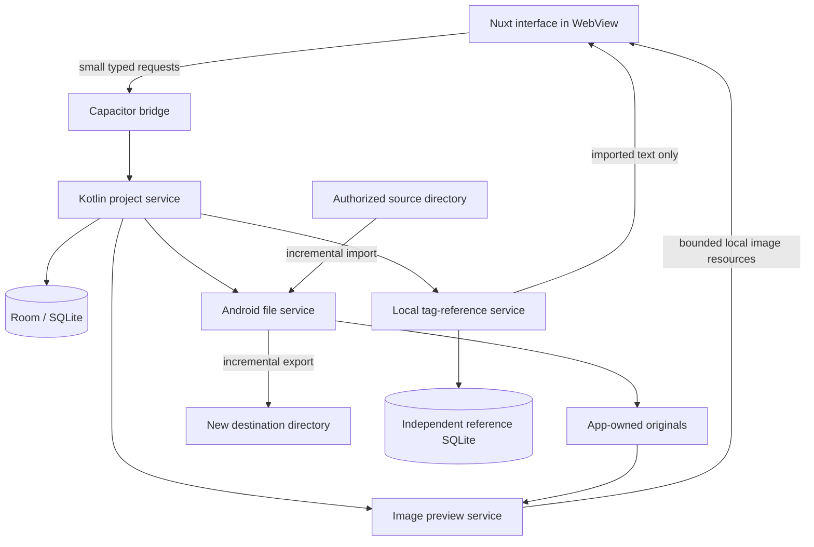

# Android Dataset Caption Editor

* **Author:** cpuopt
* **Status:** Draft — Overview and Goals approved; Technical Plan in progress
* **Date:** 2026-11-11
* **Predecessor:** [Reviewed concepts brief](concepts_brief.md)
* **Supporting review:** [Seven-lens findings](docs/reviews/dataset-mobile/goldfish_review_report.md)

## Overview

Build an Android app for preparing image training datasets on a phone. Users import an existing local folder, inspect images and captions, correct tags and natural-language descriptions, organize training subsets, and export the resulting dataset into a new directory.

The working dataset is independent of its source after successful import. Edits are saved inside the app, so ordinary editing does not require continued access to the source folder. The initial release targets datasets of 100–1,000 images averaging about 5 MB per image, approximately 0.5–5 GB of image data. These figures describe the intended workload; they do not establish tested capacity or an agreed rejection limit.

The author requested refinement of the proposed Nuxt + Capacitor + Kotlin + Room/SQLite stack. This establishes the drafting direction: a WebView interface with Android-native file and persistence operations. Exact component responsibilities, database schema, library versions, device requirements and recovery mechanisms belong to the Technical Plan and are not settled by this section.

## The Problem

An automatically captioned training dataset still needs human inspection. Users must see each image while correcting its tags and prose. Editing raw TXT files alone makes it difficult to check the image, understand unfamiliar tags, preserve the tag/prose boundary, and track progress across hundreds of images.

Dataset organization is also part of training preparation. Images from different periods of an artist's work may need separate training subsets, to which the trainer can assign different repeat values. Users need to build folders manually and move matching image/caption pairs through rules without losing their individual edits.

A phone adds constraints: limited working memory, a small screen and keyboard, directory access granted through Android, and operations that can be interrupted. A dataset can be several gigabytes even though its caption text is small. The app must not equate a selected folder with a verified independent import, or a changed text field with a successfully saved edit.

The design must address two implementation-readiness blockers identified during concept review: a verifiable import-completion promise and an honest saved-state acknowledgement. It must also keep uncertain parsing from causing incorrect no-prose classification and keep partial exports from appearing complete.

## Goals

1. **Import nested local datasets into independent projects.** Use a user-authorized local directory as input and preserve the initial folder hierarchy. A successfully imported project remains usable after the source directory is removed or its access grant revoked. Define verification and treatment of failed or excluded files in the Technical Plan before claiming completion.

2. **Support overview navigation and per-image editing.** Show images with their corresponding captions. Expose individual tags for manual viewing, addition, removal and correction, with natural language edited separately. Retain image context and understandable navigation while the phone keyboard is open. Exact layout and progress-state controls remain design choices.

3. **Show imported Chinese tag references.** Tags and VLM descriptions retain English source text. Show Chinese tag translations and introductions only where the imported reference provides them. Uncovered tags and VLM prose remain English. The author explicitly deferred machine translation and model downloads for the first release. Reference display must not change source text, rule results or exported TXT.

4. **Format captions without silently changing their meaning.** Support one combined line, separate tag/prose lines, and natural language with one sentence per line. Preserve user corrections to the tag/prose boundary. Do not infer that a caption lacks prose merely because parsing is uncertain.

5. **Persist edits within the app.** Save caption and logical-folder changes in the internal project database. Distinguish unsaved work, acknowledged saves and failures. Define acknowledgement, interruption recovery and navigation behavior in the Technical Plan; the design must not promise that every keystroke survives sudden power loss without a defined commit point.

6. **Organize training subsets manually.** Allow creation of subdirectories and movement of images into and out of them. A corresponding image and TXT move as one logical item. Export uses the edited hierarchy; repeat values remain the trainer's responsibility.

7. **Run combined-condition classification only on explicit request.** Support tag-based and caption-content conditions. Required examples are `newest` tag membership leading to `newest/`, and confirmed absent natural-language description leading to `no-vlm/`. Editing tags must not start classification automatically.

8. **Preview and manually resolve classification conflicts.** Before a run commits moves, expose conflicting rule destinations and allow the user to handle them on the preview page. No implicit rule priority or last-match destination is permitted. Group resolution, skip behavior and unresolved-item policy require a later decision.

9. **Export a new dataset directory.** Write image/TXT pairs using the project's current logical folder structure. Exported captions use the selected format and contain no preview translations. The design must define collisions, consistent export content and failure/cancellation outcomes before treating an export as complete.

10. **Keep dataset processing local at the intended scale.** The design must account for native file access, private storage, decoded-image memory and destination space. Later validation must exercise representative datasets up to the expected 1,000-image/5-GB workload on explicitly chosen Android devices. No performance, format or device guarantees are implied before those tests.

## Non-Goals

* Supporting iOS in the first release.
* Requiring source access for ordinary editing after verified import.
* Updating the original source directory as the save mechanism.
* Uploading dataset content for processing, or silently falling back to an online service.
* Exporting translation previews as training-caption content.
* Continuously enforcing classification rules while captions are edited.
* Resolving conflicting rule destinations silently through priority or execution order.
* Configuring training repeat values or executing model training inside the app.
* Machine translation and translation-model downloads in the first release. Imported Chinese tag text remains in scope; VLM machine translation is deferred.

Video editing, automatic image tagging/caption generation, image retouching, cloud synchronization, ZIP output, restorable project backups, broad batch caption tools and global tag analytics are not included in this draft's baseline. They are deferred scope questions rather than permanently rejected features. Undo remains an open scope decision. Conflict multi-selection was subsequently approved in D7. The author subsequently added Danbooru tag-reference import to baseline scope, primarily for Chinese translations and tag introductions; this supersedes the earlier deferral of vocabulary imports only to that extent, not as approval of autocomplete or all vocabulary features.

## Open Questions

These questions are retained for the relevant drafting stages; they are not a request for the author to answer all of them at once.

* What constitutes verified complete import, and what happens to unreadable files, changed inputs and interrupted copies?
* Which edit revision may display saved, and what are the interruption, retry and undo guarantees?
* How should unknown or manually corrected tag/prose boundaries participate in rule evaluation and export?
* What are the condition-builder semantics, manual conflict controls and preview invalidation behavior?
* What source/format supplies imported tag translations and introductions? Machine translation is deferred, not a pending first-release dependency.
* What file formats, pairing rules, case comparisons and destination collision policies are supported?
* How are cancelled/failed exports identified and retried without mixing project revisions?
* What minimum Android/device envelope, project lifecycle and schema-upgrade policies will be supported?

## Critical User Journeys

These journeys translate the approved goals into proposed acceptance behavior. They belong to the Technical Plan review and have not yet been separately approved.

### CUJ 1: Import and continue without the source

* **Given:** A local folder contains nested image/TXT pairs and the user grants read access.
* **When:** The user imports it, waits for verified completion, and later removes the source.
* **Then:** The app can reopen the project, display its original images, edit captions and export. Any unreadable or incomplete input was disclosed before completion; an interrupted job was never presented as complete.

### CUJ 2: Edit an image and reopen the project

* **Given:** An imported project has a selected image with tags and prose.
* **When:** The user changes the caption, receives a saved acknowledgement and reopens the app.
* **Then:** The acknowledged caption and logical location are present. A translation preview has not changed them. A save failure remains distinguishable from success; the unacknowledged input recovery policy depends on decision D1 below.

### CUJ 3: Review overlapping classification rules

* **Given:** An image contains `newest` and has confirmed absent prose, matching rules for different folders.
* **When:** The user explicitly prepares a classification run.
* **Then:** Preview shows both reasons and targets. The run does not silently choose one. A manually resolved move executes only against the reviewed project state; relevant intervening changes require renewed validation.

### CUJ 4: Export the edited subsets

* **Given:** The project has edited captions and logical subset folders.
* **When:** The user selects a new destination and starts export.
* **Then:** A successful export contains the expected image/TXT pairs at the selected layout and paths. Failure or cancellation leaves the internal project intact and is not reported as complete delivery.

## Technical Plan (Architecture)

### 1. Drafting authority and current scope

The user approved Overview and Goals and requested the proposed technology stack: Nuxt, Capacitor, Kotlin and Room/SQLite. The boundaries and operation contracts below are design proposals for this section. They are not validated production behavior. No application implementation or Android build is authorized by this draft.

Open decisions are deliberately not replaced with assistant-selected defaults. D1–D8 are selected below. The author explicitly confirmed a subsequent scope change: first-release Chinese viewing uses imported tag references only; machine translation and model downloads are deferred, superseding D9/D10. Upstream reference format and remaining operation contracts are still open. Exact dependency versions and minimum Android version will be resolved before the per-file implementation plan.

### 2. Components and ownership

| Component | Proposed responsibility | Boundary |
| --- | --- | --- |
| Nuxt/Vue interface | Overview, active-image editing, tags/prose fields, rule construction, conflict preview, user-visible operation states | Holds visible-page data and transient edits; does not own the only saved project copy |
| Capacitor bridge | Typed requests, responses and progress between the WebView and Kotlin | Carries identifiers, bounded metadata and caption text; does not shuttle the dataset as Base64 or giant byte arrays |
| Kotlin project service | Coordinates imports, caption updates, logical folder operations, classification and exports | Validates project identity/revisions and separates authoritative writes from derived previews |
| Room/SQLite persistence | Project records, caption content, logical folder tree, rules and durable operation state | Owns the acknowledged structured state; database transaction success is required before a saved response |
| Android file service | Source/destination directory access, owned image storage, incremental copying and image resources | Owns streams and file permissions; source grants are needed during import, not for normal use afterward |
| Image preview service | Bounded thumbnails and active-image decoding | Returns constrained local resources; evicted thumbnails can be regenerated without losing originals |
| Tag-reference service | Lookup imported translations and introductions | Cannot mutate source captions; reference source/format remains unresolved; no machine-translation engine |

No Node/Express server is required on the phone. Nuxt supplies built UI assets; Kotlin accesses Android facilities. The trainer and its existing UI remain separate from this app. The existing `dataset-mobile` starter must be reconciled later; its current ZIP/buffer behavior is not the selected architecture.

### 3. Proposed project records

This is a conceptual model, not a final Room schema or table list.

| Record | Information and invariant |
| --- | --- |
| Project | Stable ID, lifecycle state, data-format version, content revision and timestamps |
| Asset | Stable ID, project ID, imported filename, owned-content locator, byte size and verification state; identity does not change when a logical folder changes |
| Caption | Asset ID, original text, ordered source tags, source prose, parse/review state and caption revision; manually corrected boundaries survive formatting changes |
| Logical folder | Stable ID, project ID, parent ID and name; moves cannot create a cycle |
| Placement | Asset ID, folder ID and output stem; one image/TXT pair has one current output placement |
| Rule | Rule ID, condition structure, target folder and revision; conditions do not execute themselves |
| Classification plan | Project/rule versions, evaluated scope, matched reasons, proposed moves, conflicts and manual decisions |
| Job and item progress | Operation ID, import/export state, item completion, errors and recovery references |

Missing TXT, empty TXT, uncertain parsing and confirmed empty prose must be distinguishable. Formatting is a projection of source tags/prose, not an instruction to repeatedly reparse stored text. Translation results are derived data associated with their source revision, never an alternative source caption.

Original image bytes are owned by the project after import. The author selected private image files referenced by database records. Original images are not stored as database BLOBs. Stable asset identity is independent of the source path, private filename and editable export placement.

#### D2: Original-image storage — Option A selected by author

Both options retain independent original bytes inside the app and store edits in Room/SQLite. Neither uses original source files as ongoing dependencies.

| Option | Mechanism | Trade-off | Failure boundary |
| --- | --- | --- | --- |
| A — Private image files plus database records | Native code stores original bytes in app-private files; database records reference them using stable asset IDs | Images can be streamed individually; file copies and database changes require coordinated recovery | A copy interrupted between file completion and record commit can leave orphaned or incomplete assets unless import reconciles them |
| B — Original-image BLOBs in SQLite | Store original bytes and structured project data in the database, with asset content separated from caption queries | Asset metadata/content can share database transactions; the database grows with gigabytes of images and needs careful read/write and maintenance behavior | Materializing BLOBs or using long transactions can raise memory/space pressure; corruption or recovery of the image-bearing database has a larger scope |

The author selected A. Native file operations store original bytes in app-private files; Room records hold stable asset references, caption content and logical folder placement. Creating or moving a logical folder does not recopy image bytes. Thumbnails are derived cache files and cannot substitute for owned originals.

File copies and database commits are not one atomic transaction. Import needs persistent per-item state and reconciliation so interruption cannot leave a completed record pointing to an incomplete file. Exact verification and recovery policies remain open. The physical directory layout and cache limits will be specified during implementation planning.

### 4. Import flow and completion boundary

Proposed flow: authorize directory → enumerate subtree incrementally → build input inventory → copy/verify items into owned storage → reconcile file/record completion → publish completed project. Persist job progress outside page state so leaving the page does not itself erase the operation.

Keep relative source paths for initial placement and pair captions within their parent directory. Flag ambiguous stems such as `001.jpg` and `001.png` sharing one `001.txt`. Do not invent image bytes, discard failed items silently or treat metadata enumeration as file verification.

Candidate lifecycle states are discovering, importing, needs-attention, complete and cancelled. A failed/paused job may be recoverable, but the exact resume and source-change policy is not selected. Import completion must account for every accepted item and cannot rely on a copied-file count alone. Verification strength and unsupported/orphan-file policy are later author decisions.

Space estimates distinguish the source, new owned copy, caches and eventual export. The app must not require source deletion to make an unverified import appear successful. Permission loss before completion is an import problem; after completion it must not prevent ordinary editing.

#### D3: Failed input items at import completion — Option B selected by author

These options apply to actual copy/read/verification failures. A missing TXT may instead be a valid image requiring new annotation; missing-caption, unsupported-file and ambiguous-pairing policies are separate decisions. Neither option authorizes silently losing files.

| Option | Mechanism | Trade-off | Failure boundary |
| --- | --- | --- | --- |
| A — Require all accepted items | Keep the project in needs-attention until every accepted item succeeds, or the import is cancelled | A completed project preserves the full accepted input set; one persistent bad file can prevent completion | Unreadable or changed source items must be repaired/retried before the project can be marked complete |
| B — Permit explicit exclusions | Present failed items and reasons; the user may retry or explicitly exclude selected failed items and complete the remaining verified dataset | Usable files can become an independent project without fixing every bad input; the project may contain fewer items than the original input | An excluded item is unavailable in the completed project and export; the exclusion list and final counts must stay visible and recorded |

Both options preserve completed copy progress and leave the source unchanged. Neither permits skipping an unreadable subtree whose unknown contents were never inventoried without separately disclosing that scope. Verification strength is still to be selected and is not weakened by excluding an item.

The author selected B. Present each failed item with its relative source path and failure reason, allowing retry or explicit exclusion. Record exclusions and final imported/excluded counts in the project. Mark the remaining dataset complete only after every retained accepted item passes verification; excluded originals are not available for editing or export. This choice does not authorize silently excluding unknown contents of an unreadable subtree or automatically treating missing TXT as a copy failure.

#### D4: Copy integrity verification — Option B selected by author

Verify in native code with bounded buffers, never by loading every image into the WebView. These choices concern copied-byte integrity, not caption interpretation or full image-decoding validation.

| Option | Mechanism | Trade-off | Failure boundary |
| --- | --- | --- | --- |
| A — Completion and byte-count checks | Check stream completion, copied-byte count, available source size metadata and final private-file size | Avoids an extra full read of each private image; performs less integrity checking | Cannot detect same-length corruption or replacement; missing or unreliable source metadata limits completeness evidence |
| B — Source-stream digest and destination read-back | Calculate a cryptographic digest while copying, reopen the private file, hash it and compare digest and byte count | Adds a full destination read and hashing work, increasing import time and energy use | Proves agreement with the source stream that was read, not that the source was healthy or unchanged before reading; does not guarantee future storage health |

Neither option permits an incomplete/unreadable destination to be published as verified. Interrupted verification leaves the item pending and subject to D3. Source mutation, unreliable enumeration and decode failures still need explicit treatment; a matching digest alone does not establish inventory completeness or a valid image.

The author selected B. Calculate the source-stream digest and byte count during native copying. Close and reopen the private destination, calculate its digest and byte count using bounded buffers, and compare both. Only a successful comparison permits the item to enter verified state. Persist that result with the asset record before counting it toward completed import. Digest mismatch or read-back failure is an item failure handled through D3, not an automatic exclusion. Persisted digests support recovery checks but do not imply continuous background verification. The exact digest algorithm and interrupted-item restart procedure will be specified in implementation planning.

### 5. Caption mutation and saved acknowledgement

Proposed request shape: project ID, asset ID, expected caption revision, client edit ID and source field changes. A response includes the committed caption revision and matching edit ID. This is an illustrative interface contract, not executable code or a final API.

The UI updates its visible draft immediately. Native persistence checks the expected revision and commits the change transactionally. The UI displays saved only when the acknowledgement covers its current draft; an older response cannot mark newer input saved. A failure leaves the draft visible with retry/recovery information. Export and classification must settle pending edits or explicitly stop; they cannot silently read older content.

Do not block the Android/UI thread waiting for database work. Serialize or otherwise order mutations affecting the same caption. Input-method composition is not a completed text edit until composition finishes; exact event handling belongs in the implementation plan.

#### D1: Save scheduling — Option B selected by author

Both options use the same revision-aware acknowledgements. Neither can claim that input not yet committed survives arbitrary process death or power loss.

| Option | Mechanism | Trade-off | Failure boundary |
| --- | --- | --- | --- |
| A — Submit each completed edit immediately | Send each tag action and completed text input change to the native write queue without an idle timer | More bridge/database traffic during continuous typing; smaller avoidable waiting period before a commit | A process ending before acknowledgement can still lose queued input; slow storage can accumulate pending work |
| B — Coalesce continuous text input | Save tag actions immediately; combine text changes after a short idle interval, and flush before navigation, classification or export | Fewer writes and bridge calls; recently typed text remains pending longer | Abrupt process termination may lose the idle window plus unfinished writes; lifecycle callbacks alone cannot guarantee a last flush |

The author selected B: coalesce continuous text input. Tag actions submit immediately; completed text edits become pending and are submitted after an idle interval. Navigation to another image, classification and export request a flush and wait for acknowledgement of the latest draft. A failed flush must retain the draft and prevent that action from silently proceeding against older data. Non-destructive inspection that does not leave the editor need not wait for persistence.

The exact idle interval and bounded queue/coalescing policy remain implementation-plan details to define and validate. The app cannot promise a final flush on abrupt process termination. An older acknowledgement must never mark newer text saved. A separate durable draft journal is not implicitly included. Undo/history scope is independent of this selected scheduling policy.

### 6. Manual moves and classification plans

Manual folder changes update logical placement and move the image/caption pair as one item. They must preserve asset identity and caption state. Reject invalid parent/child relationships and expose destination name collisions before committing.

A classification run evaluates a settled project version and a chosen rule scope, generating a stored or reconstructible plan for preview. Preview explains matches and conflicting targets. Tag edits do not run rules. A final apply request validates that the relevant state still matches the preview; it must not silently recompute a different image set and move that instead.

`newest` membership and absent-prose checks use source fields rather than translated text. Unknown parsing cannot become proven absent prose by default. D7 selects individual and multi-selection conflict handling. Full condition grammar, normalization, same-target overlaps and skip/block behavior remain open decisions. No priority ordering or duplication policy is introduced here.

#### D7: Manual rule-conflict resolution — Option B selected by author

Both options show the image, current location, matched rules and competing destinations before any move. Each image has one final destination for this run; neither option introduces automatic priority, multiple subset membership or file duplication.

| Option | Mechanism | Trade-off | Failure boundary |
| --- | --- | --- | --- |
| A — Resolve each conflicting image individually | Open each conflict and explicitly select its destination | Every image receives an individual decision; large overlapping groups require repetitive phone interaction | A large unresolved set can make review slow; it must not be silently defaulted just to finish the run |
| B — Individual decisions plus explicit multi-selection | Retain individual handling, and let the user select several conflicts and assign one common destination to that selection | Reduces repetitive decisions; needs visible selected scope and affected-image counts | An overbroad selection can assign unintended images; group resolution must remain reviewable and must still validate destination collisions |

The author selected B. Preview retains per-image destination selection and additionally supports explicit selection of multiple conflicting images followed by one shared destination assignment. Display the selected images/count and destination before applying that resolution. Keep each affected image's resolution visible and individually changeable before the classification run commits moves. Multi-selection changes the move plan, not the saved rules or current folder placement.

Validate the chosen destination and resulting image/TXT names for every selected item. A bulk choice does not override filename collisions or make an invalid move executable. The project/rule version checks still apply after manual resolution. Grouping by matched rules may help navigation but does not itself select or resolve anything; exact controls remain UI design details. Skip behavior and whether unresolved items block the whole run are separate decisions. This approval applies to classification conflict resolution, not broad batch caption editing.

### 7. New-directory export

Proposed flow: settle pending edits → select a consistent project view → validate output names and pairing → authorize a new destination → stream originals and generated TXT files → verify the selected completion criteria → report delivery. The destination must not become the authority for subsequent editing.

Logical folders determine output paths. Formatting uses stored source tags/prose and selected layout; translations cannot enter TXT. No full-dataset ZIP intermediate or JavaScript-held export blob is required by this directory workflow.

Keep the internal project intact on failure. Track which output entries belong to this operation and avoid deleting unrelated destination files. Do not assume an Android document provider can atomically rename an entire directory. The author selected read-only export in D5 below; failure recovery is decision D6.

#### D5: Editing while exporting — Option A selected by author

Both options settle pending saves before starting and bind the operation to a known project revision. Neither permits different images' captions or paths to be read from arbitrary live revisions during a single export.

| Option | Mechanism | Trade-off | Failure boundary |
| --- | --- | --- | --- |
| A — Read-only project during export | After pending saves commit, block caption, asset and folder mutations for that project until the export completes, fails or is cancelled | A single project view is easier to preserve; the user cannot continue editing that project during a potentially long export | A stalled export blocks editing until cancelled or recovered; a process restart must reconcile the job rather than leave a permanent lock |
| B — Export a fixed snapshot and keep editing | Persist a short-transaction snapshot of captions, paths, formatting settings and asset references, then stream that frozen view while later edits proceed | Editing remains available; later changes are intentionally absent from this export and the UI must explain that boundary | Referenced originals must remain available until the job releases them; deletion/lifecycle handling and snapshot cleanup become more complex |

The author selected A. Settle and acknowledge pending saves before establishing a project-scoped read-only export session. While the job is actively exporting, native validation rejects caption edits, image additions/removals, folder changes, classification commits, project deletion and changes to active export settings. The UI explains the read-only state and allows inspection, progress viewing and cancellation. Enforce the restriction natively, not just by disabling controls.

Do not hold a database transaction open for the full multi-gigabyte copy. Associate the read-only session with its durable job and validated project revision. Restore edit access after confirmed success, failure or cancellation, once active writers for that job have stopped. On restart, reconcile interrupted jobs before permitting resume or releasing a stale session; never leave a permanent UI lock based only on a vanished page or process. This does not add an all-project global lock.

#### D6: Interrupted or failed directory export — Option B selected by author

Both options preserve the internal project, identify partial output as incomplete and never report success merely because some files exist. Once an interrupted job is stopped/reconciled, editing may resume under D5. Neither option may silently overwrite or remove unrelated destination files.

| Option | Mechanism | Trade-off | Failure boundary |
| --- | --- | --- | --- |
| A — Restart in a fresh output directory | Retain the failed-job report; a retry creates a clean new output directory and exports the current project from the beginning | Less resume-state logic, and no mixing of old/new revisions; completed large files are copied again | Retained partial output consumes space until deliberately cleaned; repeated interruptions waste time and I/O |
| B — Resume after validating the previous run | Persist per-item progress and expected output metadata; reauthorize/recheck the destination and continue only when project revision, settings and existing output still match | Can avoid recopying verified completed items; requires validation and recovery bookkeeping | If project content/settings changed, output was altered, or destination access cannot be restored, that run cannot resume and must restart separately |

The author selected B. Persist the job's project revision, export settings, destination references and per-item progress. Before resuming, restore access and compare the current project/settings with the recorded run, then validate the already-written output. Do not trust a completed-item flag or file existence without the corresponding validation. Revalidate or rewrite interrupted individual files.

A valid continuation reestablishes the project read-only session under D5. If the project/settings changed, output was altered or access cannot be restored, do not mix revisions or silently fall back to a fresh export: explain why continuation is unavailable and offer a separate restart in a new directory. Preserve the internal project and identify the previous partial result. No fixed-snapshot editing model is implied. Exact output-validation criteria, partial-output cleanup and naming collision handling remain later design details.

### 8. Imported Chinese tag reference display

Keep English source tags/prose visibly distinct from imported reference text. Lookup results identify the selected tag and reference version; late results cannot replace details for a different tag. Lookup failure does not clear source text, count as absent prose, block saving or enter export text. No machine-translation or online fallback is included.

The author confirmed the revised first-release scope: display dictionary-provided Chinese tag translations/introductions, keep uncovered tags in English, and defer VLM machine translation. If an introduction is available only in English, display its supplied language rather than generating Chinese. English VLM editing and formatting remain in scope. Prototype machine-translation dependencies do not authorize shipping those features.

#### Imported Danbooru tag references — confirmed scope addition

The app must accept an imported Danbooru-related tag database, primarily for tag translations and introductions. Treat the imported reference as viewing data distinct from project captions. Tag inspection should be able to show the English source tag, its available Chinese translation, and its available introduction. Missing dictionary entries or descriptions must be distinguishable from an empty source caption.

The author has not selected a source but confirmed SQLite as the representation after import. This does not require the upstream artifact itself to be SQLite, and does not authorize accepting arbitrary SQLite schemas unchanged. A future source adapter must map a documented input format into the app's supported reference schema. SQLite storage does not establish that Chinese descriptions or complete translations exist in the input.

The exact upstream source and file format are not yet supplied. Do not assume a tag autocomplete CSV contains wiki introductions, that every tag has Chinese text, or that a single upstream database supplies both. Danbooru documents tags and wiki pages as distinct API resources ([tags](https://safebooru.donmai.us/wiki_pages/api%3Atags), [wiki pages](https://safebooru.donmai.us/wiki_pages/api%3Awiki_pages)); this is source context, not authorization to fetch data or select a community translation dataset. Reference format/schema, availability of Chinese introductions, source/version metadata and update semantics must be inspected before an import contract is finalized.

Proposed service boundary: import/index reference records natively, and return only the requested tag details or bounded query results to the WebView. Keep reference-version identity separate from project revisions; loading a reference must not rewrite source tags, trigger subset moves or alter exported TXT. Lookup normalization, if later approved for `long hair` versus `long_hair`, applies to lookup keys rather than modifying stored caption text. Alias-driven tag rewriting is not approved.

Where the reference lacks Chinese text, retain the English tag and indicate missing reference content. Do not generate translations for tags, introductions or VLM prose. Reference import does not authorize image downloads, embedded external content, online translation fallback, autocomplete, or reference copies per project.

#### D8: SQLite reference placement — Option A selected by author

Both choices query imported reference data natively and return bounded results to the WebView. Both keep reference text out of exported training captions and retain provenance/version information separately from project edit revisions.

| Option | Mechanism | Trade-off | Failure boundary |
| --- | --- | --- | --- |
| A — Dedicated reference SQLite file | Keep the imported tag reference in a separate app-level SQLite database, independent of the project database | Reference maintenance is separate; requires coordinating availability/version changes across two database connections | Interrupted replacement can leave lookups unavailable without staging and safe activation |
| B — Reference tables in the app database | Import tag reference records into dedicated tables in the same Room/SQLite database that holds project metadata | Queries and transactions share a database; large reference updates share resources and migrations with projects | Long or failed imports can interfere with editing without bounded transactions and isolation |

The author selected A. Keep a dedicated app-level reference SQLite file independent of the Room/SQLite project database, shared by project lookups rather than copied into each dataset. Loading, replacing or removing reference data must not mutate source captions, project placement, review state or classification decisions.

A failed import/replacement must not expose a partially indexed reference as ready or replace a valid active database with an incomplete file. Existing valid reference data remains available on replacement failure; if no reference has ever been installed, show reference-unavailable explicitly while preserving ordinary editing. Invalidate reference-derived previews when the active reference version changes. Exact schema, replacement activation and native database access mechanism remain to be specified; do not assume atomic transactions across the independent databases.

#### D9: Translation model provisioning — superseded; first release deferred

**Historical decision only:** the author subsequently confirmed deferring machine translation, retaining imported Chinese tag references, and excluding translation engines/model downloads from the first release. The earlier permission below is not an active requirement or authorization to download anything.

The author accepts an initial network download of translation models, followed by on-device translation without uploading images or captions. Downloading a model is not permission to send dataset content to an online translator. Normal editing and imported-reference lookups remain available if model download fails; machine-translation preview must display its unavailable state rather than empty or fabricated output.

Expose model readiness and setup/download failure separately from translation failure. Offline inference requires that the needed model remains installed; deletion or app-data removal may require another setup download. Exact size, update policy and download network controls depend on the selected engine and are not specified by the user's acceptance.

#### D10: On-device translation engine — deferred, no active choice

The candidates below are retained as historical exploration only. No engine is selected or required in the first release. Reintroducing machine translation requires a later scope decision.

Both options operate locally after setup and provide previews only. No engine has been quality- or performance-tested against this app's tags and VLM prose. Imported reference text remains a separate source with its own provenance, not model-generated ground truth.

| Option | Mechanism | Trade-off | Failure boundary |
| --- | --- | --- | --- |
| A — Google ML Kit Translation | Kotlin uses its on-device translation API and managed language-model download facilities | Provides a defined translation interface and model management; model choice and terminology behavior are constrained by the SDK | Model download may be unavailable on the intended network/device; specialist tags and prose need quality checks and may be mistranslated |
| B — App-managed model through ONNX Runtime | Select a compatible English-to-Chinese model and tokenizer, manage their downloads and run native inference | Control over selected model/version and delivery; app owns tokenization, decoding, integrity, licensing and resource testing | No compatible model has been chosen; incompatible operators or model memory/latency can make it unusable on target phones |

Official evidence: [ML Kit Android translation](https://developers.google.com/ml-kit/language/translation/android) documents dynamic model downloads, readiness checks, explicit model management and resource release. [ML Kit translation overview](https://developers.google.com/ml-kit/language/translation) states inference runs on-device without sending user text to a remote server and calls for use-case-specific quality evaluation. [ONNX Runtime mobile guidance](https://onnxruntime.ai/docs/tutorials/mobile/) requires an appropriate compatible model that fits device storage/memory and recommends measuring latency and energy. These establish capabilities, not evidence that either candidate meets this app's quality or device targets. No option is selected.

### 9. Boundary changes and later implementation scope

The planned app adds a native project API for project discovery/opening, paged asset metadata, caption reads/mutations, folder changes, classification planning/apply and import/export jobs. Job responses should use bounded progress events and allow querying durable status after reopening the interface. Exact method signatures and event schemas will be finalized after the unresolved contracts are selected.

Later file-level planning will cover Nuxt views/state/API types, Kotlin bridge/project services, Room entities/queries/migrations, native file/image operations, lifecycle handling, build configuration, tests and documentation. This section does not yet authorize a file manifest or changes to the trainer. Selection of native background scheduling and supported device budgets requires Android-specific evidence before implementation claims.

## Drafting Progress

Overview and Goals were approved, then amended by explicit scope decisions. D1 B, D2 A, D3 B, D4 B, D5 A, D6 B, D7 B and D8 A remain selected. The user explicitly deferred machine translation and model downloads, superseding D9/D10; first-release Chinese display uses imported tag references, while uncovered tags and VLM prose remain English. Reference source remains unselected. Remaining operation contracts and Technical Plan approval are pending, followed by Alternatives Considered and detailed implementation/verification planning. Production implementation remains paused.

*Drafted with EGM*
