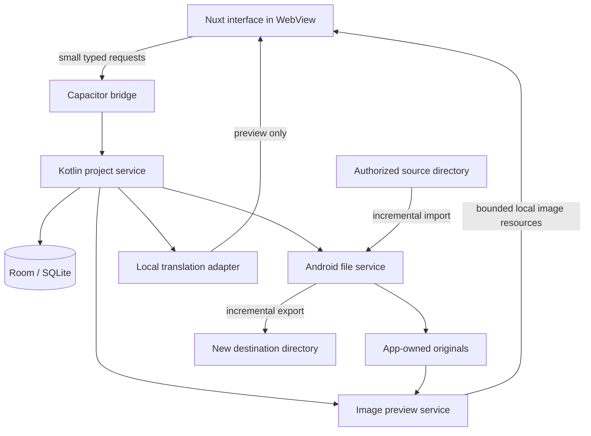

# Android Dataset Caption Editor

* **Author:** cpuopt
* **Status:** Draft — Overview and Goals approved; Technical Plan in progress
* **Date:** 2026-11-11
* **Predecessor:** [Reviewed concepts brief](concepts_brief.md)
* **Supporting review:** [Seven-lens findings](docs/reviews/dataset-mobile/goldfish_review_report.md)

## Overview

Build an Android app for preparing image training datasets on a phone. Users import an existing local folder, inspect images and captions, correct tags and natural-language descriptions, organize training subsets, and export the resulting dataset into a new directory.

The working dataset is independent of its source after successful import. Edits are saved inside the app, so ordinary editing does not require continued access to the source folder. The initial release targets datasets of 100–1,000 images averaging about 5 MB per image, approximately 0.5–5 GB of image data. These figures describe the intended workload; they do not establish tested capacity or an agreed rejection limit.

The author requested refinement of the proposed Nuxt + Capacitor + Kotlin + Room/SQLite stack. This establishes the drafting direction: a WebView interface with Android-native file and persistence operations. Exact component responsibilities, database schema, library versions, device requirements and recovery mechanisms belong to the Technical Plan and are not settled by this section.

## The Problem

An automatically captioned training dataset still needs human inspection. Users must see each image while correcting its tags and prose. Editing raw TXT files alone makes it difficult to check the image, understand unfamiliar tags, preserve the tag/prose boundary, and track progress across hundreds of images.

Dataset organization is also part of training preparation. Images from different periods of an artist's work may need separate training subsets, to which the trainer can assign different repeat values. Users need to build folders manually and move matching image/caption pairs through rules without losing their individual edits.

A phone adds constraints: limited working memory, a small screen and keyboard, directory access granted through Android, and operations that can be interrupted. A dataset can be several gigabytes even though its caption text is small. The app must not equate a selected folder with a verified independent import, or a changed text field with a successfully saved edit.

The design must address two implementation-readiness blockers identified during concept review: a verifiable import-completion promise and an honest saved-state acknowledgement. It must also keep uncertain parsing from causing incorrect no-prose classification and keep partial exports from appearing complete.

## Goals

1. **Import nested local datasets into independent projects.** Use a user-authorized local directory as input and preserve the initial folder hierarchy. A successfully imported project remains usable after the source directory is removed or its access grant revoked. Define verification and treatment of failed or excluded files in the Technical Plan before claiming completion.

2. **Support overview navigation and per-image editing.** Show images with their corresponding captions. Expose individual tags for manual viewing, addition, removal and correction, with natural language edited separately. Retain image context and understandable navigation while the phone keyboard is open. Exact layout and progress-state controls remain design choices.

3. **Provide preview-only translation.** Let users inspect tag and prose translations while keeping source caption text authoritative. Translation failure must not alter source text, classification results or exported TXT. Provider, languages and model download requirements remain unresolved.

4. **Format captions without silently changing their meaning.** Support one combined line, separate tag/prose lines, and natural language with one sentence per line. Preserve user corrections to the tag/prose boundary. Do not infer that a caption lacks prose merely because parsing is uncertain.

5. **Persist edits within the app.** Save caption and logical-folder changes in the internal project database. Distinguish unsaved work, acknowledged saves and failures. Define acknowledgement, interruption recovery and navigation behavior in the Technical Plan; the design must not promise that every keystroke survives sudden power loss without a defined commit point.

6. **Organize training subsets manually.** Allow creation of subdirectories and movement of images into and out of them. A corresponding image and TXT move as one logical item. Export uses the edited hierarchy; repeat values remain the trainer's responsibility.

7. **Run combined-condition classification only on explicit request.** Support tag-based and caption-content conditions. Required examples are `newest` tag membership leading to `newest/`, and confirmed absent natural-language description leading to `no-vlm/`. Editing tags must not start classification automatically.

8. **Preview and manually resolve classification conflicts.** Before a run commits moves, expose conflicting rule destinations and allow the user to handle them on the preview page. No implicit rule priority or last-match destination is permitted. Group resolution, skip behavior and unresolved-item policy require a later decision.

9. **Export a new dataset directory.** Write image/TXT pairs using the project's current logical folder structure. Exported captions use the selected format and contain no preview translations. The design must define collisions, consistent export content and failure/cancellation outcomes before treating an export as complete.

10. **Keep dataset processing local at the intended scale.** The design must account for native file access, private storage, decoded-image memory and destination space. Later validation must exercise representative datasets up to the expected 1,000-image/5-GB workload on explicitly chosen Android devices. No performance, format or device guarantees are implied before those tests.

## Non-Goals

* Supporting iOS in the first release.
* Requiring source access for ordinary editing after verified import.
* Updating the original source directory as the save mechanism.
* Uploading dataset content for processing, or silently falling back to an online service.
* Exporting translation previews as training-caption content.
* Continuously enforcing classification rules while captions are edited.
* Resolving conflicting rule destinations silently through priority or execution order.
* Configuring training repeat values or executing model training inside the app.

Video editing, automatic image tagging/caption generation, image retouching, cloud synchronization, ZIP output, restorable project backups, vocabulary imports, broad batch caption tools and global tag analytics are not included in this draft's baseline. They are deferred scope questions rather than permanently rejected features. Undo and conflict-group actions also require explicit scope decisions.

## Open Questions

These questions are retained for the relevant drafting stages; they are not a request for the author to answer all of them at once.

* What constitutes verified complete import, and what happens to unreadable files, changed inputs and interrupted copies?
* Which edit revision may display saved, and what are the interruption, retry and undo guarantees?
* How should unknown or manually corrected tag/prose boundaries participate in rule evaluation and export?
* What are the condition-builder semantics, manual conflict controls and preview invalidation behavior?
* Which translation languages, model/provider and download policy meet the local-processing requirement?
* What file formats, pairing rules, case comparisons and destination collision policies are supported?
* How are cancelled/failed exports identified and retried without mixing project revisions?
* What minimum Android/device envelope, project lifecycle and schema-upgrade policies will be supported?

## Critical User Journeys

These journeys translate the approved goals into proposed acceptance behavior. They belong to the Technical Plan review and have not yet been separately approved.

### CUJ 1: Import and continue without the source

* **Given:** A local folder contains nested image/TXT pairs and the user grants read access.
* **When:** The user imports it, waits for verified completion, and later removes the source.
* **Then:** The app can reopen the project, display its original images, edit captions and export. Any unreadable or incomplete input was disclosed before completion; an interrupted job was never presented as complete.

### CUJ 2: Edit an image and reopen the project

* **Given:** An imported project has a selected image with tags and prose.
* **When:** The user changes the caption, receives a saved acknowledgement and reopens the app.
* **Then:** The acknowledged caption and logical location are present. A translation preview has not changed them. A save failure remains distinguishable from success; the unacknowledged input recovery policy depends on decision D1 below.

### CUJ 3: Review overlapping classification rules

* **Given:** An image contains `newest` and has confirmed absent prose, matching rules for different folders.
* **When:** The user explicitly prepares a classification run.
* **Then:** Preview shows both reasons and targets. The run does not silently choose one. A manually resolved move executes only against the reviewed project state; relevant intervening changes require renewed validation.

### CUJ 4: Export the edited subsets

* **Given:** The project has edited captions and logical subset folders.
* **When:** The user selects a new destination and starts export.
* **Then:** A successful export contains the expected image/TXT pairs at the selected layout and paths. Failure or cancellation leaves the internal project intact and is not reported as complete delivery.

## Technical Plan (Architecture)

### 1. Drafting authority and current scope

The user approved Overview and Goals and requested the proposed technology stack: Nuxt, Capacitor, Kotlin and Room/SQLite. The boundaries and operation contracts below are design proposals for this section. They are not validated production behavior. No application implementation or Android build is authorized by this draft.

Open decisions are deliberately not replaced with assistant-selected defaults. In particular, save scheduling, private image storage layout, import verification, translation provider and output failure handling still need author decisions or supporting evidence. Exact dependency versions and minimum Android version will be resolved before the per-file implementation plan.

### 2. Components and ownership

| Component | Proposed responsibility | Boundary |
| --- | --- | --- |
| Nuxt/Vue interface | Overview, active-image editing, tags/prose fields, rule construction, conflict preview, user-visible operation states | Holds visible-page data and transient edits; does not own the only saved project copy |
| Capacitor bridge | Typed requests, responses and progress between the WebView and Kotlin | Carries identifiers, bounded metadata and caption text; does not shuttle the dataset as Base64 or giant byte arrays |
| Kotlin project service | Coordinates imports, caption updates, logical folder operations, classification and exports | Validates project identity/revisions and separates authoritative writes from derived previews |
| Room/SQLite persistence | Project records, caption content, logical folder tree, rules and durable operation state | Owns the acknowledged structured state; database transaction success is required before a saved response |
| Android file service | Source/destination directory access, owned image storage, incremental copying and image resources | Owns streams and file permissions; source grants are needed during import, not for normal use afterward |
| Image preview service | Bounded thumbnails and active-image decoding | Returns constrained local resources; evicted thumbnails can be regenerated without losing originals |
| Translation adapter | On-device source-to-preview translation | Cannot mutate source captions; language/provider/model policy remains unresolved |

No Node/Express server is required on the phone. Nuxt supplies built UI assets; Kotlin accesses Android facilities. The trainer and its existing UI remain separate from this app. The existing `dataset-mobile` starter must be reconciled later; its current ZIP/buffer behavior is not the selected architecture.

### 3. Proposed project records

This is a conceptual model, not a final Room schema or table list.

| Record | Information and invariant |
| --- | --- |
| Project | Stable ID, lifecycle state, data-format version, content revision and timestamps |
| Asset | Stable ID, project ID, imported filename, owned-content locator, byte size and verification state; identity does not change when a logical folder changes |
| Caption | Asset ID, original text, ordered source tags, source prose, parse/review state and caption revision; manually corrected boundaries survive formatting changes |
| Logical folder | Stable ID, project ID, parent ID and name; moves cannot create a cycle |
| Placement | Asset ID, folder ID and output stem; one image/TXT pair has one current output placement |
| Rule | Rule ID, condition structure, target folder and revision; conditions do not execute themselves |
| Classification plan | Project/rule versions, evaluated scope, matched reasons, proposed moves, conflicts and manual decisions |
| Job and item progress | Operation ID, import/export state, item completion, errors and recovery references |

Missing TXT, empty TXT, uncertain parsing and confirmed empty prose must be distinguishable. Formatting is a projection of source tags/prose, not an instruction to repeatedly reparse stored text. Translation results are derived data associated with their source revision, never an alternative source caption.

Original image bytes are owned by the project after import. Whether those bytes live as private files referenced from the database or as database BLOBs remains an architecture choice; this model does not silently settle it. Stable identity and logical placement are needed under either storage mechanism.

### 4. Import flow and completion boundary

Proposed flow: authorize directory → enumerate subtree incrementally → build input inventory → copy/verify items into owned storage → reconcile file/record completion → publish completed project. Persist job progress outside page state so leaving the page does not itself erase the operation.

Keep relative source paths for initial placement and pair captions within their parent directory. Flag ambiguous stems such as `001.jpg` and `001.png` sharing one `001.txt`. Do not invent image bytes, discard failed items silently or treat metadata enumeration as file verification.

Candidate lifecycle states are discovering, importing, needs-attention, complete and cancelled. A failed/paused job may be recoverable, but the exact resume and source-change policy is not selected. Import completion must account for every accepted item and cannot rely on a copied-file count alone. Verification strength and unsupported/orphan-file policy are later author decisions.

Space estimates distinguish the source, new owned copy, caches and eventual export. The app must not require source deletion to make an unverified import appear successful. Permission loss before completion is an import problem; after completion it must not prevent ordinary editing.

### 5. Caption mutation and saved acknowledgement

Proposed request shape: project ID, asset ID, expected caption revision, client edit ID and source field changes. A response includes the committed caption revision and matching edit ID. This is an illustrative interface contract, not executable code or a final API.

The UI updates its visible draft immediately. Native persistence checks the expected revision and commits the change transactionally. The UI displays saved only when the acknowledgement covers its current draft; an older response cannot mark newer input saved. A failure leaves the draft visible with retry/recovery information. Export and classification must settle pending edits or explicitly stop; they cannot silently read older content.

Do not block the Android/UI thread waiting for database work. Serialize or otherwise order mutations affecting the same caption. Input-method composition is not a completed text edit until composition finishes; exact event handling belongs in the implementation plan.

#### D1: Save scheduling — author choice required

Both options use the same revision-aware acknowledgements. Neither can claim that input not yet committed survives arbitrary process death or power loss.

| Option | Mechanism | Trade-off | Failure boundary |
| --- | --- | --- | --- |
| A — Submit each completed edit immediately | Send each tag action and completed text input change to the native write queue without an idle timer | More bridge/database traffic during continuous typing; smaller avoidable waiting period before a commit | A process ending before acknowledgement can still lose queued input; slow storage can accumulate pending work |
| B — Coalesce continuous text input | Save tag actions immediately; combine text changes after a short idle interval, and flush before navigation, classification or export | Fewer writes and bridge calls; recently typed text remains pending longer | Abrupt process termination may lose the idle window plus unfinished writes; lifecycle callbacks alone cannot guarantee a last flush |

The idle interval, queue/coalescing rules and recovery UI are not selected until D1 is answered. A separate durable draft journal would be a third architecture with its own write/recovery complexity, not an implicit fix added to either option. Undo/history scope is also independent of scheduling.

### 6. Manual moves and classification plans

Manual folder changes update logical placement and move the image/caption pair as one item. They must preserve asset identity and caption state. Reject invalid parent/child relationships and expose destination name collisions before committing.

A classification run evaluates a settled project version and a chosen rule scope, generating a stored or reconstructible plan for preview. Preview explains matches and conflicting targets. Tag edits do not run rules. A final apply request validates that the relevant state still matches the preview; it must not silently recompute a different image set and move that instead.

`newest` membership and absent-prose checks use source fields rather than translated text. Unknown parsing cannot become proven absent prose by default. Full condition grammar, normalization, same-target overlaps, grouped manual resolution and skip/block behavior remain open decisions. No priority ordering or duplication policy is introduced here.

### 7. New-directory export

Proposed flow: settle pending edits → select a consistent project view → validate output names and pairing → authorize a new destination → stream originals and generated TXT files → verify the selected completion criteria → report delivery. The destination must not become the authority for subsequent editing.

Logical folders determine output paths. Formatting uses stored source tags/prose and selected layout; translations cannot enter TXT. No full-dataset ZIP intermediate or JavaScript-held export blob is required by this directory workflow.

Keep the internal project intact on failure. Track which output entries belong to this operation and avoid deleting unrelated destination files. Do not assume an Android document provider can atomically rename an entire directory. Whether export pauses editing or uses a snapshot, and whether failure is resumed or restarted, remain author choices.

### 8. Boundary changes and later implementation scope

The planned app adds a native project API for project discovery/opening, paged asset metadata, caption reads/mutations, folder changes, classification planning/apply and import/export jobs. Job responses should use bounded progress events and allow querying durable status after reopening the interface. Exact method signatures and event schemas will be finalized after the unresolved contracts are selected.

Later file-level planning will cover Nuxt views/state/API types, Kotlin bridge/project services, Room entities/queries/migrations, native file/image operations, lifecycle handling, build configuration, tests and documentation. This section does not yet authorize a file manifest or changes to the trainer. Selection of native background scheduling and supported device budgets requires Android-specific evidence before implementation claims.

## Drafting Progress

Overview and Goals were approved by the author. Critical User Journeys and Technical Plan are now a proposed working section. Save scheduling decision D1 is pending; other consequential choices are retained explicitly rather than guessed. Technical Plan approval, Alternatives Considered, non-functional requirements and the per-file implementation/verification plan are still pending. Production implementation remains paused.

*Drafted with EGM*
